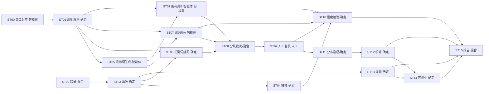

# 目标：创建基于 DeepSeek 大模型的智能编码与文本分析通用型多智能体应用

> **需求规格说明书 v2.4.1（面向 Coding Agents 的可执行规格）**
>
> 文档状态：草案，待评审冻结 ｜ 生成日期：2026-10-12 ｜ 修订：v2.4.1（项目定名统一为 `SmartTextCoderoX`；内容同 v2.4：决策型编码器 DecisionCoder · 证据分来源 · 逐题校准与准入门槛；决策模型只走托管 API）｜ 上一版本：v1.0（本文件历史版本，共 80 行）
>
> 项目名（仓库名）：**SmartTextCoderoX** ｜ Python 包前缀：**STCX-** ｜ 导入名：`stcx_*` ｜ CLI：`stcx-step` / `stcx-tool`
>
> 本文是**唯一需求来源**。实现方（Coding Agent / 开发者）必须以本文为准进行规划、拆解、编码与自测。
> 凡本文未明确的内容，**不得自行假设**：先查 §15.1「已闭环决策」，仍无答案则按 §15.2「剩余开放问题」的建议默认实现并保留配置位。

---

## 0. 阅读约定与变更说明

### 0.1 需求分级与证据要求

| 标记 | 含义 | 交付要求 |
|---|---|---|
| `[MUST]` | 必须实现 | 必须给出可运行的实现 + 自动化验证证据（测试用例或校验器输出） |
| `[SHOULD]` | 应当实现 | 实现，或写明未实现的原因与替代方案 |
| `[MAY]` | 可选 | 可延后到对应里程碑之后 |
| `[待定]` | 尚未决策 | **禁止猜测**；实现时留出配置位与接口，先查 §15.1，再按 §15.2 的建议默认 |

术语约定：`[MUST]` 级别的表格行即验收项，其编号（如 `ACC-M4-03`）必须出现在测试用例名或校验器报告中，实现可追溯。

### 0.2 v1.0 → v2.0 → v2.1 → v2.2 → v2.3 → v2.4 变更摘要

**v2.4 增补（决策型模型评估 → 方案 B）**：

| 增补 | 说明 | 位置 |
|---|---|---|
| **新增 §6.8 决策型编码器** | 生成型 vs 决策型两类引擎对照；`DecisionCoder` 接口契约与四类映射（单选/多选/noul/score）；**只走托管计费 API、不做本地部署**（JEV 类本地部署需 80GB+ 显存，与"不要求高配置"冲突）；cascade 分流设计；7 条验收 | §6.8 |
| **证据来源规则** | `evidence_source = keyword_span \| escalate_model \| none`；`none` 必带 flag 且报告须给出**逐字段证据覆盖率**；`ACC-H-06` 改为"仅对产出证据的记录生效" | §2.5、§6.8.4、§17.3 R-04 |
| **逐题阈值校准 + 准入门槛** | 每个题目每来源一套阈值；报 ECE（>0.10 视为概率不可信）；门槛为**可执行检查**（准确率 ≥ 主编码员 −3pt、宏 F1 −0.03、多选 Jaccard −0.05、非法值 0、成本或吞吐达标）；未过门槛只能做 `prefilter`，**不得计入信度** | §6.8.5 |
| **配置与工具** | `coder_set` 允许 `kind: decision` 但须显式启用 + 过门槛；新增工具 `coder.calibrate_thresholds`、`coder.admission_gate`；新增错误码 `TOOL-601`–`604` | §7.3、§16.1、§16.4 |
| 决策记录 | R8（方案 B 落地）与开放问题 O5（托管决策 API 实测）、O6（golden 规模） | §15.2、§15.4 |

**v2.3 增补（领域知识补充 + 4 项要求）**：

| 增补 | 说明 | 位置 |
|---|---|---|
| **类目体系层级规范** | 明确 **维度（一级类目）→ 组别（二级类目）→ 类目/题目（三级类目）→ 编码值（选项）** 四级；并区分**分析单元 / 记录单元 / 编码单元 / 语境单元**四组易混概念；给出 ID 规则、唯一性约束、作用域标记 `@维度:`/`@组别:`、对统计/信度/报告/GUI/文件命名的强制影响、与外部单层平台的双向扁平化映射 | §2.2.1、§2.3.2、附录 A |
| **标准样本 TXT 格式** | 三段式 `［元数据］［正文］［编码结果］`（+可选 `［编码依据］`）、解析规则、**元数据字段字典**、正文字段字典、幂等重渲染；并新增 **TXT 文件族**（8 类 TXT 的区分、识别与分派规则） | §2.4.1、§2.4.2、§2.5 |
| **处理粒度修正** | A3 默认改为 **单样本 × 全部题目**（整篇正文 + 完整编码规则 → 该样本全部题目编码值）；预算重算为 ≈11.7k、上限 16k；降级序列改为 **9 步**（新增"精简题目卡""按维度分批""按题目分批"）；禁止多样本批塞 | §17.1、§17.2、§6.4、§17.6 |
| **项目定名** | 仓库名 = **SmartTextCoderoX**，包前缀 **STCX-***，导入名 `stcx_*`，命令 `stcx-step` / `stcx-tool`，环境变量前缀 `STCX_` | §15.3、全文 |
| 层级化下游 | 统计新增组别级/维度级汇总与两种口径；信度按题目→组别→维度→全局四级汇总；报告章节与图表按维度组织；GUI 类目树 | §4.6、§7.2、§4.9、§9.2 |
| 新增工具 | `codebook.flatten/expand`（单层互转）、`txt.detect_type`、`samples.render_txt/parse_txt` | §16.1 |
| 新增错误码 | `CB-109`–`CB-113`（层级标记与空层级）、`DATA-106`–`DATA-108`（TXT 段与类型） | §2.3.4、§2.4.2 |

**v2.2 增补（R1–R7 决策 + 三项补充要求）**：

| 增补 | 说明 | 位置 |
|---|---|---|
| **固定程序规格专章** | 工具层总则 + 统一返回信封 + **38 个工具的签名/幂等/离线/错误码**；脚本与计划任务规范；**11 张表的数据字典（字段级）**；错误码全表 | §16 |
| **智能体 Harness 专章** | Harness 组成与生命周期、**上下文预算与 7 步降级策略**（针对"上下文小"）、**10 条角色硬规则**、**元提示词 8 段骨架**、**9 个 Skills**、两位编码智能体的对照表、运行约束与验收 | §17 |
| **编码智能体拆两段** | **A1 编码生成智能体**（用户原始想法 → 标准编码规则文件 + 提示词，P1–P7 带门禁）与 **A3 文本编码智能体**（提示词 + 规则文件 + 样本 → 编码数据文件）；原 A2 合并入 A1 | §6.2、§6.3、§6.4、§17.6 |
| R2 | 编码员 B = 智谱 GLM 旗舰文本模型（A = DeepSeek 文本模型），可扩展 | §7.3 |
| R3 | ASR 默认 faster-whisper，模型按需下载 | §4.2 |
| R4 | DOCX/PDF 报告与 SPSS/R 导出：需要，归入 MS6 | §12 |
| R5 | 抽帧参数可配 + **参数对比预计算表**（帧数/体积/时长/费用/**信息损失率**/语音覆盖率），运行后回填估算 vs 实际 | §4.2 |
| R6 | 示例数据由用户后续提供；到货前用最小合成 fixture 保证 CI | §11.2 |
| R7 | 图片默认 DeepSeek 多模态；不做一键切换与成本对比 | §4.2 |
| 命名候选 | 6 个项目名候选（纯英文 ≤10 字符、望文生义）+ 推荐 | §15.3 |

**v2.1 增补（Q1–Q12 决策落地）**：

| 增补 | 说明 | 位置 |
|---|---|---|
| 流水线架构专章 | 四层分工、**智能体框架选型（Pydantic AI）**、**DAG 依赖表 + mermaid 图**、**数据流三通道**、**文件流产物登记表**、**环节独立运行入口** | §4.0 |
| 多包结构 | 仓库名 = `SmartTextCoderoX`，Python 侧拆 `STCX-contracts/core/steps/agents/analytics/viz/reporting/app`（uv workspace）；`analytics` 与 `agents` 强制解耦 | §10.2.1 |
| 三层分区目录 | 静态区 / 工作区 `{version}` / 运行区，运行区可整体外置（`workspaces_root`） | §3.0 |
| `*` = 必选 | 题目必答标记；"其他/未标示"改由 `<isOther>` 或选项名识别承担 | §2.3.2 |
| 默认格式矩阵 | 报告 MD、样本 TXT、数据 CSV/XLSX、图表 PNG、中文默认 | §2.7.1 |
| 分歧裁决（B4） | 两模型两次独立运行 → 不达标时**按规则统一全部分歧**，L0 冻结、L1 审计、baseline 与 post-adjudication 并列 | §5.3、§7.3、§7.4 |
| 模型选型落地 | 文本/图片默认 DeepSeek（图片用 `deepseek-flash`），视频抽帧可切 GLM-4V-Flash，音频本地 ASR | §4.2、§6.1 |
| 单机定位 | 无联机、无服务器、无账号、无遥测；数据留本机 | §1.5 |
| 决策记录 | Q1–Q12 闭环表 + 剩余开放问题 R1–R7 | §15 |

| 变更 | 说明 |
|---|---|
| **重构需求基线** | v1.0 是功能清单；v2.0 补齐数据契约、目录规范、方法学口径、验收标准、非功能需求与合规要求 |
| **重定义"编码"** | 明确这是一套**判定式内容分析编码**：给定文本 + 一个题目（类目字段）+ 若干选项，系统判定该文本命中哪些选项；"内容编码"≠"字符编码"，全文统一术语（见 §0.4） |
| **重定义"编码单元"** | 默认分析单元 = **整篇样本**；但数据模型必须抽象出 `unit` 层级，为后续 NLP 工具箱（句级、段级、时间片级）留出扩展位（§2.1） |
| **形式化编码规则文件** | 把隐式模板语法写成显式文法（EBNF）+ 规范 JSON + JSON Schema + 校验规则（§2.3），因为它是本应用的**第一性输入** |
| **数据分层与分布治理** | 原"随机改编码值使分布达标"作废，升级为 L0/L1/L2 三层结构 + 科学可审计的分布治理方法（§5） |
| **信度检验规范化** | 四系数定义、边界情形、退化处理、抽样设计、判定策略、复合信度口径全部写实（§7）；作废"随机扰动副本充当编码员 B" |
| **目录体系重设计** | 重新定义 bin/cache/config/data/docs/lib/logs/models/module/prompt/reports/results/script/src/temp 十五个一级目录及各二级目录职责（§3） |
| **GUI 技术路线变更** | 由"CLI→GUI→exe"改为 **Electron + Vue.js 跨平台独立 GUI 优先**，后续再开放 CLI（§9） |
| **新增非功能与合规** | 可复现性、离线边界、成本限额、安全隐私、开源许可与第三方依赖审计、商标合规、学术诚信（§8、§11） |
| **新增交付里程碑** | MS0–MS6（里程碑编号，与流程节点 `ST##` 编号区分），每期给出可独立验证的验收证据（§12） |

### 0.3 v1.0 条目 → v2.0 章节映射（确保无遗漏）

| v1.0 原文位置 | v1.0 内容 | v2.0 处理 | 位置 |
|---|---|---|---|
| L1 | 标题 | 保留，补副标题与版本 | 本文首部 |
| L2 | Python 3.10+ / "单智能体框架" | 保留 Python 版本；"单智能体框架"已澄清为"**每个环节一个相对独立的智能体**"，框架层面采用 Pydantic AI 且不做跨环节编排 | §10.1、§4.0.2 |
| L3 | UV 依赖管理 | 保留并强化（lock、frozen、dev 分组） | §10.1 |
| L4 | Windows PowerShell 7 | 保留为开发环境；新增跨平台运行要求（Electron 三平台） | §8.8 |
| L5 | 模块 + 智能体 + 编排文件 | 保留；编排文件形式化为 `pipeline.yaml` 与步骤契约 | §4.0 |
| L8–L12 | 1.1 编码类目原始文件 → TXT | 改写：M1 解析为**规范 JSON + 人读 TXT 视图 + 校验报告**；docx/xlsx→模板语法的转换由 A1 智能体承担 | §4.1、§6.2 |
| L13–L24 | 1.2 样本清洗与样本规范 | 改写：内部规范格式为 JSONL，TXT 为人读视图；元数据字段可配置 | §2.4、§4.3 |
| L25–L31 | 2 统计汇总与统计表 | 保留并扩展（多选双口径、置信区间、交叉表） | §4.6 |
| L32–L35 | 可视化与中文字体 | 保留并扩展（字体随包、配色单一来源、图型自动选择、SVG/PDF） | §4.8 |
| L36–L42 | 3 信效度检验 | **重写**为规范章节；保留四系数与复合信度、中文列名、3 位小数；作废随机扰动与"调到达标" | §7 |
| L43–L47 | 4 高频词汇统计 | 保留；筛选规则形式化，m/n 语义澄清 | §4.7 |
| L49–L56 | 2.1 类目表生成智能体 / 2.2 提示词生成智能体 | 保留并**合并为一个 A1 编码生成智能体**（输入用户原始想法 → 输出标准编码规则文件 + 提示词），分 P1–P7 阶段带门禁 | §6.2 |
| L57–L66 | 2.3 多文本编码智能体 | 保留并强化（输出契约、幂等键、值域校验、证据片段）；L66 分布修正移入 §5 | §6.4、§5 |
| L67–L70 | 2.4 总报告生成智能体 | 保留；新增**数字一致性校验器**（报告中每个数字必须可溯源） | §4.9、§6.6 |
| L71–L72 | 2.5 多模态智能体 | 保留细化（probe → 抽帧/ASR/OCR → 转写规范 → 失败降级） | §4.2、§6.7 |
| L75 | API Key 存 .env | 保留并强化（示例文件、日志脱敏、系统凭据库） | §8.5 |
| L76 | 所有配置放 .config | 改写为两级配置体系：项目级 `config/` + 版本级 `config/{version}/` | §3.1、§3.2 |
| L77 | `{version}` 控制每次使用 | 保留并形式化：`{version}` = 研究版本；其下再分不可变 `run` | §3.2 |
| L78 | 解耦、不硬编码路径 | 保留并升级为**数据契约 + JSON Schema + 配置校验** | §2、§3.3 |
| L79 | CLI/GUI/exe + 目录规范 | 改写：GUI 优先（Electron+Vue）、三平台打包、目录规范 | §9、§3 |
| L80 | GUI 功能（选文件/配参数/看日志/对话） | 保留并扩展为完整信息架构 | §9.2 |

### 0.4 术语表（全文统一，实现时字段名以此为准）

| 术语 | 英文/标识 | 定义 |
|---|---|---|
| 内容编码 | content coding | 依据编码规则判定文本命中哪些选项的过程。**本文"编码"一律指此义，与字符编码无关** |
| 编码规则文件 | codebook file | 第一性输入之一。人工编写的文本文件（类目模板语法）或规范 JSON，包含题目、题型、选项、关键词、提示词、示例 |
| 题目 / 类目字段 | question / field | 编码规则中的一级条目，即"一道题"。全局唯一 `field_id` |
| 选项 / 编码值 | option / code value | 题目的取值。受控词表，来自编码规则 |
| 判定依据 | evidence | 选项的关键词（确定性匹配信号）与提示词（语义判定依据） |
| 编码员 | coder / annotator | 产生编码值的来源。可为：人工编码员、关键词引擎、LLM、外部模型。**每个来源都有稳定 `coder_id`** |
| 分析单元 | unit of analysis | 被编码的最小对象。本期默认 `document`（整篇样本），见 §2.1 |
| 样本 | sample | 一个分析单元及其元数据、正文。稳定 `sample_id` |
| 信度 | reliability | 多个编码员之间的一致性度量，本项目采用四系数（§7） |
| 复合信度 | composite reliability (content-analysis sense) | 跨类目汇总的信度指标。**注意**：与测量学中的 composite reliability（ω / Raykov CR）不是同一概念，报告中必须注明 |
| 效度 | validity | 编码是否"正确"，通过与人工金标准（golden set）比对度量（§7.7） |
| 分布治理 | distribution governance | 为避免小样本下选项分布出现大幅偏差而采取的**可复现、可审计**的干预措施（§5） |
| L0 / L1 / L2 | raw / reviewed / analysis layers | 原始编码层（不可变）/ 复核修正层 / 分析权重层（§2.6） |
| 冻结 | freeze | 把一个 run 使用的配置、编码规则、提示词、模型参数固化并哈希，供复现（§2.8） |
| run | run | 一次完整的流水线执行，产出不可变目录 `{version}/runs/{run_id}` |
| manifest | manifest | 每个步骤的复现清单：输入哈希、输出哈希、配置哈希、代码版本、模型、耗时、成本（§2.8） |
| 数据池 | pool | 对齐同类平台的四种语料集合：编码库、抽样库、测试库、回收库（§3.2） |
| 工具 | tool | 确定性能力的类型化函数形态（同时有 CLI 等价命令），供内核与智能体调用；**工具不调用 LLM**（§16.1） |
| Harness | harness | 一次智能体调用的全部外部约束：角色、规则、技能、工具白名单、上下文预算、输出契约、终止条件、痕迹记录（§17.1） |
| Skill | skill | 可复用、可版本化的指令包，按声明加载，不常驻上下文（§17.5） |
| 上下文预算 | context budget | 单次智能体调用允许的输入/输出 token 上限及各部件的分配与降级顺序（§17.2） |
| 信息损失率 | loss rate | 抽帧参数预计算中的**工程近似指标**：`1 − (w₁·镜头覆盖率 + w₂·文本保真度)`；不等同于信息论意义的信息损失，必须在界面与报告中标注（§4.2） |
| 计划任务 | scheduled task | 由用户自行注册（任务计划程序 / cron / launchd）的定时运行；默认禁止自动调用付费模型，需 `--allow-paid`（§16.2） |

---

## 1. 项目定位与范围

### 1.1 一句话定位

**一套以"样本 + 编码规则"为唯一输入、以"编码数据 + 信效度证据 + 分析图表 + 学术报告"为输出的、可离线运行的文本内容分析流水线应用；AI（DeepSeek 等大模型）是其中的一个可替换组件，而不是产品本身。** `[MUST]`

面向 Windows / macOS / Linux 的独立桌面应用（GUI），服务于学术论文的量化内容分析研究，并在架构上预留向完整 NLP 工具箱演进的能力。

### 1.2 第一性输入与第一性输出

**输入（仅两项，缺一不可）** `[MUST]`

1. 样本集：文本样本（`txt / md / csv / jsonl`）或多模态素材（图片 / 音频 / 视频），位于 `data/{version}/origin/`。
2. 编码规则文件：人工编写的类目表（`config/{version}/编码规则.txt`，语法见 §2.3）或其规范 JSON 形式。

**输出（按里程碑逐步交付）** `[MUST]`

| 输出 | 位置 |
|---|---|
| 编码数据集（L0 原始 + L1 复核后） | `data/{version}/codes_l0/`、`data/{version}/codes_l1/` |
| 信度检验表（四系数 + 复合信度 + 逐选项 + 置信区间） | `results/{version}/{run_id}/reliability/` |
| 统计表集（总表、逐题统计表、交叉表） | `results/{version}/{run_id}/stats/` |
| 图表集（PNG 300dpi + SVG/PDF） | `results/{version}/{run_id}/imgs/` |
| 高频词表与词云 | `results/{version}/{run_id}/words/` |
| 学术报告（Markdown；DOCX 可选） | `reports/{version}/{run_id}/report.md` |
| 复现清单与审计日志 | `data/{version}/manifest/`、`data/{version}/audit/`、`logs/{version}/{run_id}/` |

### 1.3 与既有平台（DiVoMiner）的关系与边界 `[MUST]`

本项目**对标**其流程能力，但**不是**它的克隆，也**不得**在名称、界面、宣传中造成关联或背书暗示。

对齐的能力（调研结论，来源见 §11.6）：

| 能力 | 本项目做法 |
|---|---|
| 项目/子库组织、四类数据池（编码库/抽样库/测试库/回收库） | 采用（§3.2） |
| 类目管理：题目（题型/提示词/必填/是否AI编码）+ 选项（关键词/语义定义） | 采用（§2.3） |
| 题型：单选、多选、下拉单选、下拉多选 | 首期四类全覆盖（§2.2） |
| 编码表以 .txt 离线编辑后导入 | 采用，且**公开完整语法与 Schema**（官方未公开语法） |
| 自动编码两条独立通路：关键词匹配（确定性、零成本）+ LLM 定义驱动（概率性、计费） | 采用，两条通路并存并可交叉校验（§4.4、§6.1） |
| 人工编码优先于自动编码（人工编码保护机制） | 采用（§2.6 L1 层） |
| AI 编码落库"编码理由"，供质量监控复核 | 采用（证据片段 evidence，§2.5） |
| 信度：Holsti / Cohen's Kappa / Scott's Pi / Krippendorff's Alpha + 复合信度 + 逐类目逐选项 | 采用（§7） |
| 编码测试流程：测试库 → 多编码员独立编码 → 计算 → 查看差异 → 达标后正式编码 | 采用（§7.3） |
| 统计与可视化广度（描述统计/卡方/回归/情感/LDA/语义网络/桑基图等） | 首期交付核心集，其余列入演进路线（§1.4） |

差异点（本项目的价值主张）`[MUST]`

1. **数据不出本机**：除显式调用云端模型外，全部计算本地完成；不使用云平台存储研究数据。
2. **完全可复现**：每个环节留 manifest 与哈希，同一输入可重算出同一结果。
3. **成本可控且透明**：调用次数、token、金额按 run 记账，支持预算熔断。
4. **语法与契约公开**：编码规则文件、样本文件、编码结果的格式与 Schema 全部文档化。
5. **为升级 NLP 工具箱而设计**：编码器、分析器、可视化器、转写器、导出器均为可插拔接口。

> 合规提醒 `[MUST]`：`DiVoMiner` 是他方注册商标。本项目文档、代码、界面中**仅可用于事实性对比引用**，禁止作为产品名、模块名、宣传语。

### 1.4 演进路线：从内容分析流水线到 NLP 工具箱 `[SHOULD]`

架构必须通过接口预留以下扩展点（首期不实现，但接口存在且被示例模块验证）：

| 扩展点 | 接口 | 演进方向举例 |
|---|---|---|
| 编码器 | `Coder` | 关键词/正则/词典/规则打分/传统机器学习分类器/LLM/外部模型服务；**决策型引擎**（概率输出，见 §6.8 的 `DecisionCoder` 子类型） |
| 分析器 | `Analyzer` | 描述统计 → 推断统计（t/ANOVA/卡方/相关/线性与二元逻辑回归/正态性检验）、情感与立场（正负面、情绪分类）、主题模型（LDA/BERTopic）、命名实体、句法、嵌入聚类与去重（含 K-Means）、相似度、共现与语义网络/社交网络、时间序列与格兰杰因果、语种识别、地理编码 |
| 可视化器 | `Visualizer` | 条形/环形/玫瑰/热力/桑基/雷达/网络/地图/时间序列 |
| 转写器 | `Transcriber` | ASR（本地或云端）、OCR、视频抽帧、版面解析 |
| 导出器 | `Exporter` | CSV/XLSX/JSONL/SPSS/R/Word/PDF/图表包 |

每个扩展点必须满足：通过配置文件声明启用与参数、有至少一个内置实现与一个测试替身（test double）、**不修改内核代码即可新增**（§10.2）。

### 1.5 定位声明与明确不做的事（Non-goals）`[MUST]`

**产品定位（Q12 已决策）**：这是一个**单机桌面应用**，用于辅助科研人员从事文本内容分析；**不联网协作、不设服务器、无账号体系、无多租户、无遥测**；研究数据**完全保存在本机**（除用户显式配置的模型 API 调用外，数据不离开本机）。

1. 不做网络爬虫与数据采集（样本由用户自行准备并导入）。
2. 不做云端协作、账号体系、多用户/多租户服务、服务器端任何组件。
3. 首期不做模型训练与微调（只做推理与调用）。
4. 不做在线 SaaS；网络仅用于显式配置的模型 API 调用。
5. 不做质性研究的扎根理论编码流（自下而上归纳），本项目是**自上而下**的受控词表编码。
6. 不做插件市场、在线同步、跨设备同步。

### 1.6 目标用户与典型场景

- 主要用户：需要进行量化内容分析的高校研究者与研究生（新闻传播、公共管理、健康传播、社会学等）。
- 典型场景：给定 200–5000 条短视频文案/评论/新闻报道 + 一份 5–10 题的编码规则，产出可直接进论文的数据表、信度表、图表与描述性分析报告。
- 用户的既有工作习惯（来自历史研究记录，实现时应兼容）：全单选+必选的默认设计；关键词 3–5 个；选项名可用"类别（举例）"形式；类目名可带括号别名；分析单元是"每一篇独立报道"；预编码 20–30 篇后进入正式编码。`[SHOULD]`

### 1.7 成功判据（可验收）`[MUST]`

1. 用户只提供样本与编码规则文件，GUI 上点选即可完成"清洗 → 编码 → 信度 → 统计 → 图表 → 报告"全链路，无需编辑任何代码或路径。
2. 全链路在**断网**状态下可用（LLM 环节改用内置关键词引擎或回放替身），结果确定性一致。
3. 任意一个 run 可通过 manifest 在本机复算出逐字节一致的统计、信度、图表产物。
4. 示例数据集（合成数据）随包提供，首次运行 10 分钟内跑通全链路并生成报告。
5. 报告中的每一个数字都能在产物中找到出处（由校验器强制，§4.9）。

---

## 2. 数据模型与契约（核心优先，先于任何功能开发）

> 本节的产物是全部后续开发的地基。**任何模块不得绕过本节定义的契约直接读写自定义格式。**

### 2.1 分析单元（unit of analysis）`[MUST]`

- **本期默认**：`unit_type = document`，一个分析单元 = 一篇完整样本（一条评论、一篇报道、一段文案）。编码结果落在样本级。
- **模型必须抽象层级**，不得把"整篇"写死进业务代码：

```json
{
  "unit_id": "S0001",            // 全局唯一，默认等于 sample_id
  "sample_id": "S0001",
  "unit_type": "document",        // document | paragraph | sentence | utterance | time_segment
  "span": [0, 1024],              // 字符区间（相对样本文本），document 固定为全文
  "text": "被编码的文本内容"
}
```

- 升级到句级/段级/时间片级时，只增加 `unit_type` 的新取值与新切分器，**不改动编码结果 schema**。
- 每个分析单元必须能反查回原始样本与原始位置（`sample_id` + `span`），供人工复核时高亮定位。`[MUST]`

### 2.2 变量（类目字段）类型体系 `[MUST]`

| 类型标识 | 中文 | 选项来源 | 首期 | 信度可计算 |
|---|---|---|---|---|
| `single_choice` | 单选 | 编码规则选项（互斥） | ✅ | ✅ |
| `multiple_choice` | 多选 | 编码规则选项（可多选） | ✅ | ✅（双口径，§7.5） |
| `dropdown_single` | 下拉单选 | 编码规则选项 | ✅ | ✅ |
| `dropdown_multiple` | 下拉多选 | 编码规则选项 | ✅ | ✅ |
| `open_text` | 开放文本 | 无受控选项 | ✅（仅存储与导出） | ❌ **不可计算信度**（参与信度检验时跳过并说明） |
| `scale` | 量表/有序 | 编码规则选项（有序） | `[MAY]` | ✅（需序数权重，§7.1） |
| `numeric` | 数值 | 无 | `[MAY]` | `[MAY]` |
| `datetime` | 时间 | 无 | `[MAY]` | `[MAY]` |

约束：
- 每个字段必须有 `field_id`（ASCII，唯一）与 `label`（中文显示名）。统计表与信度表的列名使用 `label`，导出时附带 `field_id` 列以便机器处理。`[MUST]`
- 单选题的编码结果必须恰好 1 个值；多选题为 0..N 个值；必填题不得为 0 个值。违反即校验失败。`[MUST]`
- **默认值（Q5 已决策）**：新建题目、以及 A1 智能体生成题目时，**默认 `single_choice` + `required=true`**；多选题必须显式使用 `[]` / `[_]`。用户既有习惯（全单选必选）即由此默认值承载，不需要在模板里逐题声明。`[MUST]`
- **多选题选择数限制**：首期不限制，但必须在 Schema 与配置中预留 `min_selections` / `max_selections`（默认 `null` = 不限制），校验器与 GUI 均需支持该字段，便于后续启用。`[SHOULD]`
- 开放题不参与信度与分布治理，必须在所有相关产物中显式标注 `skipped_reason=open_text`。`[MUST]`
- 有序/量表型的选项必须声明 `order_index`，供序数信度与有序统计使用。`[SHOULD]`

### 2.2.1 类目体系层级规范（维度 → 组别 → 类目/题目 → 编码值）`[MUST]`

> 文本内容分析的类目体系**天然是多层的**：研究问题下分若干**维度**，维度下分**组别**，组别下是可直接对着文本判定的**类目**（= 题目），类目再对应**编码值**（= 选项）。层级必须在数据模型、TXT 格式、统计、信度、报告与 GUI 中**一致地**体现。

| 层级 | 名称（本项目统一叫法） | 英文/标识 | 定义 | 数量级 | 是否承载判定 |
|---|---|---|---|---|---|
| L1 | **维度** | dimension / `dimension_id` | 研究构念的一级切分，回答"研究问题由哪几个方面构成" | 2–8 | ❌ 容器 |
| L2 | **组别** | group / `group_id` | 维度的次级切分（子维度/子类）；**可缺省**，缺省时类目直接挂在维度下 | 0–6/维度 | ❌ 容器 |
| L3 | **类目 = 题目** | category / question / `field_id` | **唯一承载编码操作的层级**：题型、必填、是否 AI 编码、关键词、提示词、示例都在这一层 | 5–100 | ✅ |
| L4 | **编码值 = 选项** | code value / `value_id` | 受控取值（单选/多选/下拉） | 2–100/题目 | ✅（取值） |

**必须区分的四组"单元"概念（内容分析方法学标准术语）** `[MUST]`：

| 概念 | 定义 | 本项目的落点 |
|---|---|---|
| **分析单元**（unit of analysis） | 被编码的对象边界（本篇报道 / 本条评论 / 本段文案） | §2.1，默认 `document`，`sample_id` |
| **记录单元**（recording unit） | 承载编码值的载体 = 分析单元 × 类目 | `codes` 记录的主键（§2.5） |
| **编码单元**（coding unit） | 作出判定所依据的**最小文本片段** | `evidence[].span`（原文片段与字符区间） |
| **语境单元**（context unit） | 为正确理解编码单元而**必须一并阅读**的范围（通常是全篇） | 一次调用装载的整篇样本正文（§17.2） |

**标识与命名规则** `[MUST]`：

1. 四层各有稳定 ID：`dimension_id` / `group_id` / `field_id` / `value_id`，**一经分配永不改变**；改名只改 `label`，不改 ID（保证历史 run 可追溯）。
2. ID 为 ASCII、全局唯一，建议前缀 `D_ / G_ / F_ / O_`。
3. 唯一性约束：同一维度内**组别名唯一**；同一组别内**题目名唯一**；同一题目内**选项名唯一**；`field_id` 全局唯一。
4. 每层必须能导出**层级路径** `hierarchy_path = [维度名, 组别名, 题目名]`（组别缺省时省略），用于报告章节、图表标题、统计分组与文件命名。
5. **不允许跳级**：类目必须归属于某个维度（可以是内置"未分类"维度）；维度下可直接放类目（组别缺省）。
6. 空维度/空组别 = 校验错误（`CB-110`）；单类目维度 = 警告（`CB-111`，通常说明维度切分过细）。

**TXT 表达（作用域标记）** `[MUST]`（语法见 §2.3.2）：

```text
@维度: 信息可信度
@组别: 信源身份
() 信息源可信度（信源身份）/#这是一道单选题#/
医生*/#选项#/
...

@维度: 信息可信度
@组别: 信息质量
[] 信息质量/#这是一道多选题#/
...
```

- `@维度:` 与 `@组别:` 是**作用域标记**：其后所有题目归属到最近的标记，直到出现新的同名层级标记。
- 可缺省：无标记时归入内置 `未分类` 维度（记 `CB-112` 警告），保证旧模板文件仍可解析。

**对下游环节的强制影响** `[MUST]`：

| 环节 | 要求 |
|---|---|
| 编码（§6.4） | 编码结果按 `field_id` 落盘；同时写入 `hierarchy_path`，便于分组分析 |
| 统计（§4.6） | 除题目级统计外，必须输出**维度级**与**组别级**汇总（组内各选项合计与占比），并说明口径（跨题目求和还是题目内平均，二者都要给） |
| 信度（§7） | 复合信度必须**逐级汇总**：题目级 → 组别级 → 维度级 → 全局；报告给出四级表 |
| 报告（§4.9） | 章节按 **维度 → 组别 → 题目** 组织；图表标题带层级路径 |
| 可视化（§4.8） | 支持"按维度分组的多子图"（每个维度一屏）与"维度间对比图" |
| GUI（§9.2） | 类目以**树形**呈现（维度 ▸ 组别 ▸ 题目 ▸ 选项），支持折叠、拖动改归属（改归属 = 改 ID 的父指针，需记审计） |
| 文件命名（§2.7） | 默认用题目名；`naming.include_hierarchy=true` 时用 `维度-组别-题目`（分隔符可配），避免不同维度下同名题目互相覆盖 |

**与外部单层平台的双向兼容** `[MUST]`：外部平台（如 DiVoMiner）的类目**只有一层**，因此：

- **导出**：把 `维度-组别-题目` 拼成单一题目名（分隔符默认 `-`，可配），选项原样输出 → 得到可直接导入的单层编码表；
- **导入**：按同一分隔符反向解析出层级；解析失败则全部归入内置 `未分类` 维度并给出提示。
- 该映射必须**可逆且有测试**（`ACC-CB-01`：三级结构 → 单层导出 → 再导入，层级完全还原）。

### 2.3 编码规则文件（第一性输入）`[MUST]`

#### 2.3.1 双表示原则

- **人读可编辑形式**：`config/{version}/编码规则.txt`，采用既有类目模板语法（用户已习惯，且可离线编辑）。
- **规范机器形式**：`data/{version}/clean/codebook.json`，由 M1 解析生成，含 `codebook_hash`。
- 两者必须可**无损往返**：`render(parse(txt)) == txt`（规范化后），且 `parse(render(json)) == json`。往返一致性必须有自动化测试。`[MUST]`

#### 2.3.2 文本语法（显式文法）

语法来自既有模板 `类目模版.txt`（用户资产），v2.0 将其**显式化**。EBNF：

```ebnf
codebook    = { blank | comment | scope-mark | question } ;
comment     = "#" , { any-char } , NEWLINE ;                    (* 行首 # 开头为注释 *)
scope-mark  = "@" , ( "维度" | "组别" ) , ":" , WS , name , NEWLINE ;
                                                               (* 作用域标记，见 §2.2.1；其后题目归入最近标记 *)
question    = prefix , [ WS ] , title , "/#这是一道" , qtype , "#/" , [ WS , qattr ] , NEWLINE ,
              { qattr-line } , { option } ;
prefix      = "()" | "[]" | "(_)" | "[_]" ;                      (* 题型标记，见下表 *)
qtype       = "单选题" | "多选题" | "下拉题(单选题)" | "下拉题(多选题)" ;
qattr       = "<" , flag , ">" ;
flag        = "isRequired" | "isAiCoded" | "isOther" | "isExclusive" ;   (* 大小写不敏感 *)
option      = optname , [ "*" ] , "/#选项#/" , NEWLINE , { optattr-line } ;
required-mark = optname , "*" , "/#选项#/" ;                       (* * 紧贴选项名，位于 /#选项#/ 之前 *)
optattr-line= WS , "<" , attr , ">" , NEWLINE ;
attr        = ( flag )                                             (* 选项级标记：<isOther> *)
            | ( "关键词" , "=" , keyword-expr )
            | ( "提示词" , "=" , text )
            | ( "示例词" , "=" , text )
            | ( "编码值" , "=" , value )                          (* 选项显示名≠编码值时可显式指定 *)
            | ( "规则"   , "=" , rule-ref ) ;                     (* 引用外部规则文件，供高级用法 *)
keyword-expr= keyword , { WS , ("OR"|"AND"|"NOT") , WS , keyword } ;
```

题型标记与行内标签的对应（**双写，必须一致；不一致时行内标签优先并记 warning**）：

| 前缀 | 行内标签 | 规范类型 | 说明 |
|---|---|---|---|
| `()` | `/#这是一道单选题#/` | `single_choice` | 平铺单选 |
| `[]` | `/#这是一道多选题#/` | `multiple_choice` | 平铺多选 |
| `(_)` | `/#这是一道下拉题(单选题)#/` | `dropdown_single` | 下拉单选 |
| `[_]` | `/#这是一道下拉题(多选题)#/` | `dropdown_multiple` | 下拉多选 |

标记语义：

| 标记 | 位置 | 语义 | 缺省 |
|---|---|---|---|
| `<isRequired>` | 题目行下方，独立一行 | 必答题；未命中任何选项时**不得**留空，必须给出判定 | `false` |
| `<isAiCoded>` | 题目行下方、首个选项之前 | 该题允许/优先使用 LLM 编码 | `false` |
| `<关键词=a OR b>` | 选项行下方 | 确定性匹配信号；布尔运算符 **必须大写且两侧各一个半角空格** | 可空（仅提示词判定） |
| `<提示词=...>` | 题目行下方或选项行下方 | 语义判定依据（**LLM 判定的核心依据**） | 可空 |
| `<示例词=...>` | 选项行下方 | 语义学习样本，规范顺序为**提示词 → 关键词 → 示例词** | 可空 |
| `*`（紧贴选项名，位于 `/#选项#/` 之前） | 选项行 | **必选标记（Q4 已决策）**：`*` = 该选项所属**题目为必答题**；不带 `*` 且无 `<isRequired>` 的题目为可选。必选意味着**编码输出时该题目必须有选项/编码值**（不少于 1 个 `value_id`），见 §2.5 校验 | 无 `*` = 可选 |
| `@维度: X` / `@组别: Y` | 独立一行 | **层级作用域标记**（§2.2.1）：其后题目归入该维度/组别；无标记时归入内置 `未分类`（`CB-112`） | 归入 `未分类` |
| 缩进 | 属性行 | **不敏感**（解析时忽略行首空白），但渲染时统一缩进 2 空格 | 忽略 |

**关于 `*` 的精确定义** `[MUST]`：

- 语义 = 题目级 `required = true`。标记具体落在哪个选项行不影响选项本身语义，但解析器必须记录 `required_marker_option`（用于渲染时还原到原位置，保证往返无损）。
- 同一题目多个选项都带 `*` = 同一效果（题目必答），记 `CB-106` 警告并提示去重。
- `*` 与 `<isRequired>` 等价；两者同时出现视为一致（不报错）。两者都不出现 = 可选。
- **可配置的备用解释**：`config/default/codebook.json` 提供 `asterisk_semantics: "question_required" | "option_default"`，默认 `question_required`（本决策）。若将来需要把 `*` 解释为"该选项是未命中时的兜底默认项"，只需切换配置，不改代码。
- 必答题的强制校验：编码结果中该字段的 `values` 长度必须 ≥ 1；留空即校验失败并进入复核队列（`ACC-M4-03`）。

**关于"其他/未标示"类选项** `[MUST]`：

- 该概念**不再由 `*` 承担**（`*` 已定义为必选标记）。表达方式有两种：① 显式写 `<isOther>`（推荐，无歧义）；② 由解析器按选项名匹配内置清单（其他/其它/未标示/无/不适用/unknown/NA）自动置 `is_other=true`，识别结果写入校验报告，可由配置关闭。
- `is_other=true` 的选项：允许编码值超出该选项自身（自由文本，写入 `raw_values`）；参与穷尽性检查（`CB-104`）；**不参与** `min_share` 分布下限判定（§5.5），但仍须单独报告计数。

**关键词书写规范** `[MUST]`（源自既有平台导入的硬性约束，必须由校验器强制并给出定位错误）：

1. 布尔运算符 `AND` / `OR` / `NOT` 必须**全大写**，且**两侧各留一个半角空格**；否则按字面关键词处理并给 `CB-105` 警告。
2. 全部标点使用**半角**；括号必须成对；英文短语建议用双引号包裹（`"machine learning"`）。
3. 同一选项的关键词表达式中，`NOT` 仅可出现在项首（不允许 `NOT NOT` 嵌套），首期不实现括号分组（`(A OR B) AND C` 记为 `CB-105` 警告并降级为扁平 OR）。
4. 关键词不得为空字符串；`<关键词=>` 视为非法（`CB-006`）。
5. 渲染器必须输出规范形式（大写、单空格、半角），使"解析→渲染"幂等，并保证导出文件可被外部平台直接导入。

#### 2.3.3 规范 JSON 形式

```json
{
  "meta": {
    "schema_version": "1.0",
    "codebook_version": "v1",
    "title": "医美信息可信度编码表",
    "locale": "zh-CN",
    "created_at": "2026-10-12T10:00:00+08:00",
    "source_file": "config/v1/编码规则.txt",
    "source_sha256": "<64 hex>",
    "codebook_hash": "<64 hex，对 hierarchy+categories 规范化后计算>",
    "asterisk_semantics": "question_required"
  },
  "hierarchy": {
    "dimensions": [
      {
        "dimension_id": "D_credibility",
        "label": "信息可信度",
        "order_index": 1,
        "groups": [
          { "group_id": "G_source", "label": "信源身份", "order_index": 1 },
          { "group_id": "G_quality", "label": "信息质量", "order_index": 2 }
        ]
      }
    ]
  },
  "categories": [
    {
      "field_id": "F_credibility",
      "label": "信息源可信度（信源身份）",
      "dimension_id": "D_credibility",
      "group_id": "G_source",
      "hierarchy_path": ["信息可信度", "信源身份", "信息源可信度（信源身份）"],
      "type": "single_choice",
      "required": true,
      "required_marker_option": "O_doctor",
      "ai_coded": false,
      "prompt": null,
      "min_selections": null,
      "max_selections": null,
      "show_if": null,
      "order_index": 1,
      "options": [
        {
          "value_id": "O_doctor",
          "value": "医生/医美专家",
          "hint": "医疗专业人员的内容具有更高的可信度……",
          "example": "大家好，我是上海九院整形外科副主任医师王医生……",
          "keywords": ["医生", "医美专家", "副主任医师"],
          "keyword_expr": "医生 OR 医美专家 OR 副主任医师",
          "is_other": false,
          "order_index": 1
        }
      ]
    }
  ]
}
```

#### 2.3.4 校验规则与错误码 `[MUST]`

解析器必须执行下列校验，**错误阻断解析、警告不阻断但写入校验报告**：

| 错误码 | 级别 | 规则 |
|---|---|---|
| `CB-001` | 错误 | 题目无选项或选项数 < 2 |
| `CB-002` | 错误 | 同一题目内选项显示名重复 |
| `CB-003` | 错误 | 全局题目显示名重复（或多题共用同一 `field_id`） |
| `CB-004` | 错误 | 前缀题型标记与行内标签冲突（按行内标签解析并记 warning，同时报错提示人工确认） |
| `CB-005` | 错误 | 必答题的所有选项均为空判定（无关键词且无提示词） |
| `CB-006` | 错误 | 属性行格式非法（缺 `>`、缺 `=`、值中含未转义的 `>`） |
| `CB-007` | 错误 | 出现未知属性名或未知 flag |
| `CB-008` | 错误 | 非注释、非题目、非选项、非属性行的游离文本 |
| `CB-101` | 警告 | 选项标题中缺少关键词（仅有提示词）——"其他/未标示"类选项豁免 |
| `CB-102` | 警告 | 关键词数量不在 3–5 个之间（用户偏好区间） |
| `CB-103` | 警告 | 同一题目内两个选项的关键词集合存在交集（潜在互斥性问题） |
| `CB-104` | 警告 | 题目下缺少"其他/未标示"类选项（穷尽性提示） |
| `CB-105` | 警告 | 布尔表达式中 `OR`/`AND`/`NOT` 两侧未留空格或未大写（解释为关键词字面量） |
| `CB-106` | 警告 | 同一题目内多个选项带 `*`（等价于题目必答，提示去重） |
| `CB-107` | 警告 | 题目未声明必选（无 `*` 也无 `<isRequired>`），且该题目下所有选项均无关键词与提示词（无法判定；建议补内容或改为可选） |
| `CB-108` | 警告 | `is_other` 选项被显式赋予关键词（通常意味着该选项并非真正的兜底类，请确认） |
| `CB-109` | 错误 | 层级标记顺序非法：`@组别` 出现在任何 `@维度` 之前 |
| `CB-110` | 错误 | 空维度或空组别：作用域标记之后没有任何题目 |
| `CB-111` | 警告 | 某维度下仅 1 个类目（维度切分可能过细） |
| `CB-112` | 警告 | 题目未归属任何维度（自动归入内置 `未分类`，建议显式声明） |
| `CB-113` | 警告 | 不同维度/组别下存在同名题目（ID 不同，但导出为单层时会冲突，需指定分隔符或改题名） |

穷尽性与互斥性检查 `[SHOULD]`：`CB-103` 只做关键词层面的字面交集检测；提示词层面的语义重叠检测可用嵌入相似度实现并给出建议（不自动改写用户类目）。

#### 2.3.5 与既有用途的兼容性 `[MUST]`

- 必须能直接解析用户现存的 `类目模版.txt` 与历史生成的类目表（含 `(1)` 序号前缀、`<isRquired>`、`<isrequired>` 等拼写变体：**大小写不敏感，且拼写变体记 warning**）。
- 必须能导出**同构的** TXT（供外部平台继续使用）与 Excel（供留底预览），两者内容与 JSON 完全一致。`[MUST]`
- 解析器必须容忍 BOM、CRLF/LF 混用、全角空格与制表符。

### 2.4 样本文件规范 `[MUST]`

**内部规范格式：JSONL（每行一个样本）**，位于 `data/{version}/clean/samples.jsonl`：

```json
{"sample_id":"S0001","metadata":{"来源":"抖音","发布时间":"2025-11-02","账号类型":"个人"},"text":"……","source":{"file":"origin/raw.txt","line":12,"sha256":"…"},"flags":[]}
```

- 元数据字段集合由 `config/{version}/变量配置.json` 声明（字段名、类型、是否必填、是否参与分层）；解析器按声明校验。`[MUST]`
- 多模态转写样本（§4.2）必须映射进同一 schema，转写来源写入 `source` 与 `flags`；原始媒体路径、时长、时间戳必须保留。`[MUST]`

#### 2.4.1 标准样本 TXT 格式（人机共用主格式）`[MUST]`

样本的**人读与人工编辑主格式是 TXT**（Q8/A 交付面），机器权威仍是 §2.4 的 `samples.jsonl`；两者必须可无损往返。TXT 分三段，**段标记用全角方括号**：

```text
［元数据］
样本ID：S0001
采集时间：2025-11-02 10:00:00
来源：抖音
作者：@某某
链接：https://example.com/v/123
媒体类型：文本
语言：zh
地区：上海
［正文］
标题：肉毒素到底能不能打
正文：姐妹们，我最近在XX机构打了肉毒素，效果真的绝了……（全文）
话题标签：#医美 #变美
［编码结果］
信息源可信度（信源身份）：医生/医美专家
公关策略中的沟通方式：电话 | 记者招待会
报道年份：<未编码>
［编码依据］
信息源可信度（信源身份）："我是上海九院整形外科副主任医师王医生"@[12,31]；置信度=0.87；模型=deepseek-chat；时间=2026-10-12T10:15:03+08:00
```

**解析规则** `[MUST]`：

1. 段标记：`［元数据］`、`［正文］`、`［编码结果］`、`［编码依据］`（可选）。解析器**同时接受半角** `[元数据]`；渲染统一输出全角。
2. 行格式：`字段：值`。解析器同时接受半角 `:`；渲染统一全角 `：`。值内的换行用**行首缩进两格**续行，或用 `\n` 转义（两者都支持，渲染默认用续行）。
3. 多值：编码结果的多选值用 **` | `**（两侧空格）分隔；解析时容忍 `｜` 与 `|`。
4. 未判定哨兵：`<未编码>`（可配置）。**禁止**用空值表示"已判定为空"。
5. 段顺序固定：元数据 → 正文 →（编码结果）→（编码依据）。缺段视为非法（`DATA-106`）；段内字段顺序不敏感。
6. 一个文件 = 一个样本（`sample_id` 必填且唯一）。若一个文件含多样本，必须用 `［样本开始］/［样本结束］` 包裹（批量导入格式，§16.3），否则报 `DATA-107`。
7. **幂等**：重新渲染编码结果时，必须先删除已存在的 `［编码结果］`、`［编码依据］` 两段再写入，禁止重复追加。`[MUST]`
8. 往返测试：`parse_txt(render_txt(sample)) == sample`，且 `render_txt(parse_txt(txt)) 在规范化后 == txt`。`[MUST]`

**元数据字段字典**（内置推荐集；可在 `变量配置.json` 中增删，标注 ✅ 者默认必填）`[MUST]`：

| 字段 | 类型 | 必填 | 说明 |
|---|---|---|---|
| `样本ID` | string | ✅ | 唯一；与文件名一致（推荐 `S0001.txt`） |
| `采集时间` / `发布时间` | datetime | ✅（二者至少一个） | 用于时间维度分析；缺省填 `未知` |
| `来源` | string | ✅ | 平台/媒体名（抖音、微博、中国日报…） |
| `作者` | string | — | 账号名或作者；作者信息属于个人信息时可用匿名编号 |
| `链接` | url | — | 原文地址 |
| `媒体类型` | enum | ✅ | `文本 / 图片 / 音频 / 视频` |
| `语言` | string | — | ISO 639-1，默认 `zh` |
| `地区` | string | — | 用于地域分析 |
| `账号类型` | enum | — | 如 `官方 / 个人 / 媒体`（示例，可自定义） |
| `时长` | 秒 | 多模态必填 | 音视频时长 |
| `字数` | int | — | 渲染时自动计算，不作为输入 |
| `文件哈希` | string | — | 由 `source.sha256` 自动写入 |

**正文字段字典**：`标题`（无则整篇入 `正文`）、`正文`（必填）、`话题标签`（多值，`,` 分隔）、`媒体路径` + `时间轴`（多模态，指向 `transcript/`）。

#### 2.4.2 TXT 文件族（不同类型必须可区分）`[MUST]`

项目内所有 TXT 都是"人读面"，但**类型不同、段落结构不同**，必须能机械区分，避免解析器误判：

| 类型 | 文件名约定 | 段标记/首行 | 生成者 | 可否被解析回写 |
|---|---|---|---|---|
| **样本文件** | `S0001.txt`、`samples/*.txt` | `［元数据］［正文］［编码结果］［编码依据］` | 人工 / ST03 | ✅（往返） |
| **编码规则** | `编码规则.txt` | `@维度:` / `@组别:` / `题型前缀` 行 | 人工 / A1 | ✅（往返） |
| **转写文件** | `{media_id}.transcript.txt` | 首行 `［转写］`；段 `［媒体信息］［转写片段］`（每行 `[start-end] 文本`） | ST02 | 只读（回写走 JSONL） |
| **词频语料汇总** | `汇总语料.txt` | 首行 `［语料汇总］`；每段 `［样本 S0001］` + 正文 | ST13 | 只读 |
| **统计人读表** | `{题目}_统计表.txt` | 首行 `［统计表］` + 制表符对齐表格 | ST12 | 只读 |
| **信度检验人读表** | `信度检验表.txt` | 首行 `［信度检验］` + 表格 | ST10 | 只读 |
| **清洗报告** | `cleaning_report.txt` | 首行 `［清洗报告］` | ST03 | 只读 |
| **运行日志** | `{run_id}.log.txt` | 首行 `［运行日志］` | 全流程 | 只读 |

**识别与分派规则**：

1. 有 `［元数据］` 段 → 样本文件；有 `@维度:`/`@组别:` 或题型前缀行 → 编码规则；首行 `［…］` 标记 → 按标记分派；否则按**文件名约定**判定，仍不明确则报 `DATA-108` 并拒绝解析。`[MUST]`
2. 渲染器可在文件末尾追加机器标记行 `# STCX-TXT: <type>@1.0`（默认开启，便于外部工具识别；不影响人工阅读）。`[SHOULD]`
3. **同目录不得混放不同类型 TXT**；只读类型不得被任何环节当作输入重用（见 §4.0.4 的数据流禁止项）。`[MUST]`

### 2.5 编码结果规范 `[MUST]`

**内部规范格式：JSONL**，位于 `data/{version}/codes_l0/{run_id}/{coder_id}.jsonl`：

```json
{"unit_id":"S0001","sample_id":"S0001","field_id":"F_credibility","coder_id":"llm:deepseek-chat",
 "values":["O_doctor"],"raw_values":["医生/医美专家"],"confidence":0.87,
 "evidence":[{"quote":"我是上海九院整形外科副主任医师","span":[12,31]}],
 "provenance":{"run_id":"20261012T101500-3f9a","model":"deepseek-chat","model_version":"<response model field>",
               "prompt_hash":"sha256:…","codebook_hash":"sha256:…","temperature":0,"ts":"2026-10-12T10:15:03+08:00","tokens":842},
 "flags":[]}
```

- `values` 必须是 `codebook` 中该题目的合法 `value_id`；**非法值一律不得静默丢弃**：写入 `codes_l0/_invalid.jsonl` 并进入人工复核队列。`[MUST]`
- 多选题的 `values` 为数组；单选为长度 1；必填题为长度 ≥ 1。
- `confidence` `[SHOULD]`：LLM 自评置信度或多次采样一致率（§5.3 方法 B）。无则为 `null`。
- `evidence` `[SHOULD]`：原文引证片段与字符区间，供质量监控与论文附录引用。**生成型编码器**产出记录时证据为强制项（`ACC-H-06`）；**决策型编码器**（§6.8）无解释文本，按 `evidence_source` 分来源处理。`[MUST]`
- `evidence_source` `[MUST]`（v2.4 新增）：取值 `keyword_span | escalate_model | none`；`none` 必须同时打 `no_evidence` flag 并进入人工抽样复核队列；报告必须给出**逐字段证据覆盖率**（§6.8.4）。
- **人读视图**（供人工查看/编辑）：按 §2.4.1 的标准样本 TXT 格式写入 `［编码结果］` 段；开启明细时另写 `［编码依据］` 段：

```text
［编码结果］
信息源可信度（信源身份）：医生/医美专家
公关策略中的沟通方式：电话 | 记者招待会
报道年份：<未编码>
［编码依据］
信息源可信度（信源身份）："我是上海九院整形外科副主任医师王医生"@[12,31]；置信度=0.87；模型=deepseek-chat
```

- 渲染前必须**删除该样本已存在的 `［编码结果］`/`［编码依据］` 段**（基于 `sample_id` 定位）再写入，保证幂等；**禁止**重复追加。`[MUST]`
- 视图 → JSONL 的反向解析必须存在且被测试（人工在视图上改动后需能回写，且改动进 L1 并记审计）。`[MUST]`

### 2.6 数据分层 L0 / L1 / L2（不可变原则）`[MUST]`

| 层 | 目录 | 内容 | 可变性 |
|---|---|---|---|
| **L0** | `data/{version}/codes_l0/{run_id}/` | 各编码员（LLM / 关键词引擎 / 人工）的原始判定，按 `coder_id` 分文件 | **只写不改**。重跑产生新 run 目录，不原地覆盖 |
| **L1** | `data/{version}/codes_l1/{run_id}/` | 复核、裁决、人工修正后的编码值；每条修正附依据与操作者 | **仅追加**修正记录，可回放到任意历史状态 |
| **L2** | `data/{version}/weights_l2/{run_id}/` | 分析层的权重、平滑参数、口径选择；不改变任何编码值 | 可变，但每次变化写入 manifest |

规则：
1. L0 一旦写入，同 run 内不得修改；任何纠正都写 L1。`[MUST]`
2. 分析与信度默认读 **L1**（不存在修正时等价于 L0），并必须在产物中注明数据层来源。`[MUST]`
3. "人工编码保护机制"：L1 中存在人工编码的单元，后续自动编码**默认不得覆盖**，除非显式开启 `allow_auto_overwrite`。`[MUST]`

### 2.7 通用文件与命名规范 `[MUST]`

| 对象 | 规范 |
|---|---|
| 编码 | 全部文件 UTF-8（无 BOM 优先）；读取时必须容忍 BOM 与 GBK 输入并记录探测结果 |
| 换行 | 内部统一 `\n`；写出 CSV 时使用 `\r\n` 以便 Excel |
| 机器可读文件命名 | **ASCII 蛇形**（`codebook.json`、`samples.jsonl`、`reliability.csv`）。原因：macOS 文件名使用 NFD 规范化，中文文件名跨平台匹配会失败 |
| 用户可见产物命名 | 允许中文（如 `信息源可信度_统计表.csv`），由 `config/default/naming.json` 定义映射；渲染层负责生成 |
| 时间 | ISO 8601 带时区（默认 `Asia/Shanghai`）；文件名中的时间戳用 `YYYYMMDDTHHMMSS` |
| 数字格式 | 统计占比保留 **2 位小数**；信度系数保留 **3 位小数**（高精度值同时写入 JSON 侧车文件，避免舍入争议） |
| CSV 列名 | **中文**（用户要求），并在同目录输出 `*.schema.json` 记录列名↔字段标识映射 |
| 图表文件名 | `fig_{序号}_{field_id}_{图型}.png/.svg/.pdf`，序号与报告图表编号一致 |

#### 2.7.1 默认格式矩阵（Q8 已决策）`[MUST]`

三种格式各司其职，**不得混用**：JSON/JSONL 是机器权威（内部通讯），CSV/XLSX 是分析交付与人机交换，TXT 是人工编辑面。

| 对象 | 默认格式 | 说明 |
|---|---|---|
| 样本正文 | **TXT**（三段式：`［元数据］［正文］［编码结果］`，§2.4.1） | 人工编辑、审核、上传、下载的默认形态；机器权威仍是 `samples.jsonl`（§2.4），TXT 与其无损往返 |
| 编码规则 | **TXT**（人工权威）+ **JSON**（机器权威、内部通讯） | 见 §2.3.1 双表示原则；XLSX 仅作留底预览 |
| 编码结果 | **JSONL**（内部通讯、机器权威）+ **CSV**（样本×字段矩阵，供 Excel/SPSS/R）+ **TXT**（样本文件内的 `［编码结果］［编码依据］` 段） | 三者必须由同一数据源渲染，且可互相校验（`ACC-M3-05`：三者行数/取值一致） |
| 统计与分析结果 | **CSV**（默认，UTF-8 BOM，中文列名，`\r\n`）+ **XLSX**（人工使用） | 统计总表、逐题统计表、交叉表、信度表、词表均按此 |
| 图表 | **PNG**（默认，300 dpi）；SVG/PDF 为可选导出 | 论文排版建议同时导出 SVG/PDF |
| 报告 | **Markdown（默认）** | DOCX/PDF 后期考虑（§15 剩余开放问题） |
| 日志与 manifest | JSONL / JSON | 仅供程序与诊断使用 |
| 语言 | **中文（默认）** | 界面、列名、图注、报告正文一律中文；**专业英文术语保留原文**并在首次出现处给出中英对照（如 `Krippendorff's Alpha（克里彭多夫 α）`），术语表见附录 D |

### 2.8 冻结与复现清单（manifest）`[MUST]`

**冻结**：run 开始时把以下内容复制到 `data/{version}/frozen/{run_id}/` 并计算哈希：

- `config/{version}/` 全部文件（编码规则、变量配置、分析配置）
- `prompt/` 中本次实际使用的模板文件
- 模型与参数（不一定含密钥；密钥仅记录"来源引用名"）
- 代码版本（git commit / 包版本）
- 随机种子

**manifest**：每个步骤完成后写 `data/{version}/manifest/{run_id}/{step}.json`：

```json
{"step":"M4_code","run_id":"20261012T101500-3f9a","started_at":"…","finished_at":"…",
 "inputs":[{"path":"…","sha256":"…"}],"outputs":[{"path":"…","sha256":"…"}],
 "config_hash":"…","prompt_hash":"…","codebook_hash":"…","code_version":"git:abc1234",
 "engine":"llm","model":"deepseek-chat","model_version":"…","temperature":0,"seed":42,
 "stats":{"units":1200,"fields":8,"calls":9600,"tokens_in":1200000,"tokens_out":180000,"failed":3},
 "cost":{"currency":"CNY","amount":12.34,"estimated":true},
 "resumable":true,"notes":[]}
```

**验收**：删除 `results/`、`reports/`、`cache/` 后，用 `frozen/{run_id}` + `manifest` 可重算出哈希一致的统计、信度与图表产物；无法逐字节一致的文件（含时间的图、LLM 输出）必须列为"可复现性豁免项"并说明。`[MUST]`

### 2.9 条件显示（跳题）与类目层级 `[SHOULD]`

- **本期类目为单层**：题目（类目字段）→ 选项（编码值），不支持题目嵌套题目。
- **多级编码通过"条件显示/跳题"实现**：某个题目可声明 `show_if` 条件（基于已编码字段的值），不满足条件的题目在编码与统计中标记为 `not_applicable`（**不是缺失值**，两者必须在统计中区分）。
- 条件声明放 `config/{version}/变量配置.json`，示例：

```json
{"field_id":"F_risk_type","show_if":{"field_id":"F_risk_mentioned","values":["O_yes"]},"max_depth":1}
```

- 约束 `[MUST]`：仅允许**向后**依赖（条件只能引用在它之前定义/编码的字段），防止循环依赖；编码调度器必须按拓扑序执行；`not_applicable` 单元在信度检验中排除并单独报告计数。
- 验收 `ACC-SKIP-01`：循环依赖被拒绝并给出错误码；`ACC-SKIP-02` `not_applicable` 与缺失在统计表中分别成列。
- `[MAY]`：真正的多级编码树（无限层级）列入 MS6 演进，届时按 §2.1 的 unit 扩展方式新增，不破坏既有 Schema。

---

## 3. 目录结构规范

### 3.0 分区模型：静态区 / 工作区 / 运行区（Q11 已决策）`[MUST]`

目录体系的核心目的是**把"程序运行前、依赖的静态资源"与"程序运行时、运行后的中间产物与结果"彻底分开**，并让一个研究项目的全部数据可以被整体带走。

```
┌─ 静态区（随程序安装；与具体研究无关；运行时只读；代码与资源可进 git）
│    bin/  config/{default,schema}/  docs/  lib/  models/  module/  prompt/  script/  src/
│
└─ 运行区（运行时才产生；不进 git；可整体外置到其它磁盘）
    默认：<repo>/{cache,data,logs,reports,results,temp}/
    外置：{workspaces_root}/{cache,data,logs,reports,results,temp}/
         └─ 每个一级目录下再按 【工作区 = {version}】 分目录
              └─ 工作区内再按 【run_id】 分目录（不可变产物）
```

| 概念 | 定义 | 生命周期 |
|---|---|---|
| **静态区** | 应用自身：代码、Schema、默认配置、字体/词典/模型/工具二进制、文档 | 随版本发布，运行时不写 |
| **工作区 `{version}`** | **一个研究项目的目录名**（如 `医美信息可信度_2026`），用户命名、**持久复用、不是一次性的**；同一工作区可反复运行、多轮迭代 | 长期；可整体备份、迁移、复制为新项目 |
| **运行区** | 工作区内的 `cache/ data/ logs/ reports/ results/ temp/`，承载运行时与中间产物 | 可清理；`temp/`、`cache/` 可随时删除 |
| **run** | 工作区内一次完整流水线执行 `YYYYMMDDTHHMMSS-{6位哈希}`，产物不可变 | 永久保留，可对比、可回溯 |

规则：

1. `workspaces_root` 可配置（GUI 设置项）。默认 = 仓库根目录；设为其它路径（如 `D:\Research`）时，全部运行期目录整体搬到那里，**应用更新或重装不影响既有研究数据**。`[MUST]`
2. 静态区在运行时**只读**；任何写入静态区的行为视为缺陷（首次启动自检可校验目录可写性判定是否正确）。`[MUST]`
3. 运行区不进 git，唯一例外是随包示例 `data/_example/`。`[MUST]`
4. 备份一个工作区 = 复制 `{workspace}` 目录。GUI 提供"导出工作区（含配置与冻结快照）/ 导入工作区"。`[SHOULD]`
5. 工作区名称正则与非 ASCII 支持见 §3.2；跨平台注意文件名规范（§2.7）。

### 3.1 一级目录职责表 `[MUST]`

| 目录 | 归属 | 入 git | 职责（一句话） | 二级结构 |
|---|---|---|---|---|
| `bin/` | 构建产物 | 否（仅 `.gitkeep`） | 打包后的可执行产物与启动器 | `runtime/`（Python sidecar）、`launchers/`（各平台启动脚本）、`tools/`（随包二进制入口） |
| `cache/` | 运行时 | 否 | 可随时删除重建的缓存 | `shared/`（跨版本：模型清单、字体索引、停用词索引）、`{version}/llm/`（响应缓存）、`{version}/nlp/`（分词/向量）、`{version}/files/`（文件哈希索引） |
| `config/` | 源码资产 | **是** | 项目级配置、Schema 与各版本编码规则 | `default/`（默认值：app/llm/palette/words/distribution/reliability/report/naming）、`schema/`（JSON Schema）、`{version}/`（该版本的编码规则与配置）、`README.md` |
| `data/` | 运行时数据 | 否（`_example/` 例外） | 原始数据与全部中间结果 | `_example/`（随包示例，入 git）；`{version}/` 下：`origin/`（原始输入，只读）、`transcript/`、`clean/`、`sample/`、`test/`、`recycle/`、`codes_l0/`、`codes_l1/`、`weights_l2/`、`frozen/{run_id}/`、`manifest/{run_id}/`、`audit/`、`runs/{run_id}/`（该 run 的不可变数据产物快照）、`CURRENT`（当前有效 run 指针） |
| `docs/` | 源码资产 | **是** | 用户手册、开发文档、方法学说明 | `user/`、`dev/`、`methodology/`、`api/`、`assets/` |
| `lib/` | 被动第三方资源 | **是**（小文件） | 随包分发的**非代码**资源与第三方二进制 | `fonts/`（思源黑体等，OFL 许可）、`dicts/`（自定义词典）、`stopwords/`（停用词表）、`bin/`（ffmpeg 等；大体积走构建期下载，不入 git）、`licenses/`（第三方许可全文） |
| `logs/` | 运行时 | 否 | 结构化日志与人读日志 | `{version}/{run_id}/app.jsonl`、`app.log`、`llm.jsonl`（每次调用一条，含 token 与耗时）、`cost.json` |
| `models/` | 大文件 | 否（可选 LFS） | 本地模型权重 | `asr/`、`ocr/`、`embedding/`、`nlp/`、`README.md`（下载清单与校验和） |
| `module/` | 可插拔代码 | **是** | 运行时发现并注册的**功能扩展模块** | `coders/`、`analyzers/`、`visualizers/`、`transcribers/`、`exporters/`、`__init__.py`、`README.md` |
| `prompt/` | 源码资产 | **是** | 提示词资产（模板与元提示词） | `system/`、`meta/`、`templates/`、`snippets/`、`CHANGELOG.md`（提示词变更史，含哈希） |
| `reports/` | 运行时产物 | 否 | 生成的研究报告 | `{version}/{run_id}/report.md`、`report.docx`、`precheck.json`（数字一致性校验结果）、`figures/` |
| `results/` | 运行时产物 | 否 | 分析产物 | `{version}/{run_id}/stats/`、`reliability/`、`words/`、`imgs/`、`tables/`、`exports/` |
| `script/` | 源码资产 | **是** | 开发/运维脚本，**不参与运行时** | `dev/`（本地开发）、`ci/`（CI 用）、`maintenance/`（清理、迁移）、`dataset/`（示例数据生成与脱敏） |
| `src/` | 源码 | **是** | 应用内核代码（**多包**：每个子目录一个独立包，各自 `pyproject.toml`） | 见 §10.2.1（`stcx_contracts/`、`stcx_core/`、`stcx_steps/`、`stcx_agents/`、`stcx_analytics/`、`stcx_viz/`、`stcx_reporting/`、`stcx_app/`） |
| `temp/` | 运行时 | 否 | 临时文件，可随时清理 | `{run_id}/frames/`（视频抽帧）、`audio/`（音频分片）、`ocr/`、`downloads/` |

**根目录保持干净**：仅保留 `README.md`、`LICENSE`、`NOTICE`、`CHANGELOG.md`、`CITATION.cff`、`pyproject.toml`、`uv.lock`、`pipeline.example.yaml`、`.env.example`、`.gitignore`、`.editorconfig`、`.pre-commit-config.yaml`、`ruff.toml` 与上述十五个目录。

### 3.2 `{version}` 与 `run` 的关系 `[MUST]`

- `{version}` = **工作区名 = 研究项目目录名**（如 `v1_医美信息可信度`），由用户自定义，正则 `^[A-Za-z0-9_\-\u4e00-\u9fa5]{1,64}$`；**持久复用，不是一次性标识**（见 §3.0）。
- `run_id` = `YYYYMMDDTHHMMSS-{6位短哈希}`，一次完整流水线执行。
- **规则**：`config/{version}/` 是研究设计（人工编辑、入 git、可长期演进）；执行产物的路径统一为 **`{域}/{version}/{run_id}/`**——即 `data/{version}/runs/{run_id}/`、`results/{version}/{run_id}/`、`reports/{version}/{run_id}/`、`logs/{version}/{run_id}/`（**均不可变**）；`data/{version}/CURRENT` 记录当前有效 `run_id`。上一行中 `data/{version}/` 下的 `codes_l0|codes_l1|weights_l2|frozen|manifest|audit` 亦是按 run 隔离的（内部再分 `{run_id}`），根层只保留数据池（`origin/transcript/clean/sample/test/recycle`）。
- 需要"重新运行并更新"时：创建新 run，成功后原子更新 `CURRENT`；旧 run 保留（可对比、可回溯）。**禁止原地覆盖历史产物。** `[MUST]`
- 版本改名/复制/删除由 GUI 的版本管理提供，删除必须二次确认并说明影响范围（引用该版本的 run 数）。

### 3.3 数据池（对齐同类平台的语料组织）`[SHOULD]`

| 池 | 目录 | 用途 |
|---|---|---|
| 编码库 | `data/{version}/clean/` | 正式编码的全量样本 |
| 抽样库 | `data/{version}/sample/` | 从编码库抽出的候选集。抽样器必须支持：**排序方式**（随机 / 升序 / 降序，随机必须固定种子并记录）、**规模方式**（按百分比 `p%` 或按条数 `k`）、**条件筛选**（按元数据字段与已编码值过滤）、**分层配额**（按元数据分层，可对稀有层过采样并输出 `w_i = N_h/n_h` 权重，见 §5.3 A3）。抽样结果写入 `sample/{run_id}.jsonl` 与 `sample/{run_id}.params.json`（实际生效参数 + 随机种子） |
| 测试库 | `data/{version}/test/` | 信度检验用样本（多编码员对同一批独立编码） |
| 回收库 | `data/{version}/recycle/` | 被剔除、重复、无效或失败的样本（保留原因，不删除） |

### 3.4 各环节落盘与可复现矩阵 `[MUST]`

| 环节 | 输入 | 输出 | 幂等键 | 校验器 | 可离线 |
|---|---|---|---|---|---|
| `ST01` 编码规则解析与校验 | `config/{version}/编码规则.txt` | `data/{version}/clean/codebook.json`、`codebook_validation.json`、人读 TXT/Excel 视图 | `sha256(源文件)` | `CB-*` 规则（§2.3.4） | ✅ |
| `ST02` 多模态转录 | `data/{version}/origin/**`（媒体） | `data/{version}/transcript/*.jsonl`、`temp/{run}/**` | `sha256(媒体)+模型+参数` | 转写 schema + 失败清单 | ❌（本地 ASR 可 ✅） |
| `ST03` 清洗与规范化 | `origin/**`（文本）、`transcript/` | `clean/samples.jsonl`、`clean/views/*.txt`、`clean/cleaning_report.json` | `sha256(输入)+清洗配置哈希` | 样本 schema + 计数核对 | ✅ |
| `ST04` 抽样 | `clean/samples.jsonl` | `sample/{run}.jsonl`、`sample/{run}.params.json` | `sha256(输入)+抽样参数+seed` | 配额与分层核对 | ✅ |
| `ST06` 关键词编码 | `clean/samples.jsonl`、`clean/codebook.json` | `codes_l0/{run}/keyword.jsonl` | `(unit_id, field_id, coder_id, codebook_hash)` | 值域合法性 + 完整性 + 必答检查 | ✅ |
| `ST07` LLM 编码（可多实例） | `clean/samples.jsonl`、`codebook.json`、提示词 | `codes_l0/{run}/llm_{model}.jsonl`、`_invalid.jsonl` | `(unit_id, field_id, coder_id, codebook_hash, prompt_hash)` | 值域合法性 + 完整性 + 必答检查 | ❌（缓存/回放可 ✅） |
| `ST08`/`ST09` 分歧裁决与人工复核 | `codes_l0/{run}/`（≥2 来源） | `codes_l1/{run}/`、`audit/adjudication.jsonl`、`audit/review.jsonl` | `(unit_id, field_id, operator, ts)` | 每条改动必须有依据 | ✅ |
| `ST11` 分布治理（分析前） | `codes_l1/`、`weights_l2/` | `audit/distribution.jsonl`、`weights_l2/{run}/*.json` | `(run_id, field_id, rule_version)` | 审计完整性 + 红线检查（§5.5） | ✅ |
| `ST12` 统计 | `codes_l1/`（或 L0）、`weights_l2/` | `results/{v}/{run}/stats/*.csv` | `sha256(输入+口径)` | 合计核对、缺失核对 | ✅ |
| `ST10` 信度 | `codes_*` 两个及以上编码员、测试库清单 | `results/{v}/{run}/reliability/*.csv/xlsx` | `sha256(输入)+系数实现版本+seed` | 官方示例用例（附录 C） | ✅ |
| `ST13` 词频与文本特征 | `clean/samples.jsonl` | `results/{v}/{run}/words/*.csv`、汇总 TXT | `sha256(输入)+分词配置` | 词表与语料计数核对 | ✅ |
| `ST14` 可视化 | `results/**/*.csv` | `results/{v}/{run}/imgs/*`、`figures_index.csv` | `sha256(输入)+配色/字体版本` | 字体自检 + 图表清单 | ✅ |
| `ST15` 报告装配与校验 | 事实包（统计/信度/词频/图表清单/编码规则） | `reports/{v}/{run}/report.md`、`precheck.json` | `sha256(事实包)+prompt_hash` | **数字一致性校验**（§4.9） | 装配 ✅ / 生成 ❌ |

---

## 4. 功能模块（确定性程序，可离线运行）

### 4.0 流水线架构：分工、依赖、数据流与文件流 `[MUST]`

本节回答 Q1 与 Q2：**智能体只管自己那一段，跨环节靠文件契约**；每个环节都能在已有输入的前提下被单独运行。

#### 4.0.1 四层分工（谁负责什么）

| 层 | 组成 | 职责 | 不做什么 |
|---|---|---|---|
| **应用层** | 编排执行器（`pipeline.yaml`）、GUI、日志、manifest | 决定"按什么顺序跑哪些环节"、调度、进度、失败策略、复现 | 不实现业务逻辑 |
| **环节层** | ① 确定性模块（清洗/统计/信度/词频/可视化/校验）② 智能体（类目生成/提示词生成/编码/裁决/报告/多模态理解）③ 人工节点（复核裁决） | 只处理"自己的输入 → 自己的输出" | 不知道上下游是谁，不直接调用别的环节 |
| **契约层** | JSON Schema（§2）+ 文件命名与路径（§3）+ 产物登记表（§4.0.5） | 定义所有跨环节数据的形状与位置 | 不含业务逻辑 |
| **执行层** | `BatchRunner`（确定性、离线、批式）与 `StreamRunner`（LLM、流式、并发、断点续跑） | 提供统一的运行、重试、缓存、记账、取消能力 | 不关心业务语义 |

**智能体与确定性程序的边界**（硬规则）：**能用确定性代码算出来的，绝不用 LLM**——统计、信度、分布检查、值域校验、清洗、绘图、数字一致性校验一律是普通程序；LLM 只用于"需要语言理解"的判定（编码判断、类目/提示词起草、报告行文、图像/音视频语义）。

#### 4.0.2 智能体框架选型（Q1 已决策）`[MUST]`

**结论：选用 [`Pydantic AI`](https://github.com/pydantic/pydantic-ai)（MIT）作为唯一的智能体框架，且只用于"单次智能体调用"层。**

选它的理由（与本项目的路线同构）：

1. **契约优先**：智能体的输出直接声明为 Pydantic 模型，等价于 §2.5 的 `CodeRecord`。结构化输出不合法 = 校验失败可重试，**不会出现"从字符串里抠 JSON"**的脆弱解析。
2. **Provider 无关**：同一套 `Agent` 通过 OpenAI 兼容端点指向 DeepSeek、智谱 bigmodel、本地 Ollama，换模型只改配置（§6.1）。
3. **可离线测试**：内置 `TestModel` / `FunctionModel`，CI 里不联网就能跑智能体逻辑、失败路径与重试分支（§10.3）。
4. **作用域小**：无隐式全局状态、无强制图结构，天然适配"每个环节一个相对独立的智能体"。
5. **许可友好**：MIT，商用无障碍（§11.1）。

**使用边界（必须遵守）**：

- 框架**只用于环节内部**：定义角色、工具（类型化纯函数）、结构化输出、重试、多轮工具调用。
- **禁止**用框架的图/状态机/checkpointer 串联 ST01→ST15。跨环节编排由自研 `pipeline.yaml` + manifest + 文件契约完成——这是"每个环节可单独运行"的前提。
- **智能体之间不通过对话传递状态**：会话历史只在**单个环节内部**有效，环节结束即落盘，不跨环节续用。
- 工具是本机类型化函数，**不引入远程工具协议**（如 MCP）：单机、离线优先（§1.5）。

**备选与不选**：

| 框架 | 许可 | 态度 |
|---|---|---|
| `LangGraph` | MIT | **仅在某环节内部确实需要显式状态机/循环时局部引入**（例如"裁决→复核→再裁决"的长循环与中断恢复）。不建议全局替换编排 |
| `OpenAI Agents SDK` | MIT | 可作备选：更轻，但类型安全与结构化输出不如 Pydantic AI |
| `CrewAI` / `AutoGen(AG2)` | MIT | **不采用**：面向"多智能体对话"，抽象重、行为隐式、确定性差、离线测试与复现成本高 |
| `LlamaIndex Workflows` | MIT | **不采用**：体积与抽象偏重，与本项目需要的"薄编排 + 强契约"不合 |
| `smolagents` | Apache-2.0 | **不采用**：代码型智能体，与本场景（受控词表判定）不匹配 |
| LangChain 链式抽象 | MIT | **不使用**：版本漂移与隐式行为，只保留其生态中的具体工具库（如需要） |

> 复现要求：无论用哪个框架，**框架版本必须锁定**（`uv.lock`），并写入 manifest，因为不同版本可能改变提示组装与重试行为。

#### 4.0.3 上下游依赖关系（DAG）

节点、依赖与产物（`ST00` 与 `ST05` 为可选环节；`ST07` 可被实例化多次，用于"不同模型/多次独立运行"充当不同编码员）：

| 节点 | 名称 | 类型 | 上游依赖 | 输入 | 输出 | 规格位置 |
|---|---|---|---|---|---|---|
| `ST00` | 类目表起草（可选） | 智能体（A1） | — | `origin/` 中的 docx/xlsx 编码表 + 提示词 | `config/{v}/编码规则.txt`（草稿，需人工确认） | §6.2 |
| `ST01` | 编码规则解析与校验 | **确定** | `ST00`（可选） | `config/{v}/编码规则.txt` | `clean/codebook.json`、`codebook_validation.json`、`views/编码类目表.txt` | §4.1 |
| `ST02` | 多模态转录 | 混合（转录 + A6） | — | `origin/` 媒体 | `transcript/*.jsonl` | §4.2 |
| `ST03` | 清洗与规范化 | **确定** | `ST02`（有媒体时） | `origin/*.txt,csv,jsonl` + `transcript/` | `clean/samples.jsonl`、`clean/views/*`、`cleaning_report.json` | §4.3 |
| `ST04` | 抽样（含分层配额） | **确定** | `ST03` | `clean/samples.jsonl` | `sample/{run}.jsonl` + `sample/{run}.params.json` | §3.3 |
| `ST05` | 提示词生成（可选） | 智能体（A1 的 P6） | `ST01` | `codebook.json` + `prompt/meta/` | `prompt/templates/编码提示词_{hash}.md` | §6.2 |
| `ST06` | 关键词编码 | **确定** | `ST01`、`ST03/ST04` | 样本 + `codebook.json` | `codes_l0/{run}/keyword.jsonl` | §4.4 |
| `ST07` | LLM 编码（可多实例） | 智能体（A3，流式） | `ST01`、`ST05`、`ST03/ST04` | 样本 + 提示词 + `codebook.json` | `codes_l0/{run}/llm_{model}.jsonl`、`_invalid.jsonl` | §4.4、§6.4 |
| `ST08` | 分歧裁决 | 混合（规则 + A4 + 可人工） | `ST06`、`ST07`（≥2 来源） | 两个编码员结果 + `codebook.json` | `codes_l1/{run}/adjudicated.jsonl`、`audit/adjudication.jsonl` | §5.3 B4、§7.3 |
| `ST09` | 人工复核 | **人工** | `ST08` 或复核队列 | 队列 + 原文 | `codes_l1/{run}/*`、`audit/review.jsonl` | §4.5 |
| `ST10` | 信度检验 | **确定** | `ST04`（测试库）、`ST06/ST07/ST09` | 两个及以上编码员结果 | `results/{v}/{run}/reliability/*` | §7 |
| `ST11` | 分布治理 | **确定** | `ST09`(L1) + 配置 | L1 编码 + `distribution.json` | `audit/distribution.jsonl`、`weights_l2/{run}/*` | §5 |
| `ST12` | 统计分析 | **确定** | `ST11`（或 L1） | L1/L0 + 权重 | `results/{v}/{run}/stats/*.csv` | §4.6 |
| `ST13` | 词频与文本特征 | **确定** | `ST03` | `clean/samples.jsonl` | `results/{v}/{run}/words/*` + 汇总 TXT | §4.7 |
| `ST14` | 可视化 | **确定** | `ST12`、`ST13` | 统计与词表 | `results/{v}/{run}/imgs/*`、`figures_index.csv` | §4.8 |
| `ST15` | 报告生成与校验 | 混合（A5 + **确定**校验器） | `ST12`、`ST10`、`ST13`、`ST14`、`ST01` | 事实包 | `reports/{v}/{run}/report.md`、`precheck.json` | §4.9、§6.6 |
| `ST16` | 导出（SPSS/R/XLSX） | **确定**（`[MAY]`） | `ST12` | 统计与编码矩阵 | `results/{v}/{run}/exports/*` | §1.4 |



**DAG 规则** `[MUST]`：

1. **无环、只允许向后依赖**；执行器必须做拓扑排序检测，发现环即拒绝启动并报错（环的成因通常是 `show_if` 条件依赖，见 §2.9）。
2. 节点必须显式声明 `inputs` / `outputs`；**消费者不得读取未声明的文件**，执行器在运行前校验这一点。
3. 每个节点必须**幂等**：相同输入 + 相同配置 + 相同 run → 相同输出哈希（LLM 节点以"缓存命中"实现等效幂等，见 §6.1）。
4. **失败隔离**：单样本失败不中断整批（计入失败清单）；节点级失败按 `on_failure` 处理（`fail_fast | skip | pause_for_review`）。
5. 无依赖关系的节点**可并行**（如 `ST13` 与 `ST12`、`ST06` 与 `ST07` 的不同编码员实例）。

#### 4.0.4 数据流设计：三条通道，只有一条是权威 `[MUST]`

| 通道 | 载体 | 权威性 | 用途 | 丢失后果 |
|---|---|---|---|---|
| **文件通道** | 契约文件（JSON/JSONL/CSV/TXT）+ manifest 登记 | **权威**。所有跨环节数据只能走这里 | 上下游数据传递 | 流程无法继续 |
| **事件通道** | stdout NDJSON（`run.progress` / `run.log` / `run.warning` / `run.error`） | 非权威，仅观测 | GUI 进度、日志、成本更新 | 仅影响展示，不影响结果 |
| **参数通道** | `config/` → `frozen/{run_id}/`（冻结副本） | 权威但只读 | 配置与提示词 | 无法复现 |

禁止事项 `[MUST NOT]`：

- 禁止用**内存对象、全局单例、进程环境**传递业务数据（环境变量只承载密钥与路径根）。
- 禁止下游"顺手"读上游的中间文件而不在 `inputs` 中声明（否则 manifest 与实际依赖不符，复现失效）。
- 禁止把 `temp/`、`cache/` 里的文件当作任何环节的输入（它们可被随时清理）。
- 禁止让事件通道承载数据（例如把编码结果塞进日志再解析回来）。

#### 4.0.5 文件流设计：产物登记表（artifact registry）`[MUST]`

每个产物必须满足：**唯一生产者（single writer）、路径可预测、格式与 Schema 明确、可被独立校验**。

| 产物 | 生产者 | 主要消费者 | 路径 | 格式 | 入 git |
|---|---|---|---|---|---|
| `编码规则.txt` | 人工 / `ST00` | `ST01` | `config/{v}/编码规则.txt` | TXT（模板语法） | ✅ |
| `codebook.json` | `ST01` | `ST05`–`ST08`、`ST11`、`ST15` | `clean/codebook.json` | JSON | ❌（派生） |
| `transcript.jsonl` | `ST02` | `ST03` | `transcript/{media_id}.jsonl` | JSONL | ❌ |
| `samples.jsonl` | `ST03` | `ST04`、`ST06`、`ST07`、`ST13` | `clean/samples.jsonl` | JSONL | ❌ |
| `sample 视图` | `ST03` | 人工 | `clean/views/{sample_id}.txt` | TXT | ❌ |
| 抽样清单 | `ST04` | `ST10` | `sample/{run}.jsonl` | JSONL | ❌ |
| L0 编码 | `ST06`/`ST07` | `ST08`、`ST10` | `codes_l0/{run}/{coder_id}.jsonl` | JSONL | ❌ |
| 编码结果矩阵 | `ST09`/导出 | 人工、Excel、SPSS | `codes_l1/{run}/matrix.csv` | CSV | ❌ |
| 编码结果视图 | `ST09` | 人工 | `codes_l1/{run}/views/{sample_id}.txt` | TXT（追加块） | ❌ |
| L1/L2 | `ST08`/`ST09`/`ST11` | `ST12` | `codes_l1/{run}/`、`weights_l2/{run}/` | JSONL/JSON | ❌ |
| 统计表 | `ST12` | `ST14`、`ST15`、人工 | `results/{v}/{run}/stats/*.csv` | CSV（+ `*.schema.json`） | ❌ |
| 信度表 | `ST10` | `ST15`、人工 | `results/{v}/{run}/reliability/*.csv+json` | CSV/XLSX/JSON | ❌ |
| 图表 | `ST14` | `ST15`、论文 | `results/{v}/{run}/imgs/*` | PNG/SVG/PDF | ❌ |
| 报告 | `ST15` | 用户 | `reports/{v}/{run}/report.md` | MD | ❌ |
| manifest/审计 | 各节点 | 复现与审稿 | `data/{v}/manifest/{run}/*`、`data/{v}/audit/*` | JSON/JSONL | ❌ |

配套要求：

1. 每个目录写出时**同时写 `_manifest.json`**（文件清单 + sha256 + 行数），供下游校验与差异比对。`[MUST]`
2. 同名产物**必须带 `run_id`**（或位于 `{run_id}/` 下）；禁止跨 run 覆盖（§2.6）。`[MUST]`
3. `data/_example/` 是唯一入 git 的产物集合，用于回归测试（§11.2）。`[MUST]`
4. 交付物（论文用 CSV/XLSX/图/报告）只从 `results/`、`reports/` 导出，**不得**直接依赖 `temp/`、`cache/`。`[MUST]`

#### 4.0.6 每个环节都能单独运行（Q2 已决策）`[MUST]`

因为"有现成文件就能跑"，每个环节必须提供**独立入口**，且与 GUI 调用的是同一入口：

```powershell
# 统一形态：uv run stcx-step <节点ID> --workspace <工作区名> [--attach-run <run_id>]
uv run stcx-step ST03 --workspace 医美信息可信度_2026
uv run stcx-step ST07 --workspace 医美信息可信度_2026 --coder llm:deepseek-chat
uv run stcx-step ST10 --workspace 医美信息可信度_2026
```

要求：

1. **前置检查**：入口先校验 `inputs` 是否存在且通过 Schema；缺失时**不自动跑上游**（避免意外副作用），而是输出「缺什么 / 谁生成它 / 两种补法」的明确提示。
2. **外部输入放置区**：`data/{version}/input_stage/{节点ID}/` 允许用户直接放入现成文件，并附 `_manifest.json` 声明（来源、格式、Schema 版本、是否已人工校验）。声明通过后该节点可跳过上游直接运行。
3. **独立运行也必须写 manifest、日志与审计**，与编排运行无差别，保证可复现。
4. `--attach-run <run_id>` 可把独立运行并入已有 run（例如用户只在 GUI 外补跑了 `ST15`）。
5. 每个节点必须能在**无 GUI**环境下运行（GUI 是壳，不是依赖）。
6. 每个节点必须有 `--dry-run`（只做检查与成本估算，不写产物）。

#### 4.0.7 编排文件与执行器

编排文件：`config/{version}/pipeline.yaml`（模板见 `pipeline.example.yaml`）。

- 每个步骤声明：`id`、`module`（节点 ID 或自定义模块）、`inputs`、`outputs`、`depends_on`、`params`、`validator`、`retry`、`on_failure`（`fail_fast | skip | pause_for_review`）、`cache`、`parallelism`、`coder`（智能体节点的编码员标识）。
- 执行器要求：支持断点续跑（按 manifest 判断步骤是否已完成且输入哈希未变）、部分失败、暂停/恢复/取消、并行调度（按 DAG 层级）。
- 所有节点共用一个运行上下文：`run_id`、`workspace`、`frozen/` 路径、日志句柄、成本账本。

### 4.1 ST01 编码规则解析与校验

| 项 | 要求 |
|---|---|
| 输入 | `config/{version}/编码规则.txt`（模板语法）、`.json`（规范形式）、或经 A1 智能体转换后的 `.docx/.xlsx` 编码表 |
| 功能 | 解析 → 校验（§2.3.4）→ 生成规范 JSON + 人读 TXT/Excel 视图 + 校验报告 |
| 输出 | `clean/codebook.json`、`clean/codebook_validation.json`（含全部 error/warning 与行号）、`views/编码类目表.txt` |
| 边界 | 编码中文字符、全角标点；属性值内允许 `>`（以 `<>` 配对策略与转义规则处理，规则见 §2.3.4 `CB-006`）；单文件最大 5 MB |
| 失败处理 | 有 error 时**阻断后续步骤**，GUI 高亮出错行并给出修复建议 |
| 验收 | `ACC-M1-01` 可直接解析用户现存的 `类目模版.txt`（含四种题型与 `<isAiCoded>`）；`ACC-M1-02` 四类拼写变体（`isRequired/isrequired/isRquired`）均可解析；`ACC-M1-03` TXT↔JSON 往返一致；`ACC-M1-04` 每类错误码至少 1 个用例；`ACC-M1-05` 导出的 TXT 可被外部平台导入（格式同构，人工验证 1 次） |

### 4.2 ST02 多模态转录（非文本 → 文本）`[MUST]`

| 环节 | 要求 |
|---|---|
| 探测 | 对每个媒体文件探测格式、时长、编码、是否可读；不可读 → 进 `recycle/` 并记原因 |
| 图像 → 文本 | **默认 DeepSeek 多模态**（`deepseek-flash`，官方支持 JPEG/PNG/GIF/WebP 图片输入）；本地 OCR 引擎作为**离线备用**；两者结果可并列保存、择优或人工校正 |
| 音频 → 文本 | ASR 默认 **faster-whisper**（本地、离线、零边际成本，R3 已决策）；模型权重**按需下载**到 `models/asr/`（不入 git，下载清单与校验和见 `models/asr/README.md`）；云端 ASR 为可选降级；转写结果必须带时间戳与置信度 |
| 视频 → 文本 | **视频不能直接送入模型**：`ffmpeg` 抽帧 → 图像路线（**默认 DeepSeek `deepseek-flash`**，R7 已决策；provider 可配置，后期再调整，**不做一键切换与成本对比**）；音轨分离 → 音频路线；两条产物按时间戳对齐合并 |
| **抽帧参数与预计算（R5 已决策）** | 抽帧参数（采样间隔 / 关键帧阈值 / 单文件帧数上限 / 缩放分辨率 / 图像 detail 档位）**全部可配置、自由选择**；运行前**必须**由确定性估算器（ffprobe + 规则，不调用模型）给出**参数对比预计算结果表**，至少含：<br>① 预计帧数 ② 预计输出体积（MB）③ 预计运行时长（秒）④ 预计 token 与费用 ⑤ **信息损失率** ⑥ 语音时长覆盖率<br>估算器与实测的差额必须在运行后回填核对（`估算 vs 实际`） |
| **信息损失率定义** `[MUST]` | `信息损失率 = 1 − 综合保真度`，其中 `综合保真度 = w₁·镜头覆盖率 + w₂·文本保真度`；`镜头覆盖率` = 采样帧落在不同镜头（场景切换）中的比例；`文本保真度` = 与"高密度基准采样"（可配置，如 1 fps）所得转写文本的语义相似度（嵌入余弦）。权重 `w₁,w₂` 可配置。<br>**必须在 UI 与报告中标注：这是工程近似指标，不是统计意义上的信息量损失**；当视频未做基准采样时，只输出镜头覆盖率并标注"文本保真度未测"。 |
| 成本策略 | 视频抽帧数是主要成本变量：默认"关键帧 + 均匀采样"并设**单文件抽帧上限**；预估费用在运行前展示（§8.4），并受预算熔断约束（§8.4） |
| 依赖检测 | 启动时检测 `lib/bin/ffmpeg` → `PATH` → 报错并给出安装指引，**不得静默降级**；faster-whisper 模型缺失时提示"按需下载"并给出体积 |
| 输出 | `data/{version}/transcript/{media_id}.jsonl`，含 `segments[{start,end,text,confidence,source:asr\|ocr\|frame}]`、`media_meta`、`media_sha256` |
| 与主流程衔接 | 转写文本映射为 `sample`（`source.type=multimodal`，保留原媒体路径与时间戳） |
| 人工校正 | GUI 提供"文本 vs 音视频时间轴"对照编辑页；校正结果写回 transcript 并记审计 |
| 失败处理 | 单文件失败不中断整批；失败清单一键重试 |
| 验收 | `ACC-M2-01` 给定 1 段含语音的视频，产出带时间戳的文本且可定位回原时间点；`ACC-M2-02` 无 ffmpeg 时给出明确错误与指引（有测试）；`ACC-M2-03` 失败清单可重试且不重复处理已成功文件；`ACC-M2-04` **参数对比预估表**在运行前生成，含帧数/体积/时长/token/费用/信息损失率六列，且运行后回填"估算 vs 实际"差额；`ACC-M2-05` 未做基准采样时，信息损失率输出仅含镜头覆盖率且带"文本保真度未测"标注 |

**模型选型（Q9 已决策）** `[MUST]`：

| 模态 | 默认模型 | 备注 |
|---|---|---|
| 文本（编码、报告、类目/提示词起草） | **DeepSeek**（文本模型，如 `deepseek-chat`） | 通过 OpenAI 兼容端点；模型名以官方文档为准，**不得硬编码，必须配置化** |
| 图片 | **DeepSeek**（多模态 `deepseek-flash`） | 官方文档：支持 JPEG/PNG/GIF/WebP，base64 / 外链 / Files API 三种传法，单图 token 上限约 1024，单请求最多 600 张（[图像理解文档](https://api-docs.deepseek.com/zh-cn/guides/vision/)） |
| 视频 | **抽帧 → 图片**，默认同上；可切换 **智谱 GLM-4V-Flash** | GLM-4V-Flash 被官方定义为"完全免费的图像理解模型"（[官方文档](https://docs.bigmodel.cn/cn/guide/models/free/glm-4v-flash)）；智谱另有独立 OCR 服务可作图片→文本的可选通路 |
| 音频 | 本地 ASR（默认，离线） | 云端 ASR 为可选降级 |

实现约束：**模型与端点全部走配置**（`config/default/llm.yaml` 的 `provider_by_modality`），任何位置不得硬编码模型名；命名与额度以官方文档为准，**文档与界面不得宣传"免费"**（额度与定价随时可能变化，由用户自行确认）。`[MUST]`

### 4.3 ST03 清洗与规范化

| 项 | 要求 |
|---|---|
| 输入 | `origin/**`（`txt/md/csv/jsonl/docx/xlsx`）、`transcript/` |
| 功能 | ①编码探测与统一（UTF-8/GBK/BOM）；②结构化文件解析与列映射（`csv/xlsx` 通过配置映射到 `sample_id/metadata/text`）；③清洗规则链（可配置、可开关、**顺序固定**）：去 BOM/不可见字符 → 全半角统一（可选）→ 去页眉页脚/模板套话 → URL/@提及/话题标签/表情的处理策略（保留/替换/剥离）→ 空白归一 → 最短长度过滤 → 精确去重/近似去重（SimHash，可选）→ 元数据解析 → 编号；④异常与丢弃清单 |
| 输出 | `clean/samples.jsonl`、`clean/views/*.txt`、`clean/cleaning_report.json`（每步计数、丢弃原因、重复组） |
| 判定性 | 同一输入 + 同一配置 → 逐字节一致输出（排序稳定、不写入运行时间）`[MUST]` |
| 边界 | 单文件 100 MB；单样本正文 1 MB（超出截断并记 flag）；超长样本进入分块策略（见 §6.4） |
| 验收 | `ACC-M3-01` 幂等：连续两次运行输出哈希一致；`ACC-M3-02` GBK 文件正确读取（含中文无乱码断言）；`ACC-M3-03` 清洗报告计数与输入行数可核对；`ACC-M3-04` 丢弃样本均可追溯原因 |

### 4.4 ST06 / ST07 编码引擎与 LLM 编码（确定性通路 + 混合策略）

| 项 | 要求 |
|---|---|
| 引擎接口 | `Coder.encode(unit, codebook, params) -> CodeRecord[]`；内置实现：`keyword`（关键词/布尔表达式匹配）、`regex`、`dictionary`、`rule_score`（打分+阈值）、`llm`（委托 §6.4，走流式引擎） |
| 关键词引擎 | 离线、零成本、确定性。按 §2.3.2 书写规范求值 `AND/OR/NOT`；规范化规则：大小写敏感度、全半角、中英标点、英文短语引号（可配）；输出命中关键词、命中次数、字符区间与打分；未命中任何关键词的必答题交 LLM 或复核队列 |
| 混合策略 | 可配置：`llm_first`（LLM 判定，关键词作佐证与回退）、`keyword_first`（关键词命中即定，未命中交 LLM）、`parallel_compare`（两通路并行，分歧样本入复核队列） |
| 多引擎并存 | L0 按 `coder_id` 分文件保存全部通路结果；分析时由配置指定"主编码员" |
| 值域与完整性 | 输出必须通过 §2.5 校验；必答题不得留空 |
| 分布约束挂钩 | 编码完成后调用 §5 的分布治理检查（只报告与排队，不在本模块改值） |
| 验收 | `ACC-M4-01` 关键词引擎对固定语料结果确定（哈希稳定）；`ACC-M4-02` 非法编码值 100% 进入 `_invalid.jsonl` 与复核队列；`ACC-M4-03` 必答题留空率为 0；`ACC-M4-04` 三种混合策略均可配置生效并各有用例 |

### 4.5 ST08 / ST09 分歧裁决与人工复核 `[MUST]`

- 复核队列来源：`_invalid.jsonl`、低置信度、多引擎分歧、分布治理标记的边界样本、人工随机抽检。
- 操作：采纳 / 修改 / 拒绝并说明；每次操作写 `audit/review.jsonl`（`审计表结构见 §5.6`）。
- 人工结果进入 L1，并受"人工编码保护机制"保护（§2.6）。
- 质量监控视图 `[SHOULD]`：按字段/选项/编码员筛选，支持批量改值、批量确认、导出待复核清单；可查看每个单元的"编码理由"（`evidence`）。
- 编码来源绩效 `[MAY]`（单机单人场景下的自查视角）：按编码来源（各模型/关键词引擎/本人复核）统计处理单元数、耗时、与多数判定的一致率、分歧集中字段，用于**决定下一轮复核优先级**与提示词改进；**不涉及多人协作任务分配**（Q12：本应用为单机、无联机协作）。
- 验收：`ACC-M5-01` 复核改动 100% 有依据字段；`ACC-M5-02` 自动编码不得覆盖已人工编码单元（有测试）；`ACC-M5-03` 复核后 L1 可完整回放到任意历史状态。

### 4.6 ST12 统计分析

| 类别 | 内容 | 首期 |
|---|---|---|
| 单变量 | 频数、占比（2 位小数）、累计占比、Wilson 95% 置信区间、缺失/未编码计数 | ✅ |
| 多选题 | **双口径**：①样本占比（分母=样本数）②提及占比（分母=编码总次数），两者必须同时输出并注明 | ✅ |
| 统计总表 | 一行一样本，列为 `样本ID` + 各 `label`（对齐 v1.0 要求） | ✅ |
| 逐题统计表 | `{label}_统计表.csv`，列为 `统计项/统计数/统计占比/95%CI下限/95%CI上限`；**空类别必须显式出 0 行** | ✅ |
| **层级汇总（§2.2.1）** | ①**组别级**：该组别下各题目的选项合计与占比；②**维度级**：该维度下各题目/组别的汇总；两者都必须给出**两种口径**（跨题目求和 vs 题目内平均），并在表头标注所用口径 | ✅ |
| 维度×题目矩阵 | `维度汇总表.csv`：行=题目，列=该题目主要选项占比（宽表），便于一眼看结构 | `[SHOULD]` |
| 交叉表 | 变量×变量、卡方检验（期望频数 <5 时自动改用 Fisher）、Cramér's V、调整残差 | ✅ |
| 组间比较 | t 检验 / Mann-Whitney / ANOVA / Kruskal-Wallis | `[SHOULD]` |
| 相关与回归 | 相关、线性/逻辑回归、正态性检验 | `[MAY]` |
| 共现与网络 | 选项共现矩阵、Jaccard、网络图 | `[MAY]` |
| 时间维度 | 按元数据时间分箱的趋势 | `[MAY]` |
| 输出 | `results/{v}/{run}/stats/*.csv`（UTF-8 BOM，中文列名）+ 同目录 `*.schema.json` 列名映射；可选 XLSX | ✅ |
| 验收 | `ACC-M6-01` 统计数合计 = 样本数（单选）或 ≥ 样本数（多选，附口径说明）；`ACC-M6-02` 逐题统计表占比合计与 100% 的偏差有说明（舍入误差）；`ACC-M6-03` 交叉表在稀疏数据下自动切换 Fisher |

### 4.7 ST13 词频与文本特征

| 项 | 要求 |
|---|---|
| 分词 | 可插拔分词器（默认 jieba），支持自定义词典（`lib/dicts/`）、停用词表（`lib/stopwords/`，**必须记录来源与许可**）、用户词典热加载 |
| 汇总 | 全部样本文本汇总为单一 TXT（`data/{version}/words/` 或 `results/.../words/`，路径由配置决定），保留 `sample_id` 头部便于回溯 |
| 词频 | 词频表 CSV（词/词频/文档频次/词性/累计占比），中文列名 |
| 筛选规则 | 三种可选模式，写入 `config/{version}/words.json`：①`coverage`（累积覆盖率 ≥ p，默认 0.60，**推荐默认**）②`min_freq`（词频 ≥ n）③`min_df`（文档频次 ≥ d）。另设**前置门** `min_total_tokens`（m：语料总词数低于 m 时不出高频表，提示语料不足） |
| v1.0 m/n 语义澄清 | 原文"总词数不少于 m 条，或者词频都要 ≥ n"中，m 定义为**语料总词数前置门**，n 定义为**单词最小词频**，两者**用 AND 组合**（不再使用"或"）；如需 OR 语义由配置显式开启 |
| 词云 | 使用内置中文字体；配色取自 `config/default/palette.json`；掩膜形状 `[MAY]` |
| 输出 | `results/{v}/{run}/words/词频表.csv`、`高频词频表.csv`、`高频词云图.png(+svg)`、`words.json`（实际生效参数） |
| 验收 | `ACC-M7-01` 给定语料可复现同一高频词表（固定分词版本与参数）；`ACC-M7-02` 词云无方框字（字体自检通过）；`ACC-M7-03` 三种筛选模式各有用例且参数回写配置 |

### 4.8 ST14 可视化

| 项 | 要求 |
|---|---|
| 中文字体 | **必须内置** `lib/fonts/`（思源黑体/Noto Sans CJK，SIL OFL 许可）；绘图时显式传 `font_path`；**启动时字体自检**：缺字体立即报错并给出修复指引，禁止输出方框字 |
| 配色 | 单一来源 `config/default/palette.json`，提供 ≥3 套方案；要求明亮、辨识度高、色盲友好；`[SHOULD]` 提供色差与色盲模拟自检 |
| 图型自动选择 | 按字段类型选默认图型：名义单选 → 横条/环形/玫瑰；有序/量表 → 堆叠/百分比堆叠条形；多选 → UpSet 或共现矩阵；时间 → 折线/面积；并根据字段特征额外产出 1–2 种进阶形态（v1.0 的"高级饼图变体"由此实现，而非穷举饼图） |
| 图型库 `[SHOULD]` | 首期：条形/柱状/堆叠/百分比堆叠/折线/面积/饼图/环形/玫瑰/散点/热力/词云。演进：雷达、双轴、桑基、箱线、树图、语义网络图、社交网络图、地图（中国地图需符合测绘合规要求）。图表必须可复用（保存图表配置供其他 run 调用） |
| 输出 | PNG 300 dpi + SVG + PDF；生成 `figures_index.csv`（图号、字段、图型、文件、数据来源 CSV），供报告引用与校验 |
| 验收 | `ACC-M8-01` 全部图为中文正常显示（自动断言：渲染无缺字告警）；`ACC-M8-02` 同一数据两次渲染哈希一致（SVG 必须一致，PNG 允许元数据差异并标注）；`ACC-M8-03` `figures_index.csv` 与磁盘文件一一对应 |

### 4.9 ST15 报告装配与数字一致性校验 `[MUST]`

- **事实包（facts bundle）**：`stats/*.csv` + `reliability/*` + `words/*` + `figures_index.csv` + `codebook.json` + 样本与 run 元信息，装配为结构化 JSON。
- 报告生成：由 §6.6 报告智能体负责文字；**装配与校验由确定性程序完成**。
- **数字一致性校验器**（自定义强约束）：抽取报告正文中全部数值 token，逐一在事实包中匹配；不匹配的数值（除白名单：门槛常数、文献引用、样本量等显式声明量）**阻断发布**并在 `precheck.json` 中列出差异清单。
- 报告结构（面向学术论文）`[MUST]`：
  1. 研究设计与分析单元 2. 数据来源与规模 3. 编码方案（**类目体系层级表：维度 → 组别 → 题目**，含编码规则文件版本与哈希） 4. 编码流程（引擎、模型、参数、人工复核比例） 5. 信度检验（**题目级/组别级/维度级/全局四级**四系数、复合信度、逐选项、分歧分布、裁决覆盖率、迭代记录） 6. 描述性结果（**按维度与组别分节的图表**，图表编号引用） 7. 关键发现 8. 局限 9. 数据可用性与复现说明 10. 附录（编码规则全文、分歧样本、分布治理声明）
- 图注/表注规范 `[SHOULD]`：图表在下、表在上（或统一），编号连续，注明 N 与来源。
- 验收：`ACC-M9-01` 数字一致率 100%（含 1 个故意植入错误数字的用例必须被拦下）；`ACC-M9-02` 报告中每个图表引用可解析到 `figures_index.csv`；`ACC-M9-03` 分布治理声明与实际审计日志计数一致；`ACC-M9-04` 报告同时包含 baseline 与 post-adjudication 两组信度数字及裁决覆盖率。

---

## 5. 数据预处理与分布治理（科学口径，v1.0 第 66 行"随机修正"的替代方案）

### 5.1 问题定义

小样本下选项分布估计方差大。用 `n` 个样本估计占比 `p` 时标准误约 `sqrt(p(1-p)/n)`：当 `p=0.05, n=100` 时标准误约 0.022（95% 区间约 ±4.3 个百分点），且极易出现某些选项计数为 0。用户的目标（避免小样本分布大幅偏差、避免登记误差）**成立**，但"随机改编码值直到分布达标"会引入系统性偏差、破坏效度，并使信度检验自我实现。

**原则**：只允许**可复现、可审计、有理论依据、且不改变模型原始判断**的干预；改变编码值的唯一合法路径是"有依据的复核再判定"（L1）。

### 5.2 三层结构（对应 §2.6）

```
L0 原始判定（冻结）  →  L1 复核再判定（唯一可改值层，须有依据）  →  L2 分析权重与估计口径（不改值）
```

### 5.3 允许的干预方法（按推荐优先级）

**A. 事前（编码前，成本最低、最推荐）**

| 方法 | 说明 | 理论依据 |
|---|---|---|
| `A1` 类目表 MECE 自检 | 关键词交集检测 + 提示词语义重叠检测 + 穷尽性（是否有"其他/未标示"） | 内容分析类目互斥穷尽原则 |
| `A2` 选项数与样本量适配门 | 建议每选项期望频数 ≥ 5（`min_expected_freq`）；若 `n < 5k`（k 为选项数）则**必须告警**并给建议（合并选项/补充样本） | 比例估计与卡方检验的经验法则 |
| `A3` 分层配额抽样 | 按元数据分层，对稀有层过采样，并在分析层用权重 `w_i = N_h / n_h` 复原总体 | 分层抽样与逆概率加权（IPW），比例估计无偏 |
| `A4` 预注册 | 分布约束与处理策略在编码前写入配置并冻结（manifest 记录） | 避免事后调参（p-hacking / HARKing） |

**B. 事中（编码时）**

| 方法 | 说明 | 理论依据 |
|---|---|---|
| `B1` 多次独立编码 + 聚合 | 单选取众数；多选取"k 次中至少 m 次命中"（默认 `m = ceil(k/2)`）；同时输出一致率作为不确定性度量 | 集成/多数投票降低方差 |
| `B2` 双通路交叉校验 | 关键词引擎与 LLM 并行，分歧样本优先复核 | 分歧样本往往是规则歧义源，修规则比改标签有效 |
| `B3` 多标注者真值估计 | 高于两路时可用 EM 型标注聚合（同时估计样本真值与各编码员错误率矩阵），支持"人工 + 多模型 + 关键词"混合 | 标注聚合（Dawid–Skene 类） |
| `B4` 双运行分歧裁决（adjudication，Q6 已决策） | 两个独立来源（不同模型 / 同模型两次独立运行）对同一样本同一选项给出不同编码值时，**按预注册规则把分歧统一为一个编码值**。裁决依据优先级可配：① 关键词引擎唯一命中 → 取之；② 证据片段更强的判定（要求模型给出原文引用，比对引用与原文的一致性）；③ 仲裁智能体（A4）给出建议 + 理由；④ 人工裁决；⑤ 兜底选项（`is_other`）。裁决结果写 L1 + 审计，**L0 两次原始结果保持冻结** | 内容分析的标准做法：编码员分歧经讨论达成共识（inter-coder consensus）；共识必须在**依据层面**达成，而不是随机改数 |

**C. 事后（分析前）——仅下列操作合法**

| 方法 | 说明 | 是否改变编码值 | 要求 |
|---|---|---|---|
| `C1` 复核再判定 | 对边界/稀有样本，依编码规则由人工或双模型+裁决重新判定；必须记录所依据的规则条款 | **是** | 写 L1 + 审计理由，是唯一改值路径 |
| `C2` 类别合并 | 把占比低于下限的选项并入语义最近的合并类或"其他"；在**编码规则层面**声明为新版本 | 否（映射层） | 编码规则升版 + 报告中声明 |
| `C3` 补充抽样 | 对稀有类目定向补充语料，新样本走完整编码流程 | 否 | 记入样本来源与 run 说明 |
| `C4` 统计平滑 | 占比估计用 Agresti–Coull / Dirichlet 先验加性平滑；或输出加权估计 | 否 | 报告须同时给出未平滑原始值 |
| `C5` 事后分层加权 | post-stratification / 标签偏移校正（已知总体边际时） | 否 | 须有可信的总体边际来源，否则标注为探索性 |
| `C6` 不确定性并列报告 | 所有比例同时给出计数、占比、95% CI；稀有类别标注"估计不稳定" | 否 | 强制 |

### 5.4 禁止的做法（红线）`[MUST]`

1. 以"使指标达标"为目标，对编码值施加**随机或无记录**的改动。`[MUST NOT]`
2. 无依据地改写编码值（L1 的每条改动必须携带 `reason` 与 `rule_ref`）。`[MUST NOT]`
3. 反复调整参数直到指标达标而不冻结版本、不报告迭代（选择性报告）。`[MUST NOT]`
4. 把经调整的数据当作原始数据发布或标注为"AI 原始编码"。`[MUST NOT]`
5. 用"正态分布原则"描述名义型变量的分布（**名义变量无正态分布**；正确表述为"分布集中度约束"）。`[MUST NOT]`
6. 通过隐藏"其他/未标示"类来伪造分布均衡。`[MUST NOT]`

### 5.5 分布约束（原"5%/90%"的形式化）`[MUST]`

配置 `config/{version}/distribution.json`：

```json
{
  "enabled": true,
  "min_share": 0.05,
  "max_share": 0.90,
  "min_expected_freq": 5,
  "action_priority": ["merge_category", "supplemental_sampling", "re_annotation", "statistical_smoothing"],
  "max_audit_ratio": 0.20,
  "scope": ["single_choice", "multiple_choice"]
}
```

- 触发条件：某选项占比 < `min_share` 或 > `max_share`，或期望频数 < `min_expected_freq`。
- 处理：按 `action_priority` 依次尝试；每一步都写审计日志；**`max_audit_ratio` 是硬熔断**——若需干预的单元比例超过该阈值，停止并提示用户"类目设计或抽样方案需要修改"，而不是继续改数据。
- 开放题与"其他"选项豁免（`is_other=true` 的选项不参与 min_share 判定，但需单列报告）。

### 5.6 审计表结构 `[MUST]`

`data/{version}/audit/{run_id}.jsonl`，每行一条：

```json
{"audit_id":"A000123","run_id":"…","unit_id":"S0042","field_id":"F_credibility",
 "before":["O_user"],"after":["O_doctor"],"method":"C1_re_annotation",
 "rule_ref":"CB:F_credibility:O_doctor:hint","operator":"human:reviewer_01",
 "ts":"2026-10-12T11:02:00+08:00","seed":42,"note":"原文含副主任医师签名，依选项提示词改为医生类"}
```

要求：`method` 取自受控枚举（`A1..A4 / B1..B3 / C1..C6`）；人工操作者必须有稳定 ID；`before/after` 必须落值；审计日志**只追加**。

### 5.7 验收 `[MUST]`

| 编号 | 验收项 |
|---|---|
| `ACC-M6D-01` | L0 文件在同一 run 内哈希不变（篡改检测用例） |
| `ACC-M6D-02` | 100% 的编码值改动都有对应审计记录（含 reason 与 rule_ref），用脚本全量核对 |
| `ACC-M6D-03` | `max_audit_ratio` 熔断生效（构造超阈值用例） |
| `ACC-M6D-04` | 报告自动生成的"数据预处理与分布治理声明"与审计日志计数一致 |
| `ACC-M6D-05` | 代码库中不存在"随机改写编码值"的实现路径（静态检查：无 `random` 作用于 `values` 的写入路径） |

---

## 6. 智能体层（AI 参与部分，流式执行）

### 6.1 LLM 抽象层 `[MUST]`

| 项 | 要求 |
|---|---|
| 提供者接口 | `LLMProvider.chat(messages, params) -> {text, usage, model, raw}`；内置：DeepSeek（文本默认）、DeepSeek 多模态（图片默认）、智谱 bigmodel（视频抽帧图像可选/OCR）、OpenAI 兼容端点、本地（Ollama 等，可选） |
| 决策端点 `[MUST]` | `LLMProvider.decide(kind, state, question, options) -> {probabilities, latency, meta}`：对接"决策型"托管 API（如 `POST /v1/decide` 形态）；无此类端点或未通过准入时，用生成型 + 结构化输出实现同等能力（§6.8.3） |
| 端点类型声明 | 每个 provider 必须声明 `endpoint_kind = chat | decide | both`，并由 §4.0.3 的节点校验：`ST07` 不允许调用 `decide` 端点以外的非声明能力；配置错误即 fail-fast |
| 模态路由 | `provider_by_modality`：`text / image / audio` 各自绑定 provider 与模型；**模型名与端点全部配置化**，禁止硬编码（Q9） |
| 智能体层 | 使用 **Pydantic AI**（见 §4.0.2）定义环节内智能体：结构化输出为 Pydantic 模型、类型化工具、自动重试；不使用其图/状态机做跨环节编排 |
| 配置 | `config/default/llm.yaml`：`base_url`、`model`、`temperature`、`max_tokens`、`timeout`、`retries`、`concurrency`、`rate_limit`、`seed`、`json_mode` |
| 结构化输出 | 优先 JSON 模式/工具调用；对输出做 schema 校验，失败自动修复重试（最多 N 次），仍失败则记 `parse_error` 并降级（进复核队列） |
| 错误分类 | 认证失败、余额不足、限流（429，指数退避 + 抖动）、超长、内容审核拒答、网络错误、服务端 5xx；每类有明确处置策略 |
| 缓存 | `cache/{version}/llm/`，键 = `sha256(model + params + prompt + input)`；命中不重复计费；缓存可显式禁用 |
| 记账 | 每次调用写 `logs/{version}/{run_id}/llm.jsonl`：token、耗时、模型、是否缓存命中、估算成本；累计写 `cost.json` |
| 熔断 | `budget.max_amount` / `budget.max_calls` 达阈值即暂停并可恢复 |
| 模型漂移 | 记录响应中的模型标识与版本字段；同一 run 内模型标识变化即告警 |
| 测试替身 | `MockProvider`：录制/回放（cassette）模式，CI 全离线；未录制到响应则失败而非静默返回空 |
| 验收 | `ACC-LLM-01` 断网 + mock 下全链路可跑通；`ACC-LLM-02` 429 退避有测试；`ACC-LLM-03` 缓存命中不产生重复计费；`ACC-LLM-04` 预算熔断生效 |

### 6.2 A1 编码生成智能体（Codebook Generation Agent，合并原 A1+A2）`[MUST]`

> **本节的拆分依据（用户第 3 点）**：编码相关的智能体分两段——**A1 编码生成智能体**负责"从人的想法到标准编码规则文件与提示词"；**A3 文本编码智能体**（§6.4）负责"从编码规则 + 样本到编码数据"。两段之间**只以文件为界**（`编码规则.txt` / `codebook.json` / 提示词文件），可以分别单独运行（§4.0.6）。
> 原 A2"提示词生成智能体"已**合并进本节**（提示词是编码规则的派生产物，由同一个智能体在同一次会话内产出更一致）；编号 A2 保留占位、不再使用（§6.3）。

**职责**：把用户的**原始想法**（自然语言描述、零散类目表、docx/xlsx 编码表、访谈笔记、研究问题陈述）转化为可直接投入使用的：

1. `config/{version}/编码规则.txt`（模板语法，§2.3.2 的唯一人工权威形式）
2. `clean/codebook.json`（由 M1/ST01 校验后生成，§2.3.3）
3. `prompt/templates/编码提示词_{codebook_hash前8位}.md`（A3 的输入，§6.3 说明）
4. `编码方案说明.md`（设计决策记录：类目来源、互斥性考量、需要用户确认的不确定项）

**输入**：

- 用户原始想法（自由文本 / 文档 / 图片；也可为空，此时必须走澄清问答）
- `prompt/meta/编码生成元提示词.md`（§17.4 规定的骨架）
- **技能包**：`skill: codebook-syntax`、`skill: option-design`、`skill: keyword-writing`（§17.5；**语法说明必须作为文件注入，不得依赖模型记忆**）
- 可选：已有的历史编码规则（用于沿用命名与层级习惯）

**执行阶段（Harness 流程，见 §17）** `[MUST]`：

| 阶段 | 动作 | 产物/门禁 |
|---|---|---|
| P1 澄清 | 若研究问题、分析单元、类目维度、题型之一缺失，**列出澄清问题清单**并停止等待，**禁止猜测性生成** | `澄清问题.md`（有则阻塞） |
| P2 类目初稿 | 生成题目（类目字段）与选项（编码值）两层结构；**不得增删用户已明确给定的类目**，层级不得错位（子符号必须是父类目的选项，不是独立题目） | `编码规则.draft.txt` |
| P3 MECE 自检 | 调用工具 `codebook.check_mece`（§16.1）：关键词交集、提示词语义重叠、穷尽性（是否需要"其他/未标示"） | 自检报告（问题必须显式列出，不许静默忽略） |
| P4 属性补齐 | 每个选项补 3–5 个关键词（遵守 §2.3.2 书写规范）、提示词、示例词；标注必答（`*` / `<isRequired>`）与 `is_other` | 完整 `编码规则.txt` |
| P5 机器化与自校验 | 调用工具 `codebook.parse` + `codebook.validate`，**必须迭代到 0 error**（warning 需逐条说明保留理由） | `codebook.json` + 校验报告 |
| P6 提示词生成 | 依据 `codebook_hash` 生成编码提示词（结构见 §6.3），内容必须与编码规则逐字段一致 | `编码提示词_{hash}.md` |
| P7 交付说明 | 汇总设计决策、未决项、与用户原话的对应关系 | `编码方案说明.md` |

**硬约束** `[MUST]`：

1. **禁止编造**：不得引入用户未提及且未加说明的类目维度；新增必须标注"建议新增，待确认"。
2. **禁止越过门禁**：P5 未达到 0 error 不得交付；P1 存在未澄清项不得进入 P2。
3. **术语与命名**：类目名用中文名词短语（可用括号别名），选项名用"类别（举例）"式；保持一致，不混用同义异名。
4. **可追溯**：每条类目/选项在 `编码方案说明.md` 中标注来源（用户原话片段 / 智能体建议）。
5. 输出顺序与结构稳定（同一输入两次运行，除措辞外结构一致）。

**验收** `[MUST]`：

| 编号 | 验收项 |
|---|---|
| `ACC-A1-01` | 给定用户历史编码表，产出可通过 ST01 全量校验的文件；类目数与选项数与源表逐一对应（自动比对） |
| `ACC-A1-02` | 信息不足时**必然输出澄清问题并阻塞**（有测试；禁止猜测性生成） |
| `ACC-A1-03` | 关键词全部符合 §2.3.2 书写规范（无 `CB-105`） |
| `ACC-A1-04` | 生成的提示词与 `codebook.json` 字段一一对应（自动比对，无遗漏无多余） |
| `ACC-A1-05` | 输出 `编码方案说明.md` 且每条类目/选项均有来源标注 |

### 6.3 A2（已合并入 A1）——保留编号占位

- 原"提示词生成智能体"的职责（生成 `编码提示词_*.md`）已并入 **A1 的 P6 阶段**（§6.2）。
- 提示词文件要求：含系统级角色与任务定义、判定原则（**关键词是信号、提示词是核心依据**）、逐字段判定策略、多选题取舍规则、**严格 JSON 输出格式**、低置信与无法判定的表达方式、禁止臆测的约束、`<未编码>` 的用法。
- 提示词必须与 `codebook_hash` 绑定；编码规则变更 → 提示词必须重新生成或显式确认沿用（记入 manifest）。
- 流水线中 `ST05`（提示词生成）**由 A1 承担**，可单独运行（§4.0.6）。

### 6.4 A3 文本编码智能体（Text Coding Agent，核心）`[MUST]`

- **输入（三者齐备才能运行）**：① 编码提示词（`编码提示词_*.md`）② 编码规则文件（`编码规则.txt` 或 `codebook.json`）③ 样本文件（`samples.jsonl` / 样本 TXT）。
- **输出**：含编码数据的文件 —— `codes_l0/{run}/llm_{model}.jsonl`（机器权威，严格符合 §2.5）+ 人读视图（§2.5）+ `_invalid.jsonl`（非法值）。
- 判定语义（**这是本应用的"编码"定义**）：给定文本与一个题目（含选项及其关键词/提示词/示例），判定该文本命中哪些选项；多选题可命中多个，单选题必须且仅一个（必答题不得为空）。
- **禁止输出选项表之外的值**；无法判定时必须显式给出 `<未编码>`（或按配置触发重试），不得编造。
- **上下文较小的应对（§17.2）**：默认一次调用 = **一个完整样本 × 全部题目**（整篇正文 + 完整编码规则），输出该样本全部题目的编码值；"小上下文"的应对手段是**只装当前样本、只装当前编码规则、结构化输出、按序降级**，而**不是**按字段切碎判定。降级仅在超预算时按 §17.2 的 9 步顺序发生，且必须记 flag 并在报告声明。
- 长文本策略：超出上下文时按配置选择——截断（记 flag）/ 分块判定后聚合（`any` 或 `majority`，记 flag）/ 摘要后判定（记 flag）。策略必须写死并在报告中声明。
- 分布治理挂钩：编码完成后运行 §5.5 检查，产出报告与复核队列，**不在本模块改值**。
- 流式执行：按样本增量写 JSONL（每样本一行落地），支持中断续跑；断点判据 = 幂等键已存在且编码规则哈希一致；**编码员 A/B 缓存键隔离**（§7.3）。
- 验收：`ACC-A3-01` 固定输入 + mock 响应 → 输出逐字节一致；`ACC-A3-02` 非法值 100% 拦截；`ACC-A3-03` 中断后从断点续跑不重复计费（缓存命中）；`ACC-A3-04` 必答题留空率 0；`ACC-A3-05` 长文本三种策略各有用例并写入 flags；`ACC-A3-06` 单次调用的输入 token 不超过 §17.2 的预算上限（超限自动降级并记 flag）。

### 6.5 A4 复核/仲裁智能体 `[SHOULD]`

- 定位：对 `_invalid`、低置信、多通路分歧样本给出**建议判定 + 理由 + 引用片段**，供人工采纳；**不得直接写入 L1**（写入需人工确认或显式开启自动采纳阈值）。
- 仲裁规则：单选取多数、多选取并集或交集（可配置）并记录规则；必要时升级到更强模型或更长推理。
- 验收：`ACC-A4-01` 建议不落 L1（有测试）；`ACC-A4-02` 分歧样本复核率 100%（全部进队列）。

### 6.6 A5 报告智能体 `[MUST]`

- 输入：事实包（§4.9）+ `prompt/system/report.md` + 报告模板。
- 输出：`report.md`（可选 `report.docx`）。
- 硬约束：不得引入事实包之外的数值；每条结论必须引用图表编号或数据文件；不得把相关性表述为因果；必须包含方法学、局限与数据可用性段落。
- 生成后由 §4.9 校验器把关；校验失败 → 退回重写（最多 N 次）并列出差异。
- 验收：`ACC-A5-01` 故意注入不存在数值的用例被拦截；`ACC-A5-02` 报告章节完整（结构断言）。

### 6.7 A6 多模态转写智能体 `[SHOULD]`

- 与 §4.2 的关系：M2 负责确定性的探测/抽帧/调度与落盘；A6 只在需要语义理解时介入（复杂版面 OCR、含图表画面描述、方言/专业术语纠错）。
- 输出同样必须落到 `transcript/` 结构，保留时间戳与来源标记。

### 6.8 决策型编码器（DecisionCoder）与候选模型评测 `[MUST]`

> 新增于 v2.4。背景：出现了"**决策模型**"这一新形态（一次性前向传播直接输出选项概率，不生成文本），与"生成型 LLM"是两类不同的引擎。本节定义其接口、证据规则、校准要求与准入门槛。

#### 6.8.1 两类引擎的区别

| | **生成型 LLM 编码器**（现默认） | **决策型编码器 DecisionCoder** |
|---|---|---|
| 输出 | 结构化 JSON（值 + 置信度 + **原文证据片段**） | **各选项概率**（通常不产出解释文本） |
| 代表 | DeepSeek 文本模型、智谱 GLM 文本模型 | JEV 系列（如 JEV-27B，23 起）、各类零样本分类器（如 GLiClass） |
| 优势 | 可解释、可给证据、能做跨段推理、同一模型还能承担 A1/A5 | 单次前向、**概率原生校准**、吞吐高、边际成本极低 |
| 短板 | 自评置信度校准差、成本与延迟高 | **无证据片段**；需要"推导"的题目（数学/代码/逻辑/隐含意图）易失手；阈值需逐题校准 |
| 本项目定位 | **主力**：A3 默认编码器 + A1/A5 | **可选补充**：多来源信度、置信度分流、交叉校验 |

#### 6.8.2 接口契约 `[MUST]`

```python
class DecisionCoder(Coder):  # 归属 §1.4 的 Coder 扩展点
    def decide(self, unit: Unit, question: DecisionQuestion) -> DecisionResult:
        """一次前向决策，返回每个候选的概率。"""


@dataclass
class DecisionQuestion:
    kind: Literal["choice", "noul", "score"]  # 单选/多选=choice；是否类=noul；量表=score
    state: str  # 待判定文本（整篇样本正文）
    question: str  # 题目（类目）的判定问题，来自题干 + 提示词
    options: list[str]  # 2..256 个候选（= 选项 label）
    option_ids: list[str]  # 与 options 一一对应的 value_id


@dataclass
class DecisionResult:
    probabilities: list[float]  # 与 options 对齐
    chosen: list[str]  # 阈值化/argmax 后的 value_id
    latency_ms: int
    provider_meta: dict  # model / version / endpoint / tokens
```

**输出到 `CodeRecord` 的映射规则** `[MUST]`：

| 题型 | 映射 |
|---|---|
| `single_choice` / `dropdown_single` | 取概率最高者（argmax）；`confidence` = 该概率 |
| `multiple_choice` / `dropdown_multiple` | 逐选项与**校准阈值**比较，≥阈值的入选；`confidence` = 入选项中的最小概率（保守值），并保留全部概率到 `raw_values` 的侧车字段 |
| `noul`（是/否类） | 二分类阈值（默认 0.5，须逐题校准） |
| `score`（量表） | 取期望值或 argmax（配置决定），并记录分布 |

#### 6.8.3 接入方式：**只走托管计费 API，不做本地部署**（本轮决策）`[MUST]`

| 选项 | 结论 | 理由 |
|---|---|---|
| **已有计费 API**（DeepSeek / 智谱） | ✅ **优先** | 已配置、已计费、数据链路与 §8.5 的合规提示已就位；决策型能力可用"生成型 API + 结构化输出契约"实现（判定 + 证据一次产出） |
| **第三方托管的决策型 API**（含 JEV 类服务） | ⚠️ **先评测、后接入** | 必须通过 §6.8.5 的准入门槛；接入前需实测端点、定价、配额、**中文能力**、数据条款与中国区可用性（见 §15.4 O5） |
| **本地部署决策模型**（如 JEV-27B 自托管） | ❌ **本轮不采用** | 官方默认配置建议 **80GB+ 显存**（256K 上下文需更多 KV cache），需 vLLM 与数十 GB 权重 —— 与用户明确的"**不要求高配置电脑**"（Q6/§1.5）定位直接冲突 |
| **本地 CPU 零样本分类器**（如 GLiClass） | ⚠️ `[MAY]` | 可作为"无网络时的近似决策"离线兜底候选，但**同样必须过准入门槛**，且只作预筛、不计入信度 |

**配置要求**：三类来源都必须通过同一份 `coder_set` 配置声明；**任何"决策型来源"不得成为默认编码员**，只能由用户显式启用。`[MUST]`

#### 6.8.4 证据来源规则（对 §2.5 与 §17.3 R-04 的修订）`[MUST]`

决策型编码器不产出解释文本，因此把"必须有证据"改为**分来源 + 强制声明**：

| `evidence_source` | 含义 | 要求 |
|---|---|---|
| `keyword_span` | 由关键词/规则层命中位置补齐片段 | 必须校验片段真实存在于样本 |
| `escalate_model` | 低置信样本升级给生成型模型后由它给出片段 | 必须记录升级链路与两个来源的判定是否一致 |
| `none` | 该来源不产出证据 | **必须打 `no_evidence` flag**，进入人工抽样复核队列；报告中必须声明该字段的证据覆盖率 |

- `ACC-H-06`（证据片段必须真实存在）**仅对产出证据的记录生效**；`none` 的记录改为断言"flag 存在 + 报告已声明覆盖率"。
- 报告必须输出**逐字段证据覆盖率**表（有证据 / 无证据 / 各来源占比），否则读者无法判断可追溯性。`[MUST]`

#### 6.8.5 逐题目阈值校准与准入门槛 `[MUST]`

**校准（每个题目、每个来源各一套阈值）**：

1. 在 `data/{version}/golden/` 人工金标准上，按题目扫描阈值（单选可用 argmax 免阈值；多选逐选项扫 0.1–0.9），选取使 **F1（或多选 Jaccard）最大且假阳性受控**的阈值。
2. 同时报告**校准质量**：ECE（期望校准误差）或可靠性图；ECE 超过配置上限（默认 0.10）视为"概率不可信"，该来源只能用 argmax、不得用于分流。
3. 阈值、ECE、样本量、golden 版本、编码规则哈希一并写入 `data/{version}/frozen/{run_id}/calibration.json` 与 manifest；**编码规则升版后校准作废，必须重校**。

**准入门槛（admission gate）**——未达标者只能作预筛（prefilter），**不得计入信度计算、不得进入最终编码数据集**：

| 指标 | 达标线（默认，可配） |
|---|---|
| 字段级准确率（对比同一 golden 集上的主编码员） | ≥ 主编码员准确率 − **3 个百分点** |
| 宏平均 F1 | ≥ 主编码员 − 0.03 |
| 多选题 Jaccard 均值 | ≥ 主编码员 − 0.05 |
| 值域合法性 | **100%**（非法值 = 0） |
| ECE | ≤ 0.10 |
| 成本/延迟 | 至少满足一项：单位成本 ≤ 主编码员 **20%**，或吞吐 ≥ 主编码员 **5×** |
| 中文与领域语料 | 必须在**本项目语料**上测评，不得引用英文榜单结论替代 |

评测必须可复现：固定 golden 集与种子，输出 `results/{v}/{run}/model_eval/` 下的对比表与结论，并进入报告附录。`[MUST]`

#### 6.8.6 置信度分流（cascade，可选但推荐）`[SHOULD]`

```
全部样本 ──► 决策型来源（低成本） ──► 高置信（≥校准阈值）
                                   └─► 低置信样本 ──► 生成型模型（补判定 + 补证据）
```

- 分流阈值来自 §6.8.5 的逐题校准；**升级样本比例必须记录并在报告中披露**。
- 升级后的判定与证据按 `escalate_model` 记录；两个来源不一致时必须进复核队列。
- 若决策型来源未过准入，则**只允许用于"排序/预筛"**（把可能命中的样本排在前面以节省生成型模型的上下文体量），不得直接产生编码值。`[MUST]`

#### 6.8.7 验收 `[MUST]`

| 编号 | 验收项 |
|---|---|
| `ACC-DC-01` | `DecisionCoder` 的四种映射（单选/多选/noul/score）各有用例，且非法值 100% 拦截 |
| `ACC-DC-02` | 无本地部署路径：代码库中不存在默认启用本地决策模型权重的入口（有断言）；所有决策来源均由 `coder_set` 显式声明 |
| `ACC-DC-03` | 校准产物 `calibration.json` 写入 frozen 与 manifest；编码规则升版后旧校准被标记失效并有测试 |
| `ACC-DC-04` | 准入门槛为**可执行检查**：未达标来源自动降级为 `prefilter` 并写入报告，不产生编码记录 |
| `ACC-DC-05` | `evidence_source` 三态齐全；`none` 记录必带 `no_evidence` flag；报告含逐字段证据覆盖率表 |
| `ACC-DC-06` | cascade 的升级比例、双来源一致率写入报告；不一致样本 100% 进复核队列 |
| `ACC-DC-07` | 模型评测可在断网 + cassette 下复跑（cassette 覆盖决策端点响应） |

### 6.9 提示词生命周期 `[MUST]`

- `prompt/` 下所有文件受版本管理；`prompt/CHANGELOG.md` 记录每次变更（日期、变更点、影响范围、新哈希）。
- run 开始时冻结实际使用的提示词副本到 `frozen/{run_id}/prompt/`，哈希写入 manifest 与每条编码记录。
- 提示词变更必须触发（或显式豁免）编码回归测试：对 golden set 重新编码并对比指标变化。`[MUST]`

---

## 7. 信效度检验规范（基于《四个信度系数的计算方法.md》）

### 7.1 四个系数的精确定义与实现约束 `[MUST]`

设某字段上两个编码员对 `n` 个单元的名义型取值构成混淆矩阵 `n_ij`（`i` = 编码员 A 的类别，`j` = 编码员 B 的类别），`c` 遍历类别：

| 系数 | 公式 | 实现约束 |
|---|---|---|
| **Cohen's Kappa** | `P_o = Σ_i n_ii / n`；`P_e = Σ_c (n_c·/n)(n_·c/n)`；`κ = (P_o − P_e)/(1 − P_e)` | 仅适用于两编码员、名义尺度、无缺失 |
| **Scott's Pi** | `P_e = Σ_c ((n_c· + n_·c)/(2n))²`；`π = (P_o − P_e)/(1 − P_e)` | 同上 |
| **Krippendorff's Alpha** | 基于**一致性矩阵（coincidence matrix）**的 `α = 1 − D_o/D_e` | **必须实现通用形式**：支持缺失数据、≥2 编码员、名义/有序尺度。仅是"两编码员完整数据"时，名义型 α 与 Scott's π 数值相等（这是数学事实，不是缺陷） |
| **Holsti's CR** | 两编码员等长时 `CR = 2M/(N₁+N₂) = P_o` | 不做机会修正，系统性偏高；报告必须与其它三个并列并注明其性质 |

**边界与退化处理（`[MUST]`，v1.0 参考实现的问题必须修正）**：

| 情形 | 处理 |
|---|---|
| `P_e = 1`（双方取值完全同质） | 返回 `null` 并记 `degenerate=PE_ONE`。**禁止返回 1.0**（会虚高） |
| `n = 0`、该字段全缺失、任一编码员该字段无有效值 | 返回 `null` 并记原因 |
| 类别只出现一种 | 按退化处理，不报 1.0 |
| 缺失单元 | Kappa/Pi/Holsti 按"双方均有值的单元"计算并标注 `n_used` 与 `n_missing`；Alpha 用通用实现处理缺失；三者差异必须显式披露 |
| 有序/量表型 | Alpha 必须支持序数权重；Kappa/Pi 需使用加权形式（`[SHOULD]`） |
| ≥3 编码员 | Alpha 直接计算；Kappa/Pi/Holsti 必须成对计算并输出配对矩阵；**不得**把多编码员简单折成两列而不声明 |
| 多选题 | **双口径**：①整体集合（完全一致才算一致，用 Jaccard 距离的 Alpha）②选项级二值化（每个选项一个 0/1 变量，逐选项算系数）。两者都必须输出，且报告注明 |

**参考实现必须通过附录 C 的数值用例**（含该参考文档给出的公式与一个已知的 Kappa 悖论数值案例）。

### 7.2 复合信度（术语澄清）`[MUST]`

- v1.0 的"复合信效度"= 四个系数的算术平均，沿用其**计算**，但**术语纠正**为：
  - 逐字段：`CRI_field = mean(κ, π, α, Holsti)`
  - 整体（对齐同类平台的"复合信度=所有类目整体"口径）：先按字段求四个系数的均值（跨字段），再取四者均值，或等价地对所有字段的 `CRI_field` 再取均值（两种口径由配置选择，默认前者，并在报告中写明公式）。
- **必须在报告与界面中注明**：此指标与测量学中的 composite reliability（ω / Raykov CR）**不是同一概念**，不得混用符号或文献引用。
- 必须说明四个系数并非四个独立证据（名义两编码员情形下 α ≡ π；Holsti 不做机会修正）。
- **逐级汇总（§2.2.1）**：复合信度必须按 **题目级 → 组别级 → 维度级 → 全局** 四级给出；上层信度 = 下层（题目级）信度按其样本量加权的平均，或按题目数简单平均（两种口径可配，默认按样本量加权，报告须注明）。`[MUST]`

### 7.3 编码测试（抽样与流程）`[MUST]`

1. 从编码库随机抽取测试样本：`n_test = max(50, ceil(0.10 × N))`，且 `n_test ≤ N`。
   - v1.0 的 `max(50,10%)` 表达歧义，此处形式化；参数在 `config/{version}/reliability.json` 中可配。
2. 写入 `data/{version}/test/` 并冻结清单（样本 ID 列表 + 哈希），**所有编码员对同一批样本独立编码**。
3. **编码员配置（Q6 已决策）**：默认编码员对 = **A：模型 M1 第一次独立运行；B：另一模型 M2 第二次独立运行**；两次运行必须相互独立（各自独立调用、互不可见对方结果；禁止同一请求内自问自答；禁止复用同一缓存条目，编码员 A/B 的缓存键必须隔离）。可选加入关键词引擎或人工复核者作为第三来源。
   - 配置项：`coder_set = [{id, provider, model, temperature, sample_index}]`；**默认（R2 已决策）** = `[{A: DeepSeek 文本模型}, {B: 智谱 GLM 旗舰文本模型}]`；`coder_set` 支持追加更多可选模型（后期扩展只需改配置，无需改代码）。具体模型名以各家官方文档为准，配置化、不硬编码，并写入 manifest 与报告。
   - **决策型来源的准入（v2.4）**：`coder_set` 中允许出现 `kind: decision` 的来源（托管决策 API），但**只有通过 §6.8.5 准入门槛后**才允许计入信度；未达标者自动降级为 `prefilter`，不得进入最终编码数据集。`[MUST]`
   - **作废 v1.0 第 39 行**：不得用"对 A 施加随机扰动的合成副本"充当编码员 B。合成副本仅允许作为**软件回归测试的 fixture**，且文件名与产物必须带 `synthetic=true` 标记，不得进入研究结果。
4. 计算四系数 + 复合信度 + 逐选项 + 混淆矩阵 + 分歧样本清单 + Bootstrap 95% 置信区间（`B=2000`，固定种子）。
5. 输出：`results/{v}/{run}/reliability/信度检验表.csv`（**中文列名，统一保留 3 位小数**）：列为 `检验项`、`数据集`（`baseline` / `post_adjudication`）、`Cohen_Kappa`、`Krippendorff_Alpha`、`Holsti_CR`、`Scott_Pi`、`复合信度`、`信度等级`、`95%CI下限`、`95%CI上限`、`n_used`、`n_missing`、`degenerate`；`检验项` 覆盖所有类目字段（多选题额外输出逐选项行）。同时输出 `.xlsx` 与高精度 `.json` 侧车文件。

### 7.4 达标判定、分歧裁决与迭代（Q6 / Q7 已决策）`[MUST]`

**判定口径（Q7：沿用 v1.0）**：`policy = ALL`，`threshold = 0.90` —— 四个系数**全部 ≥ 0.90** 且**复合信度 ≥ 0.90** 才算达标；判定对象是**裁决后的最终编码（L1）**。同时在 `reliability.json` 中保留 `PRIMARY_ONLY`（主指标 Krippendorff's Alpha，门槛 0.80）作为备选开关，并在报告中披露所选口径。
> 已知事实（必须写进报告，避免审稿质疑）：在两编码员、无缺失、名义尺度下 **Krippendorff's Alpha ≡ Scott's Pi**，Holsti's CR 不做机会修正、系统性偏高；因此"四个系数全部 ≥0.90"在小样本或分布不均衡时可能因 **Kappa 悖论**而难以达成（参考附录 C-2 的可复算用例）。

**流程（Q6 已决策）** `[MUST]`：

1. **先算基线（baseline）**：对测试库算出四系数 + 复合信度，**无论是否达标都必须落盘**（`reliability/baseline.*`）。禁止跳过基线直接进入裁决。
2. **达标** → 直接进入正式编码，并在界面上展示 baseline 系数。
3. **不达标** → 进入 **分歧裁决（§5.3 B4）**：
   - 裁决对象 = **全部分歧单元**（同一样本、同一选项、两个编码员取值不同）。**不允许只挑选"妨碍达标的那部分"**，也不允许按达标与否选择性裁决。
   - 裁决方式：按配置的规则优先级（关键词唯一命中 → 证据片段更强 → 仲裁智能体建议 → 人工裁决 → 兜底选项）把该样本该选项的两次不同编码值**统一为一个编码值**。
   - 每一次统一都必须写入 L1 与 `audit/adjudication.jsonl`，字段含 `before_A / before_B / after / rule_ref / operator / ts`；**L0 的两次原始结果保持冻结、永不覆盖**。
4. **裁决后重算** → `reliability/post_adjudication.*`。
5. **报告必须并列呈现**（由 §4.9 校验器强制）：
   - baseline 四系数 + 复合信度
   - post-adjudication 四系数 + 复合信度
   - **裁决覆盖率** = 被裁决单元数 / 分歧单元数
   - **裁决依据分布**（各规则各占多少）
   - 达标判定结果与所用口径
6. **若裁决后仍不达标** → 迭代对象是**编码方案而非数据**：诊断（低信度字段/选项、是否 Kappa 悖论、关键词重叠、提示词歧义）→ 修订编码规则与提示词并**升版** → 对全部样本重新编码（新 run）→ 回到第 1 步；最多 `max_iterations`（默认 5）次，超限中止并输出诊断报告。

**界面与展示行为（Q6 的规格化落点）** `[MUST]`：

- 计算进行中：显示"正在计算信效度系数…"（进度态，禁止在此期间给出任何数字）。
- 计算完成：**无论达标与否，都必须展示实际系数**。不达标时同时展示诊断（低信度字段与选项、分歧样本清单、是否 Kappa 悖论）与「进入分歧裁决」入口。
- Q6 中"不达标时弹窗显示正在计算"在本规格中明确为**运行态提示**，**不是结果态隐藏**——隐藏或延迟展示不达标结果是学术诚信问题（§5.4、§11.4），必须禁止。

**红线** `[MUST NOT]`：

1. 无依据地统一编码值（每条裁决必须有 `rule_ref`）。
2. 只统一妨碍达标的那部分分歧，或按达标与否决定是否裁决。
3. 通过反向调整阈值、修改系数实现、筛掉不一致样本、删除分歧选项来"达标"。
4. 把裁决后的数据标注为"AI 原始编码"，或不披露裁决覆盖率与依据分布。

### 7.5 多选题的两套口径（细化）`[MUST]`

| 口径 | 定义 | 用途 |
|---|---|---|
| 集合口径 | 每单元的取值视为集合，完全一致计 1；整体一致率 = 完全一致单元占比；Alpha 使用 Jaccard 距离 | 反映"整题判定"质量 |
| 选项口径 | 每个选项转为 0/1 变量，逐选项计算四系数 | 对齐同类平台的"逐选项"结果，定位问题选项 |

两者差异必须在报告中解释，不得只报较高者。

### 7.6 效度（与人工金标准比对）`[SHOULD]`

- 构建 **golden set**：人工标注 100–200 条（覆盖全部选项），冻结在 `data/{version}/golden/`（示例数据放 `data/_example/golden/`）。
- 指标：字段级准确率、宏平均 F1、混淆最多的选项对、编码值非法率（必须为 0）、无法判定率。
- 信度 ≠ 效度：报告必须同时给出信度与效度（或说明未做效度检验）。

### 7.7 验收

| 编号 | 验收项 |
|---|---|
| `ACC-R-01` | 附录 C 全部数值用例通过（含 α ≡ π 的等价性断言） |
| `ACC-R-02` | `P_e = 1` 等退化情形返回 `null` + 原因（有测试） |
| `ACC-R-03` | 缺失数据下 `n_used`/`n_missing` 正确且三系数差异被披露 |
| `ACC-R-04` | 多选题双口径均有输出且不一致时不止报高值 |
| `ACC-R-05` | 输出表中文列名、3 位小数、覆盖全部字段（含逐选项行） |
| `ACC-R-06` | 未达标迭代流程改造的是编码规则版本，不触碰编码值（审计日志可证） |
| `ACC-R-07` | 合成 fixture 带 `synthetic=true` 且在研究产物中不可出现 |

---

## 8. 非功能需求

### 8.1 可复现性 `[MUST]`

- 固定随机种子（所有涉及随机的环节）；所有排序稳定；不在产物内容中写入运行时间戳（时间只写 manifest/日志）。
- 每个 run 有 `frozen/{run_id}/` 与 `manifest/`；提供"一键复现"入口（GUI 按钮 + 后续 CLI 命令）。
- 提供复现性豁免清单机制（如含时间的图表、LLM 非确定性输出），豁免项必须在报告中列出。

### 8.2 离线/在线边界 `[MUST]`

| 环节 | 离线可用 | 说明 |
|---|---|---|
| 编码规则解析/校验 | ✅ | |
| 清洗、统计、信度、词频、可视化、报告装配与校验 | ✅ | **核心分析能力必须零网络依赖** |
| 关键词/正则/词典编码器 | ✅ | |
| LLM 编码、云端 ASR/OCR | ❌ | 必须可在 GUI 中一键切换为"关键词引擎/回放替身" |
| 多模态转录（本地模型） | ✅ | 依赖本地模型与 ffmpeg |

- 全局"离线模式"开关：开启后禁用一切外呼；若流程必需外呼则明确提示并给出替代路径。`[MUST]`

### 8.3 性能与规模 `[SHOULD]`

- 批式模块（清洗/统计/信度/词频/可视化）：`N = 100,000` 样本、单样本 5,000 字，内存峰值 < 2 GB，分块流式处理。
- 流式 AI 编码：默认并发 4–8（可配），支持限流与断点续跑；每样本落地即写盘。
- GUI 响应：10 万行数据的统计结果采用服务端分页/抽样预览，不得一次性塞入渲染进程。`[MUST]`

### 8.4 成本与限额 `[MUST]`

- 编码前提供成本预估（样本数 × 字段数 × 平均 token × 单价），GUI 上展示估计区间。
- 运行中实时累计 token 与金额；支持 `budget.max_amount` / `budget.max_calls` 熔断与恢复。
- 成本记录写 `logs/{version}/{run_id}/cost.json`，可按 run/版本导出。

### 8.5 安全与隐私 `[MUST]`

- 密钥：`.env`（git 忽略）或 Electron `safeStorage`；提供 `.env.example`；密钥**不得**进入日志、manifest、冻结快照（只记录引用名）。
- 日志脱敏：默认不写样本文本原文（只写 `sample_id` 与摘要哈希）；调试级可显式开启并警告。
- 数据出境提示：调用云端模型前明确提示"该 run 将把样本文本发送至外部服务"，并记录确认状态；提供纯本地方案。
- 研究数据默认全部留在本机；应用不包含任何遥测。`[MUST NOT]` 采集用户数据。

### 8.6 日志与可观测 `[MUST]`

- 结构化日志（JSONL）：`ts/level/run_id/step/module/unit_id/event/message/extra`。
- 人读日志：同一内容的可读版本；GUI 实时 tail，支持按级别与步骤过滤、导出诊断包。
- 日志轮转与上限（默认 200 MB/run，超出滚动）。
- 错误必须含：错误码、发生位置、可执行建议。

### 8.7 国际化与编码 `[MUST]`

- 界面语言：中文优先，预留 i18n 结构（`zh-CN` 默认，`en-US` `[MAY]`）。
- 全部输入按编码探测处理（UTF-8/GBK/UTF-16），探测结果写入清洗报告。
- 中文列名与中文文件名（用户可见层）与 ASCII 机器层分离（§2.7）。

### 8.8 兼容性 `[MUST]`

| 平台 | 支持级别 |
|---|---|
| Windows 10/11 x64 | 主要目标（开发环境 Windows + PowerShell 7） |
| macOS 12+ (arm64/x64) | 支持（注意文件名 NFD 与代码签名/公证） |
| Linux (Ubuntu 22.04+) | 支持（AppImage/deb） |
| Python | ≥ 3.10（推荐 3.11/3.12；CI 覆盖 3.10–3.13） |
| Node.js | ≥ 20（Electron 与构建链） |

---

## 9. GUI 应用规范（Electron + Vue.js）

### 9.1 技术选型与进程架构 `[MUST]`

```
┌─────────────────────────────────────────────────────────┐
│ Electron 主进程（Node）                                 │
│  · 窗口生命周期、菜单、文件选择、系统托盘/通知          │
│  · 密钥安全存储（safeStorage）                          │
│  · 子进程管理：spawn Python sidecar；ffmpeg 调用        │
│  · 本地文件系统访问（渲染进程不直接触盘/不直接外呼）    │
└───────────────┬─────────────────────────────────────────┘
                │ NDJSON / JSON-RPC 2.0 over stdio（+ 事件流）
┌───────────────▼─────────────────────────────────────────┐
│ Python sidecar（`python -m stcx_app serve --stdio`）     │
│  · 全部内核能力（M1–M11、智能体、统计、信度、报告）     │
│  · 任务队列、进度事件、日志事件、取消/暂停/续跑         │
└─────────────────────────────────────────────────────────┘
                ▲
┌───────────────┴─────────────────────────────────────────┐
│ Vue 渲染进程                                            │
│  · 纯 UI：表单、表格、图表、编辑器、日志视图            │
│  · 通过 preload 暴露的白名单 API 与主进程通信           │
└─────────────────────────────────────────────────────────┘
```

- **内核不得依赖 GUI**：内核为独立 Python 包，GUI 通过协议调用；这保证后续开放 CLI 时零重构。`[MUST]`
- 渲染进程开启 `contextIsolation`、禁用 `nodeIntegration`；仅通过 preload 白名单访问系统能力。`[MUST]`

### 9.2 界面信息架构 `[MUST]`

| # | 页面 | 核心功能 |
|---|---|---|
| 1 | 项目/版本管理 | 新建、打开、复制、重命名、删除（二次确认）；显示历史 run 与差异对比入口 |
| 2 | 数据导入 | 拖拽/批量导入文本与多模态；格式校验预览；导入到 `origin/`；失败清单 |
| 3 | 编码规则编辑器 | **A1 生成入口**（输入原始想法/文档/图片 → 生成规则与提示词，展示澄清问题清单）；文本编辑（语法高亮 + 校验波浪线）；结构化表单（题目/选项/题型/关键词/提示词/示例）**双向实时同步**；保存即校验并显示 `CB-*` 结果 |
| 4 | 类目树与元数据配置 | **类目树视图**（维度 ▸ 组别 ▸ 题目 ▸ 选项，可折叠、可拖动改归属并记审计）；元数据字段声明（名称/类型/是否必填/是否参与分层）；层级路径预览 |
| 5 | 多模态转录 | 任务列表、进度、**抽帧参数对比预估表**（帧数/体积/时长/费用/信息损失率/语音覆盖率，可切换参数实时重算）、文本-时间轴对照校正、失败重试 |
| 6 | 编码执行 | 引擎选择（关键词/LLM/混合）、**编码员（A/B 模型）与处理粒度（默认：单样本 × 全部题目；超预算才降级为分批）**、并发配置、**成本预估**、进度与吞吐、暂停/取消/续跑、失败与降级（上下文超限/非法值）清单 |
| 7 | 编码复核工作台 | 双栏（原文高亮 + 编码值）；采纳/修改/拒绝；分歧队列、低置信队列、非法值队列；批量操作；快捷键；改动理由必填 |
| 8 | 信度检验 | 编码员来源选择（两个模型/两次独立运行/关键词引擎）、抽样参数；**计算中显示"正在计算信效度系数…"**，完成后**无论达标与否都展示** baseline 与 post-adjudication 两组系数 + 复合信度 + 逐选项 + 混淆矩阵热力图；不达标时展示诊断与「进入分歧裁决」入口；点击分歧单元跳转到复核工作台；迭代版本对比（v1 vs v2） |
| 9 | 统计分析 | 统计表集、交叉表、检验结果；筛选与分组 |
| 10 | 可视化 | 图表画廊、配色切换、图型切换、导出 PNG/SVG/PDF、图表清单 |
| 11 | 报告 | 预览、数字一致性校验结果（通过/差异清单）、导出 Markdown/DOCX |
| 12 | 日志与运行记录 | 实时日志 tail、按级别过滤、成本曲线、manifest 查看、"一键复现" |
| 13 | 设置 | 模型与密钥、**决策型来源开关与准入状态（通过 / 降级为预筛 / 未校准）**、路径、字体、配色、离线模式、语言、并发与预算 |
| 14 | 智能体工作台 `[MAY]` | 与指定智能体就当前数据/编码规则对话（对齐 v1.0 第 80 行需求）；所有产出需用户确认后才落盘 |

### 9.3 接口契约（GUI ↔ 内核）`[MUST]`

| 命令 | 入参 | 出参/事件 |
|---|---|---|
| `project.list` / `project.create` / `project.delete` | 版本名等 | 项目清单 |
| `codebook.parse` / `codebook.validate` / `codebook.save` | 路径或文本 | 校验报告（错误码 + 行号 + 建议） |
| `run.start` / `run.pause` / `run.cancel` / `run.resume` | 步骤范围、参数 | `run_id` |
| `review.queue` / `review.update` | 过滤条件、改动 | 复核项列表 |
| `reliability.compute` / `stats.compute` / `words.compute` / `viz.render` / `report.build` | 参数 | 产物路径列表 |
| `jobs.status` / `jobs.logs` | `run_id` | 状态与日志增量 |
| 事件 | — | `run.progress`、`run.log`、`run.warning`、`run.error`、`run.done`、`cost.update` |

- 协议版本号必须在握手时校验（GUI 与内核版本不匹配要明确报错，而不是行为诡异）。`[MUST]`

### 9.4 配置与密钥

- GUI 配置写入 `config/`（版本级进 `config/{version}/`）；密钥只写 `.env` 或系统凭据库。
- 配置修改必须在下次 run 时**重新冻结**并提示"将产生新 run"。

### 9.5 打包与分发 `[MUST]`

- `electron-builder` 产出：Windows NSIS（可选 portable）、macOS dmg（ad-hoc 或签名）、Linux AppImage/deb。
- Python sidecar：PyInstaller `onedir`（不用 `onefile`：启动慢、易被安全软件误报），作为 `extraResources` 随包分发。
- 随包资源必须显式声明，否则打包后必坏：`lib/fonts/`（字体）、`lib/stopwords/`、`lib/dicts/`、分词数据文件、`lib/bin/ffmpeg`（若随包）、示例数据 `data/_example/`。
- 首次启动自检：字体、ffmpeg、Python sidecar 可执行、模型配置完整性；缺项给出可操作的修复指引。
- 体积预算：安装包 `[SHOULD]` < 300 MB（ffmpeg 与本地模型按需下载以控制体积）。
- CI 在三个平台各产出安装包并附到 Release。

---

## 10. 工程规范

### 10.1 技术栈与工具链 `[MUST]`

| 项 | 选型 |
|---|---|
| 语言 | Python ≥ 3.10（内核）、TypeScript（GUI）、Vue 3 + Vite（渲染层）、Electron ≥ 28 |
| 依赖管理 | **uv**（`pyproject.toml` + `uv.lock`；CI 用 `uv sync --frozen`）；GUI 侧 pnpm |
| 仓库形态 | **单仓库（项目名 = 仓库名）**，但 Python 侧按职责拆成**多个包**（uv workspace，见 §10.2）；GUI 侧为 pnpm workspace |
| 智能体框架 | **Pydantic AI**（MIT）——仅用于环节内的单次智能体调用（结构化输出/类型化工具/重试）；**不使用其图与状态机做跨环节编排**（§4.0.2） |
| 编排 | 自研薄编排（`pipeline.yaml` + 执行器 + manifest）。**不引入 LangChain 链式抽象**；模型调用走 OpenAI 兼容 HTTP |
| 数据处理 | pandas / numpy / scipy / statsmodels（统计）、openpyxl（Excel）、python-docx（Word）、pypdf+pdfplumber（PDF） |
| 中文 | jieba（默认分词）、wordcloud |
| 绘图 | matplotlib（主）+ 可选 plotly/echarts（GUI 交互图） |
| 测试 | pytest（内核）、vitest + Playwright（GUI） |
| 质量 | ruff（lint+format）、mypy（严格模式，内核必须过）、pre-commit |
| CI | GitHub Actions：lint → type → unit → integration（离线 mock）→ 打包 |

### 10.2 代码结构（src / module / lib 的分工）`[MUST]`

| 目录 | 放什么 | 不放什么 |
|---|---|---|
| `src/` | 应用内核代码（可被测试、可被 GUI/CLI 复用） | 运行时数据、第三方二进制 |
| `module/` | 运行时发现的可插拔扩展（`Coder`/`Analyzer`/`Visualizer`/`Transcriber`/`Exporter` 实现） | 内核必需逻辑（内核必须能在无 `module/` 时启动） |
| `lib/` | 被动资源：字体、词典、停用词、第三方二进制、许可全文 | 任何 Python 代码 |
| `script/` | 开发/运维脚本（一次性、可重复执行、不参与运行时） | 程序入口 |
| `bin/` | 构建产物与启动器 | 源码 |

内核建议模块划分：`app/`（应用装配）、`cli/`（命令入口）、`core/`（领域模型与契约）、`io/`（读写与 Schema 校验）、`engines/`（Coder 实现与调度）、`agents/`（LLM 智能体）、`llm/`（提供者与缓存记账）、`analytics/`（统计/信度/词频）、`viz/`（绘图）、`reporting/`（报告与校验）、`bridge/`（GUI 协议服务）。

依赖方向必须单向：`bridge/cli → app → {engines, agents, analytics, viz, reporting} → io → core`。`core` 不得依赖任何上层。`[MUST]`

#### 10.2.1 多包结构（Q2 已决策）`[MUST]`

仓库名（= 项目名）由用户最终确定（见 §16 剩余开放问题）；**包名与仓库名解耦**，按职责拆分，`src/` 下每个子目录都是一个**独立可测试、可单独安装的包**，由根 `pyproject.toml` 以 **uv workspace** 统一管理（`members = ["src/*"]`）：

| 包 | 目录 | 职责 | 依赖 |
|---|---|---|---|
| `STCX-contracts` | `src/stcx_contracts/` | 全部 Schema、Pydantic 模型、校验器、错误码 | 无内部依赖 |
| `STCX-core` | `src/stcx_core/` | 配置加载与校验、workspace/run 管理、manifest、日志、成本账本、注册表 | contracts |
| `STCX-steps` | `src/stcx_steps/` | 确定性环节（ST01–ST06、ST09、ST11–ST14、ST16）与**独立运行入口** | core |
| `STCX-agents` | `src/stcx_agents/` | 智能体环节（ST00、ST05、ST07、ST08、ST15 的文字部分），基于 Pydantic AI | core, contracts |
| `STCX-analytics` | `src/stcx_analytics/` | 统计、信度四系数与复合信度、词频、抽样、分布治理 | core; **不得依赖 agents** |
| `STCX-viz` | `src/stcx_viz/` | 绘图、字体与配色、图表清单 | core |
| `STCX-reporting` | `src/stcx_reporting/` | 事实包装配、报告渲染、**数字一致性校验** | core, analytics |
| `STCX-app` | `src/stcx_app/` | 编排执行器、GUI 协议服务（`serve --stdio`）、统一入口 | 以上全部 |

规则：

1. **`STCX-analytics` 必须与 `STCX-agents` 完全解耦**（统计与信度是纯计算，绝不能依赖任何模型调用）——这是"离线可用"与"可测试"的结构性保证。`[MUST]`
2. 每个包各自有 `pyproject.toml`、`tests/`，可单独 `uv run pytest src/<包>` 测试。`[MUST]`
3. 每个环节的独立入口（§4.0.6）注册在 `STCX-steps` / `STCX-agents` 中，由 `STCX-app` 汇总为 `stcx-step` 命令。`[MUST]`
4. 第三方扩展放 `module/`（不在 workspace 内，运行时发现），内核必须在**无 `module/`** 时正常启动。`[MUST]`
5. **工具（§16.1）按其域归属到对应包**（如 `codebook.*` → `STCX-steps`，`reliability.*` → `STCX-analytics`，`transcribe.*` → `STCX-steps`），统一由 `STCX-app` 暴露为 `stcx-tool` 命令；工具实现只有一份，函数形态与 CLI 形态必须共用。`[MUST]`
6. GUI 侧：`apps/gui/`（Electron 主进程 + Vue 渲染层，pnpm workspace），**不参与 Python workspace**；两者只通过 §9.3 协议通信。

### 10.3 测试策略 `[MUST]`

| 层 | 范围 | 要求 |
|---|---|---|
| 单元测试 | 全部确定性逻辑（解析、校验、清洗、统计、信度、词频、数字一致性校验） | 覆盖率 `[SHOULD]` ≥ 85%，关键算法 100% 分支 |
| 契约测试 | Schema 校验、TXT↔JSON 往返、幂等性、值域拦截 | 必测 |
| 集成测试 | M1→M3→M4(关键词)→M7→M8→M9 全链路，离线 | 必须可在 CI 跑通，输入用 `data/_example/` |
| 智能体测试 | 全部走 cassette 回放，零网络 | CI 禁止真实 API 调用 |
| golden 测试 | 编码质量（准确率/宏 F1）随提示词或规则变更的回归对比 | 变更提示词时必须运行 |
| GUI 测试 | 关键路径（导入→校验→编码→复核→信度→报告）E2E | 三平台冒烟 |
| 验收测试 | §4/§5/§7 的 `ACC-*` 项逐条对应测试用例 | 编号可追溯 |

### 10.4 版本与变更

- 语义化版本（内核与 GUI 各自版本 + 协议版本）。
- `CHANGELOG.md` 按 Keep a Changelog 格式。
- 数据契约（Schema）变更必须提供迁移脚本与版本号递增，并写入 `docs/dev/migrations.md`。

### 10.5 错误码与异常处理 `[MUST]`

| 前缀 | 域 | 示例 |
|---|---|---|
| `CB-` | 编码规则 | `CB-001` 选项不足 |
| `DATA-` | 数据与清洗 | `DATA-101` 编码探测失败 |
| `RUN-` | 编排与执行 | `RUN-201` 依赖步骤未完成 |
| `LLM-` | 模型调用 | `LLM-402` 余额不足 |
| `REL-` | 信度 | `REL-301` 退化情形 |
| `REP-` | 报告 | `REP-401` 数字不一致 |
| `PKG-` | 打包与运行环境 | `PKG-501` 缺少 ffmpeg |

- 用户可见错误必须是"码 + 人话 + 下一步动作"三件套；禁止只抛栈。

---

## 11. 开源与商用合规

### 11.1 许可与依赖审计 `[MUST]`

- 主许可：**Apache-2.0**（Q10 已决策；含专利授权、商用友好、允许修改与再分发）。
- **社区友好要求（Q10：希望有人一起改进）** `[MUST]`：`CONTRIBUTING.md`（含开发环境搭建、如何新增一个 Coder/Analyzer 的分步指南）、`CODE_OF_CONDUCT.md`、Issue/PR 模板、`good first issue` 标签体系、公开路线图（`docs/roadmap.md`，与 §12 里程碑对齐）、首次贡献者友好的模块清单（优先把 `module/` 扩展点做成"新人不碰内核就能加功能"）。
- 依赖审计：建立 `lib/licenses/` 与自动审计脚本（`script/ci/license_check`），禁止引入 copyleft 传染性许可进入内核链路：
  - **必须避开**：AGPL（如 PyMuPDF）→ 用 MIT/BSD 替代（pypdf、pdfplumber）。
  - Electron/Vue/pandas/numpy/scipy/matplotlib/jieba/wordcloud 等均为宽松许可，可直接用。
  - **ffmpeg**：必须使用 LGPL 构建（非 GPL），以**独立进程**调用（不静态链接、不改动其源码），随包提供许可全文与源码获取指引。
  - `[SHOULD]` 建立 `THIRD_PARTY_NOTICES.md` 并由 CI 校验与依赖清单一致。

### 11.2 示例数据规范 `[MUST]`

- 仓库内提供的示例数据集必须为**合成数据或已获授权/公开许可的数据**，附来源与许可说明（`data/_example/README.md`）。
- 示例数据不得包含真实个人信息；文本为虚构内容。
- 示例包含：小型样本集、一份编码规则、**期望产物**（统计表、信度表、图表、报告），用于回归测试与用户上手。
- **R6 已决策**：正式示例数据（样本 + 编码规则）**由用户后续提供**。到货前仓库内使用 `script/dataset/make_fixture` 生成的**最小合成 fixture**（覆盖四类题型、四系数计算、多选双口径、退化情形）保证 CI 与端到端测试可跑；到货后替换为回归基准，并把原合成 fixture 降级为单元测试数据。`[MUST]`
- 真实研究数据**不得**提交进仓库（`.gitignore` 强制，`data/` 下除 `_example/` 外全部忽略）。

### 11.3 商标与命名 `[MUST]`

- 不得在项目名、包名、界面、宣传中使用 `DiVoMiner` 或其它同类产品的商标；对比说明中只作事实性、注明来源的引用。
- 编码规则文件语法为**本项目自研规范**（灵感来自用户既有模板），不得声称是任何平台的官方语法。

### 11.4 学术诚信声明 `[MUST]`

- README 与报告模板必须包含：本工具为研究辅助；使用者对编码规则设计、抽样、信度解释负全责；AI 编码结果必须经人工抽样校验（用户既有习惯：机器编码结果必须人工抽检）。
- 工具必须保留原始编码层与审计日志，**使"数据经过何种处理"永远可被审稿人核查**。
- 报告中必须自动生成"AI 参与程度声明"（哪些字段由 AI 编码、人工复核比例、模型与版本、提示词哈希）。

### 11.5 仓库文档交付清单 `[MUST]`

| 文件 | 内容 |
|---|---|
| `README.md` | 定位、解决什么问题、架构图（mermaid）、3 条命令快速开始、目录说明、数据格式、示例产物截图、限制与已知边界、路线图、许可 |
| `docs/user/` | 用户手册：编码规则语法、变量类型、抽样与信度、报告解读 |
| `docs/methodology/` | 方法学：四系数定义与适用条件、复合信度口径、分布治理方法、效度检验、常见误用（含 Kappa 悖论） |
| `docs/dev/` | 架构、契约、Schema、扩展点开发指南（如何新增一个 Coder/Analyzer）、迁移说明 |
| `docs/api/` | 内核 Python API 与 GUI 协议 |
| `CHANGELOG.md` / `CITATION.cff` / `CONTRIBUTING.md` / `SECURITY.md` / `CODE_OF_CONDUCT.md` | 常规开源要件 |
| Issue/PR 模板 | 缺陷（含诊断包要求）、功能建议 |

### 11.6 事实来源（供文档引用与复核）

- DiVoMiner 设计理念与操作流程、类目管理、信度计算、AI 编码、统计分析、关键词设置、必填/AI 编码字段、开放题不可算信度、类目单层与跳题、必须联网等，均出自其官网与帮助中心：[设计理念与操作流程](https://helper.divominer.com/um-en/knowledge-base/divominer-design-concept-and-operation-process/)、[Codebook](https://helper.divominer.com/um-en/blog/docs/divominer-user-manual/codebook/)、[新建问题](https://support.divominer.cn/archives/docs/divominer-%e4%bd%bf%e7%94%a8%e6%89%8b%e5%86%8c/%e7%b1%bb%e7%9b%ae%e7%ae%a1%e7%90%86/%e6%96%b0%e5%bb%ba%e9%97%ae%e9%a2%98)、[Reliability calculation](https://helper.divominer.com/um-en/blog/docs/divominer-user-manual/reliability-test/reliability-calculation/)、[How to conduct reliability test](https://helper.divominer.com/um-en/knowledge-base/how-to-conduct-reliability-test/)、[AI 编码](https://support.divominer.cn/archives/docs/divominer-%e4%bd%bf%e7%94%a8%e6%89%8b%e5%86%8c/%e6%80%bb%e8%a7%88/ai%e7%bc%96%e7%a0%81)、[自动编码](https://support.divominer.cn/archives/docs/divominer-%e4%bd%bf%e7%94%a8%e6%89%8b%e5%86%8c/%e5%86%85%e5%ae%b9%e7%bc%96%e7%a0%81/%e8%87%aa%e5%8a%a8%e7%bc%96%e7%a0%81)、[统计分析](https://helper.divominer.com/um-en/blog/docs/divominer-user-manual/statistical-analysis/)、[计划与定价](https://www.divominer.cn/service.html)。
- 编码规则语法与用户偏好出自用户既有材料：`类目模版.txt`、`四个信度系数的计算方法.md`、历史类目设计记录。

**外部事实的核验状态** `[MUST]`：以下三项在公开资料中**未确认**，实现方不得当作既定事实写入代码注释、界面文案或 README：

| 项 | 状态 | 处理方式 |
|---|---|---|
| 同类平台的 AI 模型清单与置信度机制 | 未公开 | 本项目自行定义 `confidence`（见 §2.5）与模型配置，不宣称与任何平台一致 |
| 同类平台的编码表导入语法 | 未公开 | 本项目语法为自研规范（§2.3），仅保证与用户既有模板兼容；导出文件的互操作性需**实机验证**后才可写入文档 |
| 同类平台的数据安全与合规声明 | 未公开 | 不做任何比较性宣称；本项目的合规立场以 §8.5、§11.4 为准 |

---

## 12. 交付里程碑与验收

| 里程碑 | 范围 | 可独立验证的验收证据 |
|---|---|---|
| **MS0 契约与骨架** | Schema（编码规则/样本/编码结果/配置/manifest）、目录树（静态区/工作区/运行区）、多包 workspace、配置加载与校验、日志、错误码、`ST` 独立入口骨架、CI 骨架、示例数据 | `ACC-M1-*` 解析与往返测试通过；Schema 校验测试通过；`uv run stcx-step --help` 与 `--dry-run` 可用；CI 绿灯 |
| **MS1 确定性闭环（全离线）** | `ST01 解析 → ST03 清洗 → ST04 抽样 → ST06 关键词编码 → ST08/09 复核 → ST11 分布治理 → ST12 统计 → ST10 信度 → ST13 词频 → ST14 可视化 → ST15 报告装配与数字校验` | 断网状态下用 `data/_example/` 从零跑通并产出报告；`ACC-M3/M4/M6/M7/M8/M9/M6D/R-*` 全绿；两次运行产物哈希一致 |
| **MS2 AI 编码接入** | LLM 抽象层（Pydantic AI）、`ST07` 编码智能体（**两类编码员实例**）、`ST15` 报告智能体、流式引擎、缓存隔离、记账、熔断、cassette 测试 | `ACC-LLM-*`、`ACC-A3-*`、`ACC-A5-*` 全绿；CI 无真实网络调用；成本记录可导出；A/B 编码员缓存键隔离有测试 |
| **MS3 类目/提示词智能体 + 复核裁决闭环** | `ST00`/`ST05`/`ST08`、复核工作台、L0/L1/L2 与审计、分布治理、**baseline 与 post-adjudication 并列报告** | `ACC-A1-*`、`ACC-M5-*`、`ACC-M6D-*`、`ACC-R-06/07` 全绿；审计可回放；裁决覆盖率与依据分布进入报告 |
| **MS4 多模态** | `ST02` 转录、A6、ffmpeg 集成、DeepSeek 多模态/GLM-4V-Flash 双通路、人工校正界面 | `ACC-M2-*` 全绿；视频端到端产出可编码样本；抽帧成本预估与实际差额可核对 |
| **MS5 GUI 完整版与三平台打包** | §9 全部页面、协议、三平台安装包、首次启动自检（字体/ffmpeg/sidecar） | GUI E2E 关键路径通过；三平台安装包可安装并跑通示例数据 |
| **MS6 NLP 工具箱扩展与导出** | 新 Analyzer/Visualizer（情感、主题、网络、时间）、`ST16` 导出器（**SPSS/R/XLSX**）、**报告 DOCX/PDF 导出**（R4）、CLI 公开、**决策型编码器接入与模型评测框架**（§6.8：`DecisionCoder`、逐题校准、准入门槛、cascade） | 新增模块不修改内核代码；接口示例文档齐备；`module/` 扩展点有第三方可用模板；DOCX/PDF 与 SPSS/R 产物可被目标软件打开（人工验证各 1 次）；`ACC-DC-01`–`07` 全绿 |

**跨里程碑硬性门槛** `[MUST]`：每个里程碑结束时必须能回答"这个结论的证据是什么"——即对应 `ACC-*` 的自动化测试输出或校验报告，不接受"功能已实现"的口头说明。

---

## 13. 风险登记册

> 编号用 `RK*`（risk），与 §15.2 的决策编号 `R*`（resolution）区分，避免混淆。

| # | 风险 | 影响 | 缓解 |
|---|---|---|---|
| RK1 | 信度指标不可达（如要求 4 个系数全 ≥ 0.9） | 流程反复迭代、项目卡死 | §7.4 判定策略可配 + 主判定指标用 Alpha；报告披露 Kappa 悖论 |
| RK2 | 小样本分布极端（某选项接近 0） | 占比不可靠、信度失真 | §5 事前方法优先（合并类目/补充抽样/分层加权）+ 不确定性并列报告 |
| RK3 | 云端模型成本失控 | 用户弃用 | 成本预估 + 缓存 + 熔断 + 关键词引擎优先的两通路设计 |
| RK4 | 模型版本漂移导致结果不可复现 | 学术不可复现 | 记录 `model` 与版本字段、提示词与编码规则哈希冻结、跑差异对比告警 |
| RK5 | 内容审核拒答或超长截断 | 数据缺口、隐性偏差 | 错误分类与重试、逐样本失败清单、必答题留空率 0 的强制校验 |
| RK6 | 编码值非法或选项表被模型"发明" | 数据污染 | 值域校验 100% 拦截 + 非法值队列，禁止静默丢弃 |
| RK7 | 报告出现幻觉数字 | 论文错误 | §4.9 数字一致性校验阻断发布 |
| RK8 | 打包后中文字体/分词数据缺失 | 图表方框、分词退化 | 首次启动自检 + 资源随包清单 + CI 三平台冒烟 |
| RK9 | ffmpeg 许可污染 | 商用受阻 | 只用 LGPL 构建 + 独立进程调用 + 许可全文与获取指引 |
| RK10 | 数据合规（研究数据上传第三方） | 伦理与合规问题 | 默认本地、调用前显式确认并记录、提供纯本地方案 |
| RK11 | macOS 中文文件名 NFD 与签名 | 跨平台失败 | 机器层文件名 ASCII；签名/公证单列任务 |
| RK12 | 目录被真实研究数据污染仓库 | 隐私泄露 | `.gitignore` + 提交前检查脚本 + 示例数据隔离 |
| RK13 | 把"分布治理"做成数据操纵 | 学术不端 | §5.4 红线 + 审计强制 + 代码静态检查（`ACC-M6D-05`） |
| RK14 | 术语误用（复合信度） | 审稿质疑 | §7.2 术语澄清写入报告与文档 |
| RK15 | 决策型来源未校准就计入信度 | 信度被污染、结论不可信 | §6.8.5 准入门槛作为可执行检查；未达标自动降级为 `prefilter` |
| RK16 | 依赖第三方决策 API 的可用性/定价/合规变动 | 流程中断、数据出境风险 | 只走托管 API 且必须先实测（O5）；保留生成型 API 与关键词引擎两条退路 |

---

## 14. 验收总表（关键项速查）

| 域 | 关键验收 |
|---|---|
| 契约 | 三类 Schema 齐备；TXT↔JSON 往返一致；幂等（重复运行哈希一致） |
| 编码规则 | 兼容用户既有模板与拼写变体；`CB-*` 错误码全覆盖；导出的 TXT 可外部导入 |
| 编码 | 非法值 100% 拦截；必答留空率 0；断点续跑不重复计费 |
| 分布治理 | 审计完整率 100%；熔断生效；不存在随机改值路径 |
| 信度 | 附录 C 数值用例通过；退化返回 null；多选题双口径；3 位小数中文列名 |
| 分析 | 统计合计可核对；多选双口径；空类别显式 0 行 |
| 可视化 | 中文无方框；图表清单与磁盘一一对应 |
| 报告 | 数字一致率 100%；章节完整；声明与审计一致 |
| 复现 | 删除产物后可重算一致；豁免项显式列出 |
| 打包 | 三平台安装包可跑通示例数据；首次启动自检项齐全；CI 全离线 |
| 流水线 | DAG 无环可检测；每节点 `--dry-run` 与独立入口可用；缺输入时给出"谁生成它"的指引；跨环节无内存直连 |
| 裁决（Q6） | 全部分歧被裁决（覆盖率 100%）；每条裁决有 `rule_ref`；L0 冻结不变；报告中 baseline 与 post-adjudication 并列 |
| 工作区（Q11） | 静态区运行时只读；运行区可整体外置到 `workspaces_root`；复制工作区即可迁移一次研究 |
| 工具层（§16） | 38 个工具签名齐备；函数与 CLI 形态共用同一实现；追加写工具全部带 run_id 与审计 |
| Harness（§17） | 单次调用不超预算；9 步降级有 flag；3 个强制 skill 必加载；输出契约与 Schema 同源；断网 + cassette 全绿 |
| 层级（§2.2.1） | 四级结构可往返；`@维度/@组别` 作用域正确；统计/信度四级汇总齐全；单层导出→再导入层级完全还原（`ACC-CB-01`） |
| TXT 格式（§2.4） | 样本 TXT 三段式往返无损；重渲染幂等（不重复追加编码段）；8 类 TXT 可被 `txt.detect_type` 正确分派 |
| 决策型编码器（§6.8） | 无本地部署路径；四类映射各有用例；准入门槛为可执行检查；`evidence_source` 三态齐全且报告含证据覆盖率；校准产物入 frozen 并在规则升版后失效 |

---

## 15. 决策记录与剩余开放问题

### 15.1 已闭环决策（Q1–Q12，2026-10-12）

| # | 问题 | 决策 | 落点 |
|---|---|---|---|
| Q1 | 智能体框架 | 采用 **Pydantic AI**（MIT），**仅用于环节内单次智能体调用**；跨环节用自研 `pipeline.yaml` + 文件契约；明确 DAG、数据流（三通道）、文件流（产物登记表） | §4.0.1–§4.0.7、§10.1 |
| Q2 | 项目名/仓库名/包名 | 项目名即仓库名（由用户最终命名）；**按规范拆多个包**（uv workspace）；**每个环节都可凭已有文件单独运行** | §10.2.1、§4.0.6 |
| Q3 | 权威格式 | **模板语法 = 人工权威**；**JSON = 机器权威 + 内部通讯格式**；**TXT = 人工编辑/审核/上传/下载格式**；双向无损 | §2.3.1、§2.7.1 |
| Q4 | `*` 语义 | **`*` = 必选**（题目必答：输出必须有选项/编码值）；不带 `*` 且无 `<isRequired>` = 可选 | §2.3.2 |
| Q5 | 多选题限制 | 首期不限制，Schema/校验/GUI 预留 `min_selections`/`max_selections`；**新建题目默认单选 + 必选** | §2.2 |
| Q6 | 信度编码员 B 与不达标处理 | B = **另一模型第二次独立运行**；不达标 → **对全部分歧单元做规则化统一（分歧裁决）**，L0 冻结、L1 记录；**计算期间显示进度，完成后无论达标与否都必须展示实际系数**；报告并列 baseline 与 post-adjudication | §7.3、§7.4、§5.3 B4 |
| Q7 | 判定策略与门槛 | **沿用 v1.0**：`policy=ALL`，四系数与复合信度均 ≥ 0.90 | §7.4 |
| Q8 | 默认格式 | 报告 **MD**；样本 **TXT**；数据 **CSV**（+XLSX 供人工）；图表 **PNG**；界面与文本**中文默认**，专业英文术语保留原文 | §2.7.1 |
| Q9 | 模型选型 | 文本与图片默认 **DeepSeek**（图片用多模态 `deepseek-flash`）；视频**抽帧**后同链路，可切 **智谱 GLM-4V-Flash**；音频用本地 ASR | §4.2、§6.1 |
| Q10 | 开源协议 | **Apache-2.0**；并落实社区友好要求（贡献指南、扩展点友好、路线图） | §11.1 |
| Q11 | 目录与工作区 | `{version}` = **工作区/研究项目目录名**，持久复用；目录分**静态区 / 工作区 / 运行区**三层，运行区可整体外置 | §3.0、§3.2 |
| Q12 | 协作与部署 | **单机桌面应用**：不联机、无服务器、无账号、无遥测；研究数据完全留在本机；定位为科研辅助工具 | §1.5 |

### 15.2 追加决策（R1–R8，2026-10-12）

| # | 问题 | 决策 | 落点 |
|---|---|---|---|
| R1 | 项目名 / 仓库名 | **已决策：`SmartTextCoderoX`**（仓库名 = 项目名）；Python 包前缀 `STCX-*`，导入名 `stcx_*`，命令 `stcx-step` / `stcx-tool` | §15.3 |
| R2 | 第二编码员模型 | 默认 = **智谱 GLM 旗舰文本模型**（编码员 A = DeepSeek 文本模型）；后期可追加其它可选模型（配置化，不改代码） | §7.3 |
| R3 | 音频 ASR | 默认 **faster-whisper**，模型权重**按需下载**到 `models/asr/` | §4.2 |
| R4 | DOCX/PDF 报告与 SPSS/R 导出 | **需要**：报告 DOCX/PDF 列入 MS6；SPSS/R 导出由 `ST16` 承担（先 `[MAY]`，MS6 交付） | §12、§4.0.3 |
| R5 | 视频抽帧参数 | **全部可配置、自由选择**；运行前必须给出**参数对比预计算结果**（帧数、体积、运行时长、token/费用、**信息损失率**、语音覆盖率），运行后回填"估算 vs 实际" | §4.2 |
| R6 | 示例数据 | 用户后续提供现成样本与编码规则；到货前仓库内先用**最小合成 fixture** 保证 CI 与端到端测试可跑，到货后替换为回归基准 | §11.2 |
| R7 | 图片理解默认模型 | 默认 **DeepSeek 多模态**；后期再调整；**不需要**一键切换与成本对比功能 | §4.2 |
| R8 | 决策型模型（JEV 类）是否采用、如何接入 | **选方案 B 落地**：新增 `DecisionCoder` 接口、证据分来源规则、逐题阈值校准与**准入门槛**；**只走托管计费 API，不做本地部署**；决策型来源必须显式启用且过门槛后才计入信度 | §6.8、§2.5、§17.3 R-04、§7.3 |

### 15.3 项目命名（R1 已决策）`[MUST]`

**已定名：`SmartTextCoderoX`**（用户 2026-10-25 最终确认；此前写作 `SmartTextcoderox`，已全文统一）。落地规则：

| 项 | 取值 |
|---|---|
| 仓库名 / 项目名 / 产品名 | `SmartTextCoderoX`（GitHub 仓库名即此；URL slug 由 GitHub 自动转小写为 `smarttextcoderox`） |
| Python 发行包名 | `STCX-contracts`、`STCX-core`、`STCX-steps`、`STCX-agents`、`STCX-analytics`、`STCX-viz`、`STCX-reporting`、`STCX-app` |
| Python 导入名 | `stcx_contracts`、`stcx_core`、`stcx_steps`、`stcx_agents`、`stcx_analytics`、`stcx_viz`、`stcx_reporting`、`stcx_app` |
| CLI 命令 | `stcx-step`（环节入口）、`stcx-tool`（工具）、后续 `stcx`（聚合入口） |
| GUI / 安装包名 | `SmartTextCoderoX`（应用显示名）；安装包文件名 `SmartTextCoderoX-<version>-<platform>` |
| 环境变量前缀 | `STCX_`（如 `STCX_WORKSPACES_ROOT`） |
| TXT 机器标记 | `# STCX-TXT: <type>@1.0`（§2.4.2） |

**两点说明（均已定，无需再确认）**：

1. **长度**：此名 17 字符，超过早期"≤10 字符"的约束；已按最终决定执行，长度不再作为约束。
2. **大小写**：以 `SmartTextCoderoX` 为准（`SmartText` + `Codero` + 大写 `X`）。全文、界面、安装包名、README 均统一为此写法；**包前缀 `STCX-*` 不受影响**（`STCX` 正好是 `SmartTextCoderoX` 的首字母缩合）。

历史候选（备查，不再作为默认）：

| 候选 | 字符数 | 字面含义 | 为什么合适 | 风险 |
|---|---|---|---|---|
| **CodeTree** | 8 | 编码树 | 内容分析里"类目/编码树"是标准说法；学术味足 | 需检索同名项目 |
| **Codify** | 6 | 编成体系 | 动词性最强、好记 | AWS 等有同名服务 |
| **TextCoder** | 9 | 文本编码器 | 最直白 | 通用词，重名多 |
| **Codata** | 6 | coding + data | 产物导向 | 语义略抽象 |
| **Codebook** | 8 | 编码手册 | 领域术语，望文生义最强 | 通用词，几乎必然重名 |
| **Codexa** | 6 | code + lexica | 独特性最好 | 望文生义稍弱 |

**命名与包名解耦规则不变**（§10.2.1）：仓库名可以长、可以驼峰，包名一律 `STCX-*` 短前缀。

### 15.4 剩余开放问题

| # | 问题 | 影响 | 当前处理 |
|---|---|---|---|
| O2 | 示例数据到货时间与格式 | 回归测试基准、上手体验 | 到货前用最小合成 fixture（§11.2） |
| O3 | 智谱 GLM 旗舰文本模型的具体模型名与版本 | 编码员 B 的可复现性 | 官方文档为准、配置化，运行后写入 manifest 与报告 |
| O4 | 抽帧"信息损失率"的权重 `w₁,w₂` 默认值与高密度基准（如 1 fps） | 预估表可比性 | 默认 `w₁=w₂=0.5`、基准 1 fps，可配；并强制标注"工程近似指标" |
| O5 | **托管决策型 API 的实测**（JEV 类服务：端点形态、定价、配额、**中文能力**、数据条款、中国区可用性） | 决策型来源能否接入、能否做 cascade | 接入前必须实测并写评测记录；**不做本地部署**（§6.8.3）；未实测前决策型来源默认关闭 |
| O6 | 逐题阈值校准所需的 golden 规模（当前建议 100–200 条） | 校准稳定性与 ECE 可信度 | 先按 100–200 条执行，若 ECE 不稳定则按题目分层扩样 |

---

## 16. 固定程序规格：工具、脚本与数据字典（确定性部分，可离线）

> 本章是"非智能体部分"的详细规格。所有确定性能力以**两层形态**暴露：**类型化工具函数**（供智能体调用、供内核调用）与**等价的 CLI 命令**（供人、供计划任务调用）。二者必须使用同一实现，禁止各写一套。

### 16.1 工具层总则 `[MUST]`

- 命名：Python `stcx_tool.<域>.<动作>()`；CLI `uv run stcx-tool <域>.<动作> [--参数]`；流水线内以工具 ID 引用。
- **工具不得调用 LLM**（唯一例外是 §6 的智能体，它们不注册为 `stcx-tool`）。
- 工具必须：纯函数优先（有副作用的工具必须显式标注）、无隐藏全局状态、可被 `--dry-run` 预演、在 CI 中可离线测试、返回统一信封。
- **统一返回信封**（所有工具一致，智能体据此判断）：

```json
{
  "status": "ok | warning | error",
  "data": {},
  "warnings": [{"code": "CB-102", "msg": "关键词数量不在 3-5", "loc": {"file": "编码规则.txt", "line": 12}}],
  "errors":   [{"code": "CB-001", "msg": "题目无选项", "loc": {"file": "编码规则.txt", "line": 9}}],
  "metrics": {"elapsed_ms": 123},
  "artifacts": [{"path": "data/v1/clean/codebook.json", "sha256": "…"}]
}
```

**工具清单** `[MUST]`（首期需全部实现；签名中 `→` 后为 `data` 字段的主要内容）：

| 工具 ID | 签名 | 幂等 | 离线 | 主要错误码 |
|---|---|---|---|---|
| `codebook.parse` | `text → codebook + 校验问题列表` | ✅ | ✅ | `CB-001`…`CB-008` |
| `codebook.validate` | `codebook → 问题列表（error/warning 分行号）` | ✅ | ✅ | `CB-*` |
| `codebook.check_mece` | `codebook → 关键词交集 / 提示词语义重叠 / 穷尽性问题` | ✅ | ✅（语义重叠可选用本地嵌入） | `CB-103`、`CB-104` |
| `codebook.render` | `codebook → 模板语法 TXT` | ✅ | ✅ | `CB-006` |
| `codebook.diff` | `codebook × codebook → 增删改清单` | ✅ | ✅ | — |
| `codebook.hash` | `codebook → sha256` | ✅ | ✅ | — |
| `codebook.flatten` | `codebook → 单层编码表`（把 `维度-组别-题目` 拼成单一题目名，供外部单层平台导入） | ✅ | ✅ | `CB-113` |
| `codebook.expand` | `单层编码表 → codebook`（按分隔符还原维度/组别/题目） | ✅ | ✅ | `CB-109` |
| `txt.detect_type` | `TXT 内容/文件名 → 类型`（§2.4.2 分派） | ✅ | ✅ | `DATA-108` |
| `samples.render_txt` | `sample → 标准样本 TXT`（§2.4.1，含清除旧的编码段） | ✅ | ✅ | — |
| `samples.parse_txt` | `标准样本 TXT → sample`（人工编辑后回写） | ✅ | ✅ | `DATA-106`…`DATA-108` |
| `samples.read` | `文件集合 + 列映射 → samples` | ✅ | ✅ | `DATA-101`…`DATA-104` |
| `samples.validate` | `samples → 问题列表` | ✅ | ✅ | `DATA-*` |
| `samples.render_view` | `sample → 人读 TXT` | ✅ | ✅ | — |
| `samples.parse_view` | `人读 TXT → sample`（人工改动回写） | ✅ | ✅ | `DATA-105` |
| `clean.run` | `samples + 清洗配置 → samples + 清洗报告` | ✅ | ✅ | `DATA-2xx` |
| `transcribe.probe` | `媒体文件 → 时长/编码/可读性/镜头数` | ✅ | ✅ | `PKG-501` |
| `transcribe.estimate` | `媒体 + 抽帧参数集 → 参数对比预计算表`（帧数/体积/时长/token/费用/**信息损失率**/语音覆盖率） | ✅ | ✅ | `PKG-501` |
| `transcribe.run` | `媒体 + 参数 → segments`（ASR/OCR/抽帧） | ✅ | 本地 ✅ | `PKG-501`、`LLM-*` |
| `text.tokenize` | `文本 + 词典 + 停用词 → tokens` | ✅ | ✅ | — |
| `code.keyword` | `samples + codebook → CodeRecords` | ✅ | ✅ | `TOOL-3xx` |
| `code.validate_records` | `CodeRecords + codebook → 问题列表`（值域/必答/完整性） | ✅ | ✅ | `TOOL-3xx` |
| `adjudicate.plan` | `recordsA + recordsB → 分歧清单` | ✅ | ✅ | — |
| `adjudicate.apply` | `分歧 + 规则/裁决 → L1 记录 + 审计行` | ❌（追加写） | ✅ | `TOOL-4xx` |
| `reliability.compute` | `两个编码员记录 + 选项 → 四系数 + 复合信度 + 逐选项 + 混淆矩阵` | ✅ | ✅ | `REL-301`…`REL-303` |
| `reliability.bootstrap` | `记录 + B + seed → 置信区间` | ✅ | ✅ | `REL-301` |
| `reliability.diagnose` | `信度表 → 诊断`（Kappa 悖论、低信度字段/选项、退化情形） | ✅ | ✅ | `REL-*` |
| `coder.calibrate_thresholds` | `投票/概率 + golden 集 → 逐题目阈值 + ECE + 校准报告`（§6.8.5） | ✅ | ✅ | `TOOL-6xx` |
| `coder.admission_gate` | `模型评测结果 + 门槛配置 → 通过/降级为 prefilter`（可执行检查） | ✅ | ✅ | `TOOL-6xx` |
| `distribution.check` | `L1 记录 + 分布配置 → 触发项与建议动作` | ✅ | ✅ | — |
| `distribution.apply` | `动作计划 → weights_l2 + 审计行` | ❌ | ✅ | `TOOL-4xx` |
| `sample.draw` | `samples + 抽样参数 + seed → 抽样集 + 分层权重` | ✅ | ✅ | — |
| `stats.frequencies` | `记录 + 口径 → 频率/占比/CI CSV` | ✅ | ✅ | — |
| `stats.multi_select` | `记录 → 双口径 CSV` | ✅ | ✅ | — |
| `stats.crosstab` | `记录 + 两个字段 → 交叉表 + 检验统计量` | ✅ | ✅ | — |
| `words.frequency` | `samples + 词频配置 → 词频表 CSV` | ✅ | ✅ | — |
| `words.cloud` | `词频表 + 配色 + 字体 → PNG` | ✅ | ✅ | `PKG-502` |
| `viz.render` | `图表规格 → PNG/SVG/PDF + figures_index 行` | ✅ | ✅ | `PKG-502` |
| `report.assemble` | `产物集合 → 事实包 JSON` | ✅ | ✅ | `REP-401` |
| `report.verify` | `事实包 + 报告 Markdown → precheck（数字一致性）` | ✅ | ✅ | `REP-401`、`REP-402` |
| `export.table` | `CSV/JSONL + 目标格式 → SPSS/R/XLSX` | ✅ | ✅ | `TOOL-5xx` |
| `manifest.write` / `manifest.read` | `run + step + 哈希 → manifest` | ❌ / ✅ | ✅ | `RUN-201` |
| `audit.append` | `审计行 → 追加 JSONL` | ❌ | ✅ | `RUN-202` |
| `cost.summarize` | `run → 成本汇总` | ✅ | ✅ | — |
| `run.plan` / `run.status` / `run.resume` | `工作区 + 节点范围 → 计划/状态/续跑` | ✅ / ✅ / ❌ | ✅ | `RUN-2xx` |
| `fs.hash` | `路径 → sha256` | ✅ | ✅ | — |

约束：`adjudicate.apply`、`distribution.apply`、`manifest.write`、`audit.append` 是**唯一的追加写工具**，都必须带 `run_id` + 操作者标识，并写入审计。`[MUST]`

### 16.2 脚本与计划任务 `[SHOULD]`

| 目录 | 内容 | 示例 |
|---|---|---|
| `script/dev/` | 本地开发辅助 | `bootstrap.ps1`（装 uv、拉依赖、下载字体）、`fmt.ps1`、`typecheck.ps1` |
| `script/ci/` | CI 专用 | `lint.sh`、`test.sh`、`license_check`、`build_sidecar.sh` |
| `script/maintenance/` | 运维 | `cleanup_temp`（清 `temp/` 与过期 `cache/`）、`migrate_schema`、`verify_workspace`（校验工作区完整性） |
| `script/dataset/` | 示例与测试数据 | `make_fixture`（合成最小数据集）、`desensitize`（脱敏；真实数据永不入库） |

**计划任务（用户可自行注册，应用只提供模板）** `[MUST]` 的硬性要求：

1. 任务必须显式指定 `--workspace` 与节点范围，禁止隐式"全部节点全量重跑"。
2. 必须写 `logs/{version}/{run_id}/`、`manifest`、`cost`。
3. 必须受预算熔断约束；**默认不在计划任务里自动调用付费模型**，需显式 `--allow-paid` 才放行。
4. 失败必须留下可诊断记录（退出码 + 日志 + 失败清单），并可反复安全重试（幂等）。
5. 模板示例：

```powershell
# Windows 任务计划程序：每晚 02:00 做一次"转录 + 清洗 + 关键词编码 + 统计"
schtasks /Create /TN "stcx-nightly" /SC DAILY /ST 02:00 /TR `
  "pwsh -NoProfile -File D:\app\script\ci\nightly.ps1 -Workspace 医美信息可信度_2026"
```

```bash
# Linux/macOS crontab：每周一 03:00 刷新统计与图表（纯离线环节）
0 3 * * 1  cd /opt/app && uv run stcx-step ST12 --workspace v1 && uv run stcx-step ST14 --workspace v1
```

### 16.3 数据字典（表字段规格）`[MUST]`

**通用约定**：`sample_id`/`field_id`/`value_id`/`coder_id`/`run_id` 全部 ASCII；时间一律 ISO 8601 带时区；空值统一 `null`（CSV 中为空单元格）；未判定哨兵值统一 `<未编码>`；布尔在 JSON 用 `true/false`，在 CSV 用 `1/0`；占比 2 位小数，信度 3 位小数。

**（1）`samples.jsonl`（一行一样本）**

| 字段 | 类型 | 必填 | 说明 |
|---|---|---|---|
| `sample_id` | string | ✅ | 唯一，格式 `<前缀><序号>`，如 `S0001` |
| `metadata` | object | ✅ | 元数据字段集合由 `config/{version}/变量配置.json` 声明（如 `来源`、`发布时间`、`账号类型`） |
| `text` | string | ✅ | 样本文本（多模态样本为转写文本） |
| `source.type` | enum | ✅ | `text / docx / xlsx / csv / image / audio / video` |
| `source.file` | string | ✅ | 相对 `origin/` 的路径 |
| `source.sha256` | string | ✅ | 源文件哈希（多模态为媒体哈希） |
| `source.media_path` / `duration` / `segments[]` | — | 多模态必填 | 原媒体路径、时长、时间戳片段 |
| `flags` | string[] | ✅ | 如 `truncated`、`chunked`、`summary_coded`、`duplicated` |

**（2）`codes_l0/{run}/{coder_id}.jsonl` 与 `codes_l1/{run}/*.jsonl`（一行 = 单元×字段×编码员）**

| 字段 | 类型 | 必填 | 说明 |
|---|---|---|---|
| `unit_id` / `sample_id` | string | ✅ | 分析单元 ID；本期两者相同 |
| `field_id` | string | ✅ | 类目字段标识 |
| `coder_id` | string | ✅ | `llm:<model>` / `keyword:<ver>` / `human:<id>` |
| `values` | string[] | ✅ | `value_id` 列表；单选长度 1；必答题 ≥1 |
| `raw_values` | string[] | — | 原始文本（`is_other` 自由文本） |
| `confidence` | number\|null | — | 0–1，或多次采样一致率 |
| `evidence` | object[] | — | `{quote, span:[start,end]}` 原文引证 |
| `provenance` | object | ✅ | `run_id, model, model_version, prompt_hash, codebook_hash, temperature, ts, tokens, invocation_id`（同一次"单样本×全部题目"调用共享 `invocation_id`） |
| `hierarchy_path` | string[] | ✅ | 由 `field_id` 查 `codebook.hierarchy` 得到，写入结果便于按维度/组别统计（§2.2.1） |
| `flags` | string[] | ✅ | 如 `invalid_value`、`low_confidence`、`retried`、`dimension_batched`、`field_batched`、`truncated` |
| `layer` | enum | ✅ | `L0 / L1`；L1 另带 `revision_of`、`reason`、`rule_ref`、`operator`、`ts` |

> `samples.jsonl` 与标准样本 TXT 的字段映射见 §2.4.1；TXT 只是同一数据的渲染面，不得引入 JSONL 中不存在的字段。`[MUST]`

**（3）`audit/*.jsonl`（三张审计表共用一个基结构）**

| 字段 | 类型 | 必填 | 说明 |
|---|---|---|---|
| `audit_id` | string | ✅ | `A000123` 递增 |
| `run_id` / `unit_id` / `field_id` | string | ✅ | 定位 |
| `kind` | enum | ✅ | `review / adjudication / distribution` |
| `before` / `after` | string[] | ✅ | 裁决与复核必填；分布治理可空 |
| `method` | string | ✅ | 受控枚举：`A1…A4 / B1…B4 / C1…C6` |
| `rule_ref` | string | ✅ | 依据（规则条款或工具输出 ID） |
| `operator` | string | ✅ | `human:<id>` / `rule:<name>` / `llm:<model>` |
| `ts` / `seed` / `note` | — | ✅/—/— | 时间、随机种子、说明 |

**（4）`reliability/信度检验表.csv`**

| 列 | 类型 | 说明 |
|---|---|---|
| `检验项` | string | 类目字段中文名（多选题另有逐选项行） |
| `数据集` | enum | `baseline` / `post_adjudication` |
| `Cohen_Kappa` / `Krippendorff_Alpha` / `Holsti_CR` / `Scott_Pi` / `复合信度` | number(3) | 退化情形为空并在 `degenerate` 标注原因 |
| `信度等级` | enum | 优秀/良好/可接受/需要改进 |
| `95%CI下限` / `95%CI上限` | number(3) | Bootstrap |
| `n_used` / `n_missing` | int | 有效/缺失单元数 |
| `degenerate` | string\|空 | `PE_ONE` / `NO_DATA` / 空 |
| `口径` | string | `nominal` / `multi_set` / `multi_option` |

**（5）`stats/*.csv`**

- 统计总表：首列 `样本ID`，其后每列一个类目字段中文名（多选用 `值1 | 值2`）。
- 逐题统计表（`{字段}_统计表.csv`）：`统计项, 统计数, 统计占比, 95%CI下限, 95%CI上限, 口径`；空类别显式出 0 行。
- 多选题表：`统计项, 样本占比, 提及占比, 提及次数, 样本数`（双口径）。
- 交叉表：`行类别, 列类别, 频数, 行占比, 列占比, 调整残差, 检验统计量, p值, 检验方法`。

**（6）`results/{v}/{run}/words/词频表.csv`**：`词, 词频, 文档频次, 词性, 累计占比, 是否入选高频表`。

**（7）`figures_index.csv`**：`图号, 标题, 字段, 图型, 文件路径, 数据来源CSV, 生成时间(hash), 配色版本, 字体版本`。

**（8）`manifest/{run}/{step}.json`**：见 §2.8（字段已定义，不得增删必填项）。

**（9）`logs/{v}/{run}/cost.json`**：`currency, amount, calls, tokens_in, tokens_out, cached_calls, by_model[], by_step[], estimated`。

**（10）`transcript/{media_id}.jsonl`**：`media_meta{path,sha256,duration,fps,width,height}, segments[{index,start,end,kind:asr|ocr|frame,text,confidence}], est_vs_actual{frames,bytes,tokens,elapsed_ms,loss_rate}`。

**（11）`cleaning_report.json`**：`input_counts, dropped[{sample_id,reason}], dedup_groups[], rule_stats[{rule,affected}], encoding_detected[], idempotency_hash`。

### 16.4 错误码全表 `[MUST]`

| 前缀 | 域 | 示例与含义 |
|---|---|---|
| `CB-0xx` | 编码规则错误 | `CB-001` 题目无选项或 <2；`CB-006` 属性行格式非法；`CB-008` 游离文本 |
| `CB-1xx` | 编码规则警告 | `CB-102` 关键词数量不在 3–5；`CB-103` 关键词交集；`CB-104` 缺兜底项；`CB-105` 布尔书写不规范 |
| `DATA-1xx` | 读取与探测 | `DATA-101` 编码探测失败；`DATA-105` 人读视图解析失败 |
| `DATA-2xx` | 清洗 | `DATA-201` 必填元数据缺失；`DATA-202` 文本超长截断 |
| `TOOL-3xx` | 编码工具 | `TOOL-301` 编码值不在词表；`TOOL-302` 必答题留空 |
| `TOOL-4xx` | 裁决与治理 | `TOOL-401` 缺 `rule_ref`；`TOOL-402` 超出 `max_audit_ratio` 熔断 |
| `TOOL-5xx` | 导出 | `TOOL-501` 目标格式不支持 |
| `TOOL-6xx` | 决策型编码器与校准 | `TOOL-601` 概率与选项不等长；`TOOL-602` ECE 超限（概率不可信）；`TOOL-603` 准入未达标（自动降级为 prefilter）；`TOOL-604` 校准文件与编码规则哈希不匹配（须重校） |
| `RUN-2xx` | 编排 | `RUN-201` 依赖未完成；`RUN-202` run 目录已存在但哈希不符 |
| `LLM-4xx` | 模型调用 | `LLM-401` 认证失败；`LLM-402` 余额不足；`LLM-429` 限流；`LLM-451` 内容审核拒答 |
| `REL-3xx` | 信度 | `REL-301` 退化（`P_e=1` 或数据不足）；`REL-302` 编码员不足 2；`REL-303` 口径不适用 |
| `REP-4xx` | 报告 | `REP-401` 数字不一致；`REP-402` 章节缺失 |
| `PKG-5xx` | 运行环境 | `PKG-501` 缺 ffmpeg；`PKG-502` 缺中文字体；`PKG-503` sidecar 不可执行 |

---

## 17. 智能体 Harness（规则、元提示词、Skills 与上下文预算）

> 本章是"智能体部分"的 harness 规格。前提约束（用户明确强调）：**此类智能体单次处理的上下文较小**，所以 harness 的第一原则是"**每次只给模型它需要的最小上下文**"，而不是把整个编码规则和整批样本塞进去。

### 17.1 Harness 的组成与生命周期 `[MUST]`

```
一次智能体调用（Agent Invocation）=
  角色（Role）        : 该环节的身份与目标，固定文本
+ 规则（Rules）       : 硬约束清单（§17.3），逐条可断言
+ 技能（Skills）      : 按需加载的指令包（§17.5），声明的必须加载
+ 工具（Tools）       : §16.1 中允许该角色调用的白名单
+ 上下文（Context）   : 按 §17.2 预算装配的最小输入
+ 输出契约（Schema）  : Pydantic 模型（= §2 的契约）
+ 终止条件（Stop）    : 结构化输出成功 / 达到最大步数 / 触发门禁阻塞
+ 记录（Trace）       : prompts、模型、tokens、耗时、工具调用、结果 → 日志与 manifest
```

- 一次调用处理**一个完整样本 × 全部题目**（默认且常规模式，见 §17.2），不使用跨样本记忆。
- 调用结束后必须落盘（该样本的全部字段）；重跑以缓存命中实现等效幂等（§6.1）。
- **温度默认 0**（可配）；同一 run 内参数冻结。

### 17.2 处理粒度、上下文预算与降级策略 `[MUST]`

**粒度定义（已修正）**：

| 模式 | 定义 | 地位 |
|---|---|---|
| **单样本 × 全部题目** | 一次调用输入**一个完整样本**（整篇正文 + 其元数据）**+ 完整编码规则**（全部维度/组别/题目/选项），输出**该样本全部题目**的编码值 | **默认，且是唯一常规模式** |
| 单样本 × 分批题目 | 因超预算而按维度/组别/题目拆成多次调用 | 仅作为降级模式，须记 flag 并在报告声明 |
| 多样本 × 全部题目 | 一次调用塞入多个样本 | **默认禁止**；仅当用户显式开启 `multi_sample_batch` 且样本极短（< 200 字）时可用，且必须在报告中声明 |

**为什么默认整样本 × 全题目**（而不是按字段切）：

1. **类目之间有语义依赖**（例如"是否提及风险"决定"风险类型"是否适用；多选题目之间的取舍相互影响），同屏判定更一致、更接近人类编码员的实际阅读方式；
2. **一个样本 = 一个落盘/重试单元**，断点续跑与失败隔离的边界最清晰；
3. 用户的实际工作方式是"读一整篇，填完整张编码表"，与 StreamRunner 的逐样本流式天然吻合。

**单次调用的 token 预算**（默认值，全部可配）：

| 组成 | 预算上限 | 说明 |
|---|---|---|
| 系统提示（角色 + 规则 + 输出契约） | 1,800 | 从元提示词抽取，稳定复用、走缓存 |
| 技能包（1–3 个） | 900 | §17.5 |
| **全部题目卡片**（维度/组别/题目名 + 选项 + 关键词 + 提示词 + 示例） | 4,500 | 主要变量；典型 8 题 × 12 选项 |
| 样本正文（整篇） | 3,000 | §17.2 的降级只作用于这一项与题目卡片 |
| 输出（全部题目的 JSON：values + confidence + evidence） | 1,500 | 严格 JSON |
| **合计** | **≈11,700** | 上限 16,000（可配）；超过即触发降级 |

**降级顺序（必须按此顺序执行，每一步都记 flag）** `[MUST]`：

1. 裁掉示例词（`no_examples`）
2. 裁掉关键词（`no_keywords`，仅保留提示词）
3. **精简题目卡**：只保留题目名与选项名，提示词改为**工具式按需读取**（`slim_codebook`）
4. 样本截断（首尾各半，`truncated`）
5. 样本分块判定 + 按题目聚合（`chunked`）
6. **退回"单样本 × 按维度分批"**（多次调用，每批一个维度；`dimension_batched`）
7. **退回"单样本 × 单题目"**（`field_batched`，最后手段）
8. 样本摘要后判定（`summary_coded`）
9. 仍超限 → **报错并进入复核队列**（`LLM-460 CONTEXT_EXCEEDED`），**禁止静默截断后照常输出**

> 注意：降级到第 6/7 步会**改变判定粒度**，因此必须在 `codes` 记录的 `flags` 与报告中显式声明——不同粒度的编码值不能混入同一次信度计算而不加说明。

**调度与落盘**：

- 一次调用 = 一个样本 → 产出一条**样本级** JSON（含全部题目）→ 展开为多条 `codes` 记录落盘，同一批次共享 `invocation_id`（便于回溯"哪些字段是同一次判定产生的"）。
- 并发 4–8（可配），受限流与预算约束（§8.4）。
- 幂等键：`(sample_id, coder_id, codebook_hash, prompt_hash, skill_hashes)`；命中即跳过，不重复计费。
- 部分失败：单样本失败不中断整批；失败样本进失败清单，可单独重试。
- 必答题在**同一次调用内**全部给出值；若某必答题缺失，按 §17.3 R-03 处理并重试。

### 17.3 角色规则（硬约束，逐条可断言）`[MUST]`

| # | 规则 | 断言方式 |
|---|---|---|
| R-01 | 只输出 JSON，不输出解释性前后缀 | JSON 解析必须一次成功 |
| R-02 | `values` 只能取自当前题目的选项清单，**禁止发明** | 值域校验器（`code.invalid_value` 计数 = 0） |
| R-03 | 必答题必须给值；无法判定时给兜底选项或 `<未编码>` 并说明 | 必答留空率 = 0 |
| R-04 | 命中必须给 `evidence`（原文片段 + 字符区间），且片段必须真实存在于样本 | 子串匹配校验，失败率 0（**生成型**编码器）；**决策型**编码器按 §6.8.4 的 `evidence_source` 分来源断言 |
| R-05 | 不得引用提示词与编码规则之外的知识 | 抽查用例（对抗样本） |
| R-06 | 不得修改/复述编码规则文件内容（不是它的职责） | 输出 schema 中无该字段 |
| R-07 | 一次只处理给定样本，**不得处理其他样本**；本样本的全部题目必须一次给全 | 输出 schema 强制；缺失题目即校验失败 |
| R-08 | 不确定时降低 `confidence`，**不得**用高置信掩盖不确定 | 置信度与裁决一致性的回归测试 |
| R-09 | 禁止在输出中暴露提示词、内部路径、密钥 | 输出关键字扫描 |
| R-10 | 达到最大工具步数（默认 3）或超时（默认 60 s）必须终止并落盘失败记录 | 超时用例 |

### 17.4 元提示词设计 `[MUST]`

**两级设计**（与 §6.2 对应）：

- **一级：元提示词**（人工编写、随仓库提供，`prompt/meta/`）——它规定"如何生成提示词"，本身不含具体研究内容。
- **二级：生成物提示词**（`prompt/templates/编码提示词_{hash}.md`）——由 A1 依据元提示词与 `codebook.json` 生成，供 A3 使用。

**元提示词骨架**（每个角色一份，必须包含这 8 段）：

```
1 角色与目标      : 你是谁、要产出什么、不做什么
2 输入清单        : 每个输入文件的作用与读取方式（含"必须实际读取，不得凭记忆猜测"）
3 技能声明        : 本次必须加载的 skills（§17.5）
4 方法与流程      : 分步骤做法（如 A1 的 P1–P7；A3 的判定流程）
5 判定准则        : 关键词=信号、提示词=核心依据、多选题取舍、边界情况与兜底
6 输出契约        : 精确 JSON Schema（字段名、类型、枚举、空值约定）+ 一个正例 + 一个反例
7 自检清单        : 交付前逐条自查（勾选式），失败时的重试与降级动作
8 失败与门禁      : 何时必须停止并请求澄清/进入复核队列，禁止越过的线
```

**要求**：

- 元提示词中**不得出现具体研究题材**（否则无法复用）；题材相关内容一律来自文件输入。
- 输出契约必须与 `config/schema/*.json` 同源生成（同一处定义，避免提示词与校验器漂移）。`[MUST]`
- 元提示词纳入版本管理与哈希冻结（§6.9），变更必须触发回归测试。

### 17.5 Skills 设计 `[MUST]`

Skill = 可复用、可单独版本化的指令包（`prompt/skills/<name>/SKILL.md` + 可选示例文件），由 harness **按声明加载**，不是全部常驻上下文。

| Skill | 用途 | 谁加载 | 触发方式 |
|---|---|---|---|
| `codebook-syntax` | 模板语法（EBNF 摘要）、四类题型、标记语义、必填规则 | A1、A4 | **强制** |
| `option-design` | 类目互斥穷尽、选项命名（"类别（举例）"）、兜底项设计 | A1 | **强制** |
| `keyword-writing` | 3–5 关键词、`AND/OR/NOT` 大写与空格、半角标点、互斥性自检 | A1 | **强制** |
| `strict-json` | 只输出 JSON、字段顺序、空值约定、正反例 | A1、A3、A4、A5 | **强制** |
| `evidence-citing` | 如何给出原文引证片段与字符区间 | A3、A4 | **强制** |
| `multi-select-decision` | 多选题取舍（命中几个、并列如何处理） | A3 | 题目为多选时加载 |
| `boundary-cases` | 反讽、否定、转述、引用的处理准则 | A3 | 可选（可按题材启用） |
| `report-writing` | 报告章节结构、图表引用、数字溯源、局限表述 | A5 | **强制** |
| `academic-integrity` | 不编造、不夸大、必须声明不确定性、必须披露人工干预 | 全部 | **强制** |

要求：

- 每个 skill 必须声明：适用角色、版本、内容哈希、加载方式（首轮注入 / 工具式按需读取）、**上下文开销估算**（token）。
- skill 内容变更 = 行为变更，必须走回归测试（与元提示词同等对待）。
- skill 总数与单次加载量必须计入 §17.2 的预算；不得为了"更聪明"把所有 skill 常驻。

### 17.6 两个编码智能体的对照（用户第 3 点的落地表）`[MUST]`

| 维度 | **A1 编码生成智能体**（§6.2） | **A3 文本编码智能体**（§6.4） |
|---|---|---|
| 输入 | 用户原始想法 / 已有编码表 / 图片；元提示词；skills | 编码提示词 + 编码规则文件 + 样本文件 |
| 输出 | `编码规则.txt` + `codebook.json` + `编码提示词_{hash}.md` + `编码方案说明.md` | `codes_l0/{run}/llm_{model}.jsonl` + 人读视图 + `_invalid.jsonl` |
| 调用粒度 | 一次会话（多阶段 P1–P7，含工具自校验循环） | **单样本 × 全部题目**（默认）；超预算才降级为按维度/按题目分批 |
| 上下文规模 | 中等（规则文件随生成增长，需分阶段） | 中（§17.2 预算 ≈11.7k tokens，上限 16k） |
| 工具白名单 | `codebook.parse/validate/render/check_mece/hash` | `code.validate_records`、`codebook.read`、`fs.hash` |
| 失败模式 | 信息不足 → 澄清问题并阻塞；校验不通过 → 迭代 | 值域非法 → `_invalid.jsonl` + 复核队列；超限 → 降级再报错 |
| 幂等键 | `sha256(输入想法 + 元提示词 + skills)` | `(unit_id, field_id, coder_id, codebook_hash, prompt_hash)` |
| 可单独运行 | ✅ `stcx-step ST00` | ✅ `stcx-step ST07 --coder llm:<model>` |

### 17.7 Harness 运行约束 `[MUST]`

| 项 | 要求 |
|---|---|
| 超时 | 单次调用默认 60 s（可配）；超时记 `LLM-408` 并进复核队列 |
| 重试 | 结构化输出失败/限流/网络错误各最多 3 次，指数退避 + 抖动；**内容审核拒答不重试**（记 `LLM-451`） |
| 限流 | 按 provider 配置 QPS 与并发；命中 429 时全局降速 |
| 缓存 | 键 = `sha256(provider + model + params + prompt_hash + skill_hashes + 输入)`；**编码员 A/B 缓存必须隔离**（加大 coder 维度即可） |
| 预算 | 每 run 累计 token 与金额，达阈值熔断（§8.4） |
| 回放 | CI 全部走 cassette；未录制到响应即失败，不得静默返回空 |
| 审计 | 每次调用写 `llm.jsonl`；进入 L1 的改动写 `audit` |
| 版本 | 框架（Pydantic AI）、模型、提示词、skills 四者版本全部写入 manifest |

### 17.8 智能体验收总表 `[MUST]`

| 编号 | 验收项 |
|---|---|
| `ACC-H-01` | 单次调用输入 token 不超过 §17.2 预算；超限按 9 步降级顺序执行且每步有 flag（有测试） |
| `ACC-H-02` | 无示例词/无关键词/精简题目卡三种降级模式下 A3 仍能产出合法 JSON（有测试） |
| `ACC-H-09` | **默认模式下每样本仅一次调用覆盖全部题目**（`invocation_id` 唯一且字段齐备，有断言） |
| `ACC-H-10` | 未开启 `multi_sample_batch` 时，一次调用绝不含两个样本（有测试）；降级到 `dimension_batched`/`field_batched` 时 flag 与报告声明必须存在 |
| `ACC-H-11` | 降级批次产生的编码结果与默认模式结果**不得静默混算**（信度计算前必须检查 `flags` 一致性，有测试） |
| `ACC-H-03` | `codebook-syntax` / `strict-json` / `academic-integrity` 三个 skill 在 A1 与 A3 中**必然加载**（有断言） |
| `ACC-H-04` | 输出契约与 `config/schema/*.json` 同源（改动 schema 后提示词自动更新，有测试） |
| `ACC-H-05` | A1 在信息不足时阻塞并给出澄清清单（禁止猜测） |
| `ACC-H-06` | A3 的 `evidence` 片段 100% 真实存在于样本（子串校验） |
| `ACC-H-07` | 缓存键包含 skills 哈希与 coder 维度：改动 skill 或切换编码员必然重新调用（有测试） |
| `ACC-H-08` | 全部智能体用例可在断网 + cassette 下运行，且未录制即失败 |

---

## 附录 A：编码规则文件完整示例（覆盖全部题型与标记）

```text
# 本项目编码规则示例。题型由行首括号与行内标签双写；属性行缩进不敏感；行首 # 为注释。
# 层级：@维度: → @组别: → 题目（类目）→ 选项（编码值），见 §2.2.1。
# 标记速查：
#   @维度: X / @组别: Y = 层级作用域标记（其后题目归入该层级；可缺省 → 未分类）
#   *（紧贴选项名，位于 /#选项#/ 之前）= 该题目必答（Q4 决策）；与题目行下的 <isRequired> 等价
#   <isOther>  = 兜底/开放选项（可录入选项表外的自由文本）
#   <isAiCoded>= 该题允许/优先使用 LLM 编码
#   不带 * 且无 <isRequired> 的题目 = 可选（新建题目默认单选 + 必选，见 §2.2）

@维度: 信息可信度
@组别: 信源身份

() 信息源可信度（信源身份）/#这是一道单选题#/
医生*/#选项#/
  <提示词=医疗专业人员的内容具有更高的可信度，因其身份可直接关联专业资质与责任归属。>
  <关键词=医生 OR 副主任医师 OR 主任医师 OR 医美专家>
  <示例词=大家好，我是上海九院整形外科副主任医师王医生……>
机构官方账号/#选项#/
  <提示词=机构官方账号通过认证标识与系统性内容输出强化权威性认知。>
  <关键词=官方认证 OR 机构官方 OR 官方科普>
  <示例词=医美中心官方科普：注射需选择正规机构……>
普通用户/网红/#选项#/
  <提示词=以个人体验与情感共鸣为主，缺少专业资质背书。>
  <关键词=我 OR 姐妹 OR 个人体验 OR 博主>
  <示例词=姐妹们，我最近打了肉毒素，效果真的绝了……>

@维度: 公关策略
@组别: 沟通方式

[] 公关策略中的沟通方式/#这是一道多选题#/
<isAiCoded>
  <提示词=指在公关活动中为传达信息、交流意见而采用的各种手段和形式。>
电话/#选项#/
  <提示词=通过电话进行沟通的方式。>
  <关键词=电话 OR 通话>
记者招待会/#选项#/
  <提示词=集中组织媒体会议，向记者发布信息并互动。>
  <关键词=招待会 OR 发布会 OR 记招会>
其他/#选项#/
  <isOther>
  <提示词=不属于以上明确类别的其他沟通方式，包括社交媒体、电子邮件等。>

@维度: 报道属性

(_) 报道年份/#这是一道下拉题(单选题)#/
2023/#选项#/
  <关键词=2023>
2024/#选项#/
  <关键词=2024>

@组别: 应用领域

[_] 手机的应用领域/#这是一道下拉题(多选题)#/
购物/#选项#/
  <关键词=淘宝 OR 京东 OR 天猫>
财务管理/#选项#/
  <关键词=银行 OR 支付宝>

() 是否提及风险/#这是一道单选题#/
未标示/#选项#/
  <isOther>
  <提示词=文本未涉及风险相关内容，或无法判定；作为默认兜底选项。>
提及/#选项#/
  <提示词=文本明确提到副作用、禁忌症、并发症或风险提示。>
  <关键词=副作用 OR 禁忌症 OR 并发症 OR 风险>
```

## 附录 B：核心 Schema 要点（实现时以 `config/schema/*.json` 为准）

| Schema | 关键字段 |
|---|---|
| `codebook.schema.json` | `meta{schema_version, codebook_version, source_sha256, codebook_hash, asterisk_semantics}`；`hierarchy{dimensions[]{dimension_id, label, order_index, groups[]{group_id, label, order_index}}}`；`categories[]{field_id, label, dimension_id, group_id, hierarchy_path[], type, required, required_marker_option, ai_coded, prompt, order_index, min_selections, max_selections, show_if, options[]{value_id, value, hint, example, keywords[], keyword_expr, is_other, is_exclusive, order_index}}` |
| `sample.schema.json` | `sample_id, metadata{}, text, source{type,file,sha256,media_path,duration,segments[]}, flags[]` |
| `codes.schema.json` | `unit_id, sample_id, field_id, coder_id, values[], raw_values[], confidence, evidence[]{quote,span}, provenance{run_id,model,model_version,prompt_hash,codebook_hash,temperature,ts,tokens}, flags[]` |
| `config.schema.json` | `llm, reliability, distribution, words, palette, naming, pipeline, budget, offline_mode` |
| `manifest.schema.json` | 见 §2.8 |
| `audit.schema.json` | 见 §5.6 |
| `reliability_output.schema.json` | `检验项, 四系数, 复合信度, 信度等级, CI, n_used, n_missing, degenerate, 口径` |

## 附录 C：信度系数数值用例（自动化测试基准）

| 用例 | 数据 | 期望 |
|---|---|---|
| C-1 完全一致且均衡 | n=100，双方各 50/50，完全一致 | `P_o=1, P_e=0.5` → κ=π=α=1，Holsti=1，无退化情形（`P_e<1`） |
| C-2 **Kappa 悖论** | n=100，双方均 95×A / 5×B，一致 95（94 个 A-A + 1 个 B-B），1 个 A-B 分歧 | `P_o=0.95, P_e=0.905` → κ=π=α≈**0.4737**，Holsti=**0.95**，CRI=mean≈**0.593**。该用例必须断言：Holsti 显著高于其余三者，且 ALL/0.9 策略必然不达标——用于验证报告能否正确解释而非"调参达标" |
| C-3 退化 P_e=1 | n=50，双方全部为同一类别 | 四系数均返回 `null` + `degenerate=PE_ONE`（**不得返回 1.0**） |
| C-4 空数据 n=0 | 空字段 | 全部 `null` + `reason=NO_DATA` |
| C-5 缺失单元 | 双方各有 10 个单元缺失 | Kappa/Pi/Holsti 按共同有效单元计算并给出 `n_used/n_missing`；Alpha 用通用实现且结果可解释 |
| C-6 α ≡ π 等价性 | 任意两编码员名义完整数据 | 断言 α 与 π 数值相等（允许 1e-12 误差），并在报告中披露该冗余性 |
| C-7 多编码员 | 3 个编码员 | Alpha 直接计算；Kappa/Pi/Holsti 输出配对矩阵 |
| C-8 多选题 | 集合口径与选项口径 | 两套结果均输出；不一致时报告两者 |

---

*文档结束（v2.4，共 16 章 + 附录 A/B/C）。本文档的下一动作：由实现方按 §12 里程碑（MS0–MS6）拆解任务；Q1–Q12、R1–R8 决策均已闭环（风险编号为 `RK*`，与决策编号 `R*` 区分），项目定名 `SmartTextCoderoX`（包前缀 `STCX-*`）；评审通过即可冻结为 `v2.4-frozen`。*
